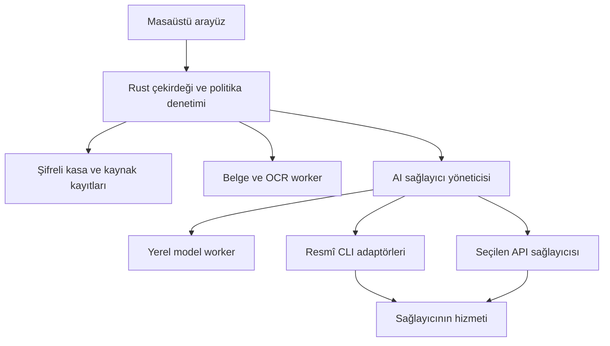
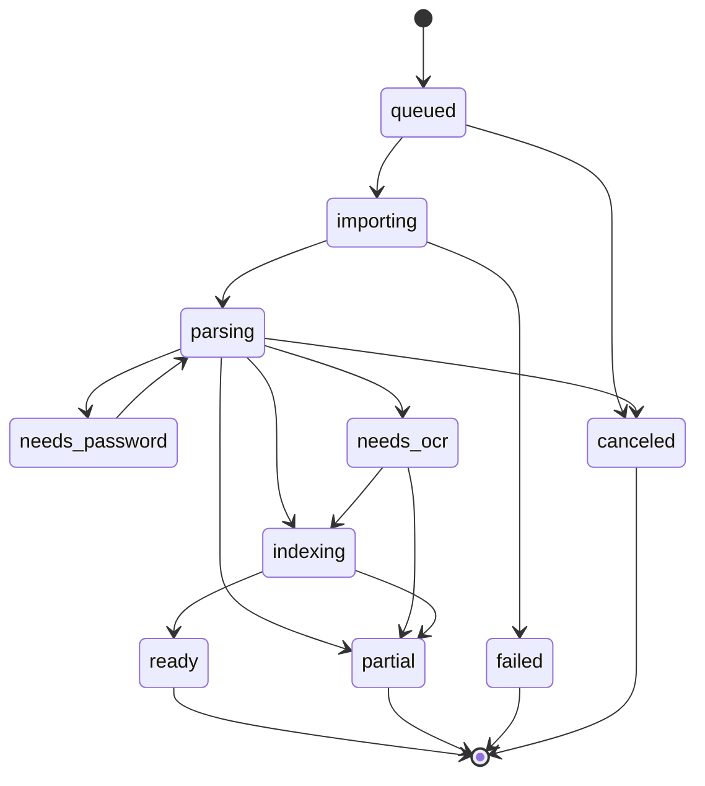

# Dosya İnceleme Masası — Tam Proje ve Uygulama Planı

**Belge sürümü:** 1.0.0  
**Hazırlanma tarihi:** 23 Ekim 2026  
**Hedef platformlar:** macOS ve Windows masaüstü  
**Proje türü:** Açık kaynak, yerel veri kasası üzerinde çalışan hukuk dosyası inceleme uygulaması  
**Hedef okuyucu:** Ürün sahibi, teknik lider, tasarımcı, hukuk danışmanı, geliştirici, kalite ve güvenlik sorumlusu; kodlama ajanları  
**Durum:** Uygulama geliştirmesi için şartname ve teslim planı. Bu belge yazılımın geliştirilmiş, güvenlik denetiminden geçmiş veya sağlayıcı bağlantılarının canlı hesaplarla doğrulanmış olduğu anlamına gelmez.

## İçindekiler

- [00. Belgenin kullanım sözleşmesi](#bolum-00)
- [01. Ürün tanımı ve değer önerisi](#bolum-01)
- [02. Sürüm ve platform sözleşmesi](#bolum-02)
- [03. Temel ürün kuralları ve gereksinim sicili](#bolum-03)
- [04. Teknoloji ve mimari kararlar](#bolum-04)
- [05. Yerel kasa, şifreleme ve veri yaşam döngüsü](#bolum-05)
- [06. Veri modeli ve bütünlük kuralları](#bolum-06)
- [07. Kaynak konumu ve kanıt bağlantısı sözleşmesi](#bolum-07)
- [08. İçe aktarma ve belge işleme](#bolum-08)
- [09. Arama, çalışma kayıtları ve inceleme](#bolum-09)
- [10. Uygulama içi komut ve olay sözleşmeleri](#bolum-10)
- [11. Yapay zekâ sistemi ve kaynak temelli analiz](#bolum-11)
- [12. Resmî CLI bağlantıları ve kullanıcı aboneliği](#bolum-12)
- [13. Ekranlar, etkileşimler ve erişilebilirlik](#bolum-13)
- [14. İçtihat arşivi ve atıf doğrulama](#bolum-14)
- [15. Maskeleme ve paylaşım güvenliği](#bolum-15)
- [16. Raporlar, dışa aktarma ve devir paketleri](#bolum-16)
- [17. İş kuyruğu, performans ve kesinti yönetimi](#bolum-17)
- [18. Güvenlik, mahremiyet ve tehdit modeli](#bolum-18)
- [19. Test stratejisi ve kabul ölçütleri](#bolum-19)
- [20. Baştan sona uygulama fazları](#bolum-20)
- [21. Geliştirici ortamı, dağıtım ve açık kaynak işletimi](#bolum-21)
- [22. Risk sicili ve karar sahipleri](#bolum-22)
- [23. Dar teknik doğrulamalar ve karar kapıları](#bolum-23)
- [24. Geliştirmeye devir, iş şablonları ve tamamlama ölçütü](#bolum-24)
- [25. Birincil kaynaklar ve güncellik sözleşmesi](#bolum-25)

<a id="bolum-00"></a>

## 00. Belgenin kullanım sözleşmesi

Bu dosya ürün tanımını, mimari kararları, veri sözleşmelerini, kullanıcı akışlarını, AI/CLI bağlantılarını, aşamalı iş listesini ve yayına çıkış ölçütlerini birlikte içerir. Uygulama ekipleri bu dosyayı işlere böler; temel gereksinimleri bölme sırasında kaybetmez.

### 00.1 Kesin kullanıcı gereksinimleri

1. Türkiye'deki avukatların dosya inceleme işini kolaylaştıracak açık kaynak bir uygulama geliştirilecek.
2. Uygulama macOS ve Windows'ta kurulabilir masaüstü yazılımı olacak.
3. Belgelerden kaynaklarına dönülebilen inceleme, kronoloji ve iddia–belge çalışması yapılacak.
4. AI desteği sağlanacak; temel işlevler AI olmadan kullanılabilecek.
5. Claude Code, Codex CLI, Antigravity CLI ve Kimi CLI gibi resmî komut satırı araçları desteklenecek. Kullanıcı, ilgili sağlayıcının izin verdiği ölçüde kendi hesabı ve aboneliğiyle bu araçları kullanabilecek.
6. Yerel model ve doğrudan API seçenekleri de aynı sağlayıcı arayüzü üzerinden desteklenecek.
7. Geliştirme baştan sona fazlara ayrılacak. Her fazın girdisi, işleri, çıktısı, bağımlılıkları ve kabul koşulu bulunacak.

### 00.2 Sözcüklerin bağlayıcılığı

- **ZORUNLU:** Belirtilen sürümün kabul kapısı; sessizce kapsam dışına çıkarılamaz.
- **ÖNERİ:** Varsayılan uygulama kararı; gerekçeli mimari karar kaydıyla değiştirilebilir.
- **DENEYSEL:** Kullanıcıya açıkça gösterilen, belirli platform veya sağlayıcı sürümlerinde henüz genel destek düzeyine ulaşmamış özellik.
- **KAPSAM DIŞI:** Bu ürünün otomatik yapmayacağı işlem; ilgili bilgi veya elle çalışma desteğini engellemez.
- **TEKNİK DOĞRULAMA:** Kodlama öncesi dar prototiple çözülecek belirsizlik. Sorumlusu, son çıktısı ve başarısızlık yolu tanımlıdır; belirsizlik tamamlanmış özellik sayılmaz.

Öncelik ile sürüm farklı alanlardır. `P0` güvenlik/veri bütünlüğü engelidir; `P1` ürünün temel değeridir; `P2` genişletmedir. `v0.x` geliştirme sürümleridir; `v1.0` genel kullanıma hazır sürümdür. Bir özellik daha sonraki sürüme konulduğunda bu belgede kapsamı, bağımlılığı ve teslim ölçütü yine tanımlanır.

### 00.3 Planın okunma sırası

Ürün sahibi önce ürün sözleşmesini, ekranları ve fazları; geliştirici mimari, veri modeli, iş kuyruğu ve komut sözleşmelerini; AI geliştiricisi sağlayıcı arayüzü, kaynak doğrulama ve CLI güvenlik profilini; kalite sorumlusu kabul kapıları, test matrisi ve sürüm kontrol listesini okur. Herkes veri bütünlüğü ve kapsam sınırlarını okur.

Belgedeki performans, süre ve doğruluk rakamları **hedef veya kapasite bütçesidir**; ölçülmüş başarı iddiası değildir. Kaynaklarla doğrulanan dış ürün özellikleri `Sxx` referanslarıyla, bizim ürün kararlarımız ise gereksinim/karar kimlikleriyle ayrılır.

<a id="bolum-01"></a>

## 01. Ürün tanımı ve değer önerisi

### 01.1 Bir cümlede ürün

**Avukatın yetkili olduğu belgelerden, her kaydı dayanak belgeye bağlanan ve avukat tarafından incelenip düzenlenebilen bir dosya çalışma alanı oluşturmak.**

Ürünün ana birimi sohbet değil, **inceleme dosyasıdır**. Sohbet, aynı dosyanın belgeleri üzerinde kullanılabilen yardımcı bir araçtır. Kullanıcının doğruladığı kronoloji, not ve bağlantılar AI konuşmasından bağımsız kalıcı kayıtlar olur.

### 01.2 Hedef kullanıcılar ve işler

| Kullanıcı | İş | Beklenen çıktı |
|---|---|---|
| Tek çalışan avukat | Uzun aradan sonra dosyaya dönme | Kaynaklı olay sırası ve açık işler |
| Küçük/orta büro avukatı | Devralınan dosyayı anlama | Belgelerin kapsamı, iddialar ve ilgili dayanaklar |
| Stajyer veya araştırma yapan ekip üyesi | Belge okuma ve araştırma hazırlığı | Avukat incelemesini bekleyen öneriler |
| Duruşmaya hazırlanan avukat | İlgili noktaları ve soruları seçme | Duruşma çalışma notu ve belge dizini |
| Emsal araştırması yapan avukat | Bulduğu kararı saklama ve yeniden kullanma | Kaynak künyesi, alıntı, kullanım notu |
| Teknik sorumlu | Kurulum, yedekleme ve sürüm güncelleme | Denetlenebilir kurulum ve geri yükleme raporu |

Bir kasadaki yerel kullanıcı atıfları, çok kullanıcılı güvenlik sınırı değildir. İlk genel sürüm tek işletim sistemi kullanıcısının kasası olarak tasarlanır. Ortak sunucu, gerçek rol yetkilendirmesi ve eşzamanlı ekip düzenlemesi v2 kapsamıdır; bunun ayrı tasarım kapısı ileride açıklanır.

### 01.3 Başlıca kullanım senaryoları

- **UC-01:** Bir klasörü içe aktar; okunabilen/okunamayan belgeleri gör; önemli bölümleri işaretle.
- **UC-02:** Bir olayla ilgili beyanları bul; belgelere bağlı kronoloji oluştur.
- **UC-03:** İddiayı, yanıtı ve belgeleri yan yana incele; karşılaştırma notu kaydet.
- **UC-04:** Duruşma öncesi seçilmiş notları ve kaynak dizinini dışa aktar.
- **UC-05:** Aynı dosyanın yeni belgesini ekle; hangi kayıtların yeniden incelenmesi gerektiğini gör.
- **UC-06:** Bir kararı içe aktar; künyesini ve kullanılan alıntıyı kontrol et; emsal kütüphanesine ekle.
- **UC-07:** Paylaşılacak belgenin kişisel veri alanlarını incele; ayrı bir maskelenmiş kopya üret.
- **UC-08:** AI sağlayıcısını seç; gönderilecek kapsamı gör; kaynaklı öneriyi inceleyip kabul et.
- **UC-09:** CLI'yi resmî yöntemle kurup oturum aç; uygulamada abonelik bağlantısını kullan.
- **UC-10:** Kayıp cihaz/bozuk disk durumunda şifreli yedeği yeni bilgisayara geri yükle.

### 01.4 Ürün sınırları

Uygulama hukuki hüküm vermez; dava kazanma olasılığı üretmez; belge içeriğini kendiliğinden gerçek kabul etmez. Mahkemeye evrak gönderme, UYAP'ta işlem yapma, e-imza kullanma, ödeme, mesaj gönderme veya karşı tarafa otomatik bildirim yapma yetkisi içermez. Bunlar inceleme ürününün çalışma alanı dışındadır.

Yargısal süre ve parasal hesaplar v1.0'da belge içindeki ifadeleri ve avukatın seçtiği görev tarihini kaydeder. Son gün veya tutar hesabı eklenecekse ayrı, kaynaklı, sürümlü kural motorundan geçer. Serbest AI yanıtı hesap motorunun yerini alamaz.

### 01.5 Başarı ölçütleri

1. Aynı dosyadaki belirli bir bilgiye ve kaynağına ulaşma süresini pilotta azaltmak.
2. Kaynak bağlantısının yanlış belge veya yanlış bölümü göstermemesi.
3. Öneri düzeltme süresinin, aynı işi elle hazırlama süresinden anlamlı biçimde az olması.
4. Kullanıcının ikinci ve üçüncü dosyasında uygulamayı yeniden kullanması.
5. Kurulumun geliştirici yardımı gerektirmemesi; AI kurulumunun çekirdek kullanımı engellememesi.
6. Beklenmedik kapanma, güncelleme, yedekleme ve geri yükleme testlerinde onaylı çalışmanın korunması.

<a id="bolum-02"></a>

## 02. Sürüm ve platform sözleşmesi

### 02.1 Destek hedefleri

| Hedef | v1.0 durumu | Paket | Doğrulama |
|---|---|---|---|
| macOS 14 ve üzeri, Apple Silicon | ZORUNLU | İmzalı ve Apple notarizasyonundan geçmiş `.dmg` / `.app` | Gerçek arm64 cihazda çekirdek, OCR, AI bağlantıları |
| macOS 14 ve üzeri, Intel | ZORUNLU | Ayrı x64 paket | Gerçek Intel cihazda aynı senaryolar; AI kapasitesi ayrıca ölçülür |
| Windows 11, x64 | ZORUNLU | Kullanıcı düzeyinde imzalı kurucu; kurumsal MSI ayrı kanal | Temiz Windows hesabında WebView2, worker, güncelleme, CLI |
| Windows 11, ARM64 | Ayrı F17 kabul kapısıyla hedeflenen destek | Native ARM64 paket; doğrulanmamış x64 emülasyonu destek sayılmaz | Tüm native bağımlılıklar ve sağlayıcıların Windows yolu |
| Linux | v1 kapsamı dışında | Paket yayımlanmaz | Kodun taşınabilirliği mümkün olduğunca korunur |

Minimum işletim sistemi sürümleri ürünün destek kararıdır. Her dağıtımda işletim sistemi üreticisinin güvenlik desteği ve bağımlılıkların minimum sürümleri yeniden değerlendirilir. En eski desteklenen sürüm ile en yeni kararlı sürüm CI/cihaz test matrisine eklenir. Eski sürüm desteği kaldırılmadan önce veri dışa aktarma ve son uyumlu sürüm bilgisi verilir.

### 02.2 Donanım ve kapasite hedefleri

- Çekirdek kullanım hedefi: 8 GB RAM; önerilen 16 GB; SSD. Gerçek ölçüm F02/F15'te yapılır.
- Yerel üretici AI: model boyutuna göre ayrı RAM/VRAM bütçesi. 16 GB veya 32 GB önerisi modele bağlıdır; her model için cihaz testi yapılmadan genel yeterlilik sözü verilmez.
- İlk kapasite profili: kasa başına 100.000 belge, inceleme dosyası başına 10.000 belge, toplam 1 milyon metin sayfası üst sınır hedefi; pilot benchmark bu sınırları doğrular veya sürüm etiketindeki sınır azaltılır.
- Varsayılan tek dosya limiti 250 MiB ve 2.000 sayfa; kullanıcıya görünür. Daha büyük belgeler ayrı iş kuyruğuna ve 1 GiB kontrollü üst sınıra alınır; akış/parça işleme olmadan limitsiz açılmaz.
- Bir klasör içe aktarımında ilk onay ekranı tahmini belge sayısı ve boyutu gösterir. Büyük iş kullanıcı arayüzünü kilitlemez.
- Taranmış belge OCR'ı, görsel çözünürlüğü ve dil modeli hızı ayrı ölçülür; saniyelik AI sonuç vaadi yoktur.

### 02.3 Çalışma biçimleri

| Mod | Veri işleme | İnternet | Maliyet/hesap |
|---|---|---|---|
| AI kapalı | Yerel arama, OCR, belge görünümü, not, manuel kronoloji | Çekirdek için gerekmez | Uygulama aboneliği gerekmez |
| Yerel AI | İndirilen ve doğrulanan model cihazda çalışır | Model edinimi/güncellemesi dışında gerekmez | Donanım ve model lisansı koşulları |
| Abonelik üzerinden CLI | Resmî CLI uygulamanın sınırlı isteğini işler | Genellikle sağlayıcı bulutuna bağlanır | Kullanıcının uygun sağlayıcı planı, kota ve şartları |
| Doğrudan API | Seçilen sağlayıcıya açıkça onaylanan içerik gider | Gerekir | Ayrı API hesabı ve kullanım bedeli olabilir |

**CLI'nin bilgisayarda çalışması, modelin de bilgisayarda çalıştığı anlamına gelmez.** Arayüz bağlantı tipini, veri yönünü ve bilinen faturalama türünü aynı ekranda gösterir. Abonelik modu API moduna sessizce geçmez. Birden fazla sağlayıcıya otomatik dağıtım varsayılan olarak kapalıdır.

<a id="bolum-03"></a>

## 03. Temel ürün kuralları ve gereksinim sicili

### 03.1 Değişmez kurallar

- **INV-01:** İçe alınan özgün dosya baytları değiştirilmez; tüm türevler ayrı sürümdür.
- **INV-02:** Her otomatik bulgu belge sürümü ve kaynak konumuna bağlanır veya açıkça kaynaksız/yorum olarak işaretlenir.
- **INV-03:** Taraf beyanı, belge içeriği, sistem çıkarımı ve avukat görüşü farklı türlerdir.
- **INV-04:** Kullanıcı tarafından onaylanan bilgi, yeniden AI çalıştırılmasıyla üzerine yazılmaz.
- **INV-05:** Dosya kapsamı her sorguda uygulanır; başka dosyanın verisi örtük olarak eklenmez.
- **INV-06:** Yerel kasa şifreli kalır; arama indeksi, önizleme, kayıtlar ve yedekler bu güvenlik kapsamına dahildir.
- **INV-07:** Dışarıya aktarım açık veri kapsamı ve sağlayıcı seçimine bağlıdır; kaynak dosyalar otomatik gönderilmez.
- **INV-08:** AI önerisi kendiliğinden hukuki son gün, belge gönderimi veya kesin sonuç oluşturmaz.
- **INV-09:** İptal, kapanma ve hata yollarında yarım sonuç tamamlanmış gösterilmez.
- **INV-10:** CLI yetkisini daraltma başarısızsa güvenlik ayarı gevşetilmez; bağlantı sınırlı/uyumsuz gösterilir.
- **INV-11:** Sağlayıcı kimlik bilgileri uygulama tarafından okunup yeniden kullanılmaz; oturumu resmî CLI yönetir.
- **INV-12:** Bir kaynak bulunamadığında karar/belge sahte ilan edilmez; doğrulanamama durumu kaydedilir.

### 03.2 İşlevsel gereksinimler

| Kimlik | Zorunlu davranış | Öncelik | İlk teslim fazı |
|---|---|---|---|
| REQ-001 | Yerel kasa oluşturma, kilitleme, kurtarma | P0 | F03 |
| REQ-002 | Dosya oluşturma, arşivleme, geri dönüşümlü silme | P1 | F04 |
| REQ-003 | Dosya/klasör sürükleyip bırakma, ön uçtan güvenli dosya seçimi | P1 | F05 |
| REQ-004 | PDF, DOCX, TXT, PNG, JPEG, TIFF, UDF kapsam matrisi | P1 | F05–F06 |
| REQ-005 | Özgün bayt ve SHA-256, türevlerin soy ağacı | P0 | F05 |
| REQ-006 | Sayfa/paragraf düzeyinde metin ve konum | P0 | F06 |
| REQ-007 | Türkçe/İngilizce OCR ve kalite görünürlüğü | P1 | F06 |
| REQ-008 | Tam metin arama ve filtreler | P1 | F07 |
| REQ-009 | Yan yana belge, seçili metne not, kaynağa geri dönüş | P1 | F07 |
| REQ-010 | Kişi/kurum ve rol kayıtları, incelemeli birleştirme | P1 | F08 |
| REQ-011 | Olay tarihi/belge tarihi/tebliğ tarihi ayrımı | P0 | F08 |
| REQ-012 | Manuel ve öneri tabanlı kronoloji | P1 | F08/F11 |
| REQ-013 | İddia–beyan–belge bağlantıları ve karşılaştırma | P1 | F08 |
| REQ-014 | İnceleme kuyruğu, kabul/ret/düzeltme geçmişi | P0 | F08 |
| REQ-015 | AI kapalı/yerel/CLI/API sağlayıcı katmanı | P1 | F09 |
| REQ-016 | Claude Code adaptörü | P1 | F10 |
| REQ-017 | Codex CLI adaptörü | P1 | F10 |
| REQ-018 | Antigravity CLI adaptörü | P1 | F10 |
| REQ-019 | Kimi CLI adaptörü | P1 | F10 |
| REQ-020 | Sağlayıcı sürüm ve yetenek sicili | P0 | F09–F10 |
| REQ-021 | Yerel model indirme/doğrulama, donanım kontrolü | P1 | F09 |
| REQ-022 | Gönderim önizlemesi ve aktarım kaydı | P0 | F09 |
| REQ-023 | Şemalı, kaynaklı AI sonuçları ve doğrulama | P0 | F11 |
| REQ-024 | Kapsamlılık raporu, okunamayan sayfalar ve veri boşluğu | P0 | F06/F11 |
| REQ-025 | Emsal kütüphanesi ve künye/alıntı kontrolü | P1 | F12 |
| REQ-026 | Maskelenmiş paylaşım kopyası ve çıktı denetimi | P0 | F13 |
| REQ-027 | Duruşma/devir notu, belge dizini, DOCX/PDF/CSV/JSON çıktı | P1 | F14 |
| REQ-028 | Görev ve kullanıcı onaylı tarih, yerel bildirim | P1 | F08/F14 |
| REQ-029 | Şifreli yedekleme, geri yükleme, bozulma tespiti | P0 | F03/F14 |
| REQ-030 | Atomik migrasyon, imzalı güncelleme, kurtarma | P0 | F16 |
| REQ-031 | Klavye ve ekran okuyucu erişilebilirliği | P1 | F04/F15 |
| REQ-032 | macOS ve Windows kurulum/kaldırma akışı | P1 | F02/F16 |
| REQ-033 | Hassas veri içermeyen yerel teşhis | P0 | F03/F15 |
| REQ-034 | Açık kaynak lisans, kaynak dağıtımı, SBOM, katkı süreci | P1 | F00/F16 |
| REQ-035 | Belirli süre kural motoru için sürümlü eklenti sözleşmesi | P2 | F18 |
| REQ-036 | Dosya bazında taşıma ve kullanıcı seçimiyle paylaşım paketi | P1 | F14 |
| REQ-037 | Genişletilebilir CLI adaptörü, imzalı yetenek kataloğu | P1 | F09/F18 |
| REQ-038 | Windows ARM64 yerel dağıtım | P2 | F17 |
| REQ-039 | Otomatik dış işlem yapılmaması | P0 | Tüm fazlar |
| REQ-040 | Bulut/CLI kotası bittiğinde verinin ve kısmi işin korunması | P0 | F10–F11 |

<a id="bolum-04"></a>

## 04. Teknoloji ve mimari kararlar

### 04.1 Varsayılan teknoloji yığını

| Katman | Karar | Gerekçe ve sınır |
|---|---|---|
| Masaüstü kabuk | Tauri 2 | macOS/Windows dağıtımı, Rust çekirdeği, dar IPC yetkileri; WebView davranışı platformlarda test edilir |
| Arayüz | React + TypeScript, Vite | Bileşen, tür, tasarım sistemi ve test araçları; çalışma anında uzak web uygulaması yüklenmez |
| Arayüz durumu | Sorgu önbelleği + küçük görünüm durumu | Belgelerin tamamı frontend store'a veya localStorage'a konulmaz |
| Çekirdek | Rust | Dosya izinleri, kasa, veri tabanı, iş kuyruğu, kaynak doğrulama, sağlayıcı süreç yönetimi |
| Veri tabanı | SQLCipher üzerinde SQLite; FTS5 aynı şifreli DB | Kasa verisi ve indekslerin şifreli tutulması [S07] [S08] |
| Belge motoru | Paketlenmiş Python worker + PyMuPDF, python-docx, güvenli XML ayrıştırma | PDF işleme/redaksiyon, DOCX okuma; ayrı süreç veri tabanına erişmez |
| OCR | Paketlenen Tesseract + Türkçe/İngilizce dil dosyaları | Kullanıcıya ayrı kurulum zorunluluğu olmadan çevrimdışı OCR |
| Bağımsız çıktı denetimi | Ayrı doğrulama worker'ında pypdf + görüntü/OCR kontrolleri | Üretici motorun başarı yanıtı tek başına maskeleme kanıtı sayılmaz [S54] |
| Yerel üretici AI | llama.cpp temelli, sürümü sabitlenmiş worker | Model lisansı/uyumluluğu ayrı katalog; varsayılan localhost portu açılmaz [S12] |
| Vektör arama | Şifreli embedding satırları + bellekte indeks | Düz metin vektör dosyası yazılmaz; ilk sürümde sınırlı aday kümesinde arama |
| Dışa aktarma | Worker üzerinden DOCX/PDF; Rust üzerinden güvenli CSV/JSON | Kaynak kimlikleri korunur; HTML/Markdown güvenli alt kümesi |
| Dağıtım | Platforma özgü kurucu, imzalı güncellemeler | macOS Apple notarizasyonu, Windows kod imzası, ayrı updater imzası [S04] [S05] [S06] |

Sürümler `latest` olarak bırakılmaz. F01'de seçilen kararlı sürümler kilit dosyalarına yazılır; bu plan belgesinde gelecek tarihte geçersiz olacak yama sürümleri uydurulmaz. Bağımlılık yükseltmesi güvenlik taraması ve regresyon sonucu ile kaydedilir.

### 04.2 Mimari karar kayıtları

- **ADR-01:** Verinin esas sahibi yerel şifreli kasadır; sunucu hesabı zorunlu değildir.
- **ADR-02:** UI, SQL veya dosya sistemi erişimi yapmaz; türlenmiş komutlarla Rust çekirdeğine gider.
- **ADR-03:** PDF/OCR işlemleri paketlenmiş worker'dadır. Ayrı süreç kullanmak tek başına işletim sistemi sandbox'ı oluşturmaz.
- **ADR-04:** Tüm AI türleri tek sözleşmeyi uygular; kaynak doğrulaması sağlayıcı dışındadır.
- **ADR-05:** CLI'ler yerel resmî yürütülebilir dosyaları üzerinden kullanılır; oturum çerezi veya OAuth token'ı kopyalanmaz.
- **ADR-06:** Proje lisansı varsayılan `AGPL-3.0-or-later`; bağımlılık lisans envanteri bununla uyumlu tutulur. PyMuPDF'nin açık kaynak/ticari lisans seçeneği ayrıca kayda alınır [S09].
- **ADR-07:** İlk sürümde birlikte düzenlenen ortak klasör/SQLite yoktur. Kasa dosyasını OneDrive/iCloud gibi araçlarla canlı eşzamanlamak desteklenmez; kapalı, tutarlı yedek taşınabilir.
- **ADR-08:** UYAP'a giriş ve imza otomasyonu ürün kapsamı dışında; yerel belgeler işlenir.
- **ADR-09:** OCR, arama normalizasyonu ve AI çıktısı özgün metnin yerine geçmez; türev sürüm taşır.
- **ADR-10:** AI hiçbir kalıcı hukuk kaydına doğrudan yazmaz; öneri oluşturur, domain komutu kullanıcı onayıyla uygular.

### 04.3 Süreç ve güven sınırları



UI renderer'da uzaktan script, font veya analitik yüklenmez. Gömülü belgelerdeki HTML/JavaScript çalıştırılmaz. Harici bağlantı ancak kullanıcının tıklamasıyla sistem tarayıcısında açılır. WebView'in Tauri komutlarına erişimi capability listesiyle daraltılır; her komut kendi veri doğrulamasını ayrıca yapar [S02].

Worker ve CLI'ye kasa anahtarı, veri tabanı bağlantısı, tüm klasör yolu veya başka dosyaların bilgileri verilmez. Gereken belge parçaları iş bazında gönderilir. İşlerin durum yazıcısı yalnız Rust çekirdeğidir. Worker çıktısı şema/boyut/kapsam doğrulamasından geçmeden kaydedilmez.

### 04.4 Repository planı

| Yol | Sorumluluk |
|---|---|
| `apps/desktop/src/` | React ekranları, erişilebilir bileşenler, görünüm modelleri |
| `apps/desktop/src-tauri/` | Tauri girişi, izinler, platform entegrasyonu |
| `crates/domain/` | Dosya, belge, kronoloji, iddia, kaynak kuralları |
| `crates/vault/` | Şifreleme, kilit, kurtarma, blob kasası |
| `crates/storage/` | SQLCipher, migrasyon, sorgular, işlemler |
| `crates/ingest/` | İçe aktarma ve türev üretim düzeni |
| `crates/jobs/` | İş kuyruğu, tekrar deneme, iptal, çökme sonrası devam |
| `crates/providers/` | AI sağlayıcı sözleşmesi ve yönlendirme |
| `crates/cli-adapters/` | Claude/Codex/Antigravity/Kimi adaptörleri |
| `crates/policy/` | Ağ, dosya kapsamı, aktarım, araç yetkisi politikaları |
| `crates/evidence/` | Kaynak konumu ve alıntı doğrulama |
| `workers/document/` | Python PDF/DOCX/OCR/redaksiyon worker |
| `workers/inference/` | Yerel model protokol sarmalayıcısı |
| `packages/contracts/` | JSON Schema ve üretilen TypeScript/Rust türleri |
| `packages/ui/` | Tasarım sistemi ve ortak bileşenler |
| `fixtures/synthetic/` | Kişisel veri içermeyen kurgu test dosyaları |
| `tests/integration/`, `tests/e2e/`, `tests/security/` | İşlev, platform ve tehdit senaryoları |
| `benchmarks/` | Performans ve AI değerlendirme düzenekleri |
| `scripts/packaging/` | Platform build ve imzalama betikleri |
| `docs/adr/`, `docs/security/`, `docs/providers/` | Mimari kayıtlar, tehdit modeli, sürüm matrisleri |
| `LICENSE`, `NOTICE`, `THIRD_PARTY_NOTICES.md` | Lisans ve yeniden dağıtım yükümlülükleri |

Kodlama ajanına çalışma ilkesi: belirtilen tek faz için değişiklik yap; global kullanıcı ayarlarını değiştirme; gerçek müvekkil belgesini fixture olarak ekleme; aşırı yetkili CLI flag kullanma; test geçsin diye kaynağı veya güvenlik kontrolünü devre dışı bırakma. Bir fazın kabul kanıtını eklemeden sonraki fazı tamamlandı işaretleme.

<a id="bolum-05"></a>

## 05. Yerel kasa, şifreleme ve veri yaşam döngüsü

### 05.1 Kasa oluşturma

Kullanıcı kasa adı ve konumu seçer; uygulama güçlü parola ve ayrı kurtarma anahtarı üretim akışını sunar. Kasa adı da hassas olabilir: kilit ekranında varsayılan takma ad gösterilir. Parola veya kurtarma anahtarı hiçbir log'a yazılmaz.

Ana anahtar işletim sistemi güvenli rastgele üreticisinden oluşturulan 256 bit değerdir. Parola bu anahtarı doğrudan oluşturmaz: Argon2id ile türetilen sarmalama anahtarı, rastgele ana anahtarı doğrulamalı şifreleme ile sarar. Parametreler ve salt sürümlü kasa başlığında saklanır. İlk bütçe 64–256 MiB ve cihazda yaklaşık 0,5–1 saniye türetme hedefidir; güvenlik incelemesi ve düşük donanım testiyle sabitlenir. Kütüphane seçimi ve algoritma parametreleri ADR olarak kilitlenir [S17].

Kurtarma anahtarı farklı bir anahtar yuvası ile aynı ana anahtarı açar. Kullanıcının kurtarma anahtarını sakladığını doğrulayan tek seferlik tekrar giriş adımı vardır. Parola ve kurtarma anahtarı kaybolursa uygulamanın gizli sıfırlama servisi yoktur; bu sonuç kasa oluşturulurken açıklanır.

### 05.2 Veri tabanı ve dosyaların korunması

- DB anahtarı ve blob anahtarı ana anahtardan ayrı bağlamlarla türetilir; rastgele anahtar SQLCipher'a ham anahtar olarak verilebilir.
- SQLCipher'ın şifrelenmiş ana DB ve WAL sayfaları kullanılır; dosya tabanlı açık geçici depolama kapatılır. Yapılandırma sadece runtime ayarına bırakılmaz; derleme ayarı da doğrulanır [S07].
- Büyük belge ve türevler doğrulanmış bir streaming AEAD kütüphanesiyle şifrelenir; elle tasarlanmış şifreleme protokolü yapılmaz. Dosya biçimi sürümü, nonce/header, son-kayıt doğrulaması ve truncation tespiti belgelenir [S16].
- Dosya sisteminde gerçek müvekkil adı veya belge adı kullanılmaz; rastgele kimlikler kullanılır. Adlar ve içerik hash'leri şifreli metadata'dadır.
- OCR metni, arama indeksi, embeddings, önizlemeler, AI sonuçları ve kullanıcı notları şifreleme kapsamındadır.
- PDF içeriği mümkün olduğunda bellek üzerinden worker'a geçer. Kalıcı açık geçici dosya varsayılan yol değildir. Zorunlu geçici dosyalar için aşağıdaki politika uygulanır.
- Kasa anahtarı OS Keychain/Windows korumalı kimlik deposuna isteğe bağlı sarılı olarak kaydedilebilir; biyometri kullanılamıyorsa parola akışı sürer. Bu kolaylık taşınabilir yedeğin kurtarma mekanizması değildir.

### 05.3 Kilit ve bellek

Varsayılan 10 dakika kullanıcı hareketsizliğinde kilit; kullanıcı 1/5/10/30 dakika veya manuel seçebilir. Ekran kilidi ve OS oturum kapanması kilitleme tetikler. Kilit, yeni işleri durdurur; hassas işlere iptal gönderir; yürütülebilir süreçler süre sonunda kapatılır; UI hassas durumları ve görüntü önbelleğini temizler; DB bağlantısı kapatılır; anahtar belleği uygun Rust türleriyle sıfırlanır.

Kilitli uygulama bildirimde dosya adı, taraf adı veya metin göstermez. İşlem sırasında RAM, GPU belleği, işletim sistemi swap alanı ve çökme dökümleri mutlak gizlilik garantisi verilebilecek alanlar değildir. Uygulama kontrol ettiği kopyaları azaltır; tam disk şifrelemesi ve OS güvenliği ayrı cihaz ön koşulları olarak belgelenir.

### 05.4 Geçici veri politikası

Üç sınıf vardır: `memory_only`, `encrypted_spool`, `explicit_plaintext_export`. İlk ikisi uygulama iç işlemleri içindir; üçüncüsü kullanıcının seçtiği dışa aktarım veya belgelendirilmiş CLI ihtiyacı için kullanılır. Her geçici işin rastgele dizini, sahibi, oluşturma zamanı, en fazla ömrü ve temizlik durumu kayıt altındadır.

Varsayılan süre iş bitince temizlik; beklenmedik kapanmada bir sonraki açılışta sadece uygulamanın kendi manifestindeki dizinler temizlenir. Kaynak klasör, HOME veya kullanıcı belgeleri üzerinde genel temizlik yapılmaz. SSD üzerinde silme fiziksel geri getirilemezlik garantisi değildir. Bu yüzden açık içerik yaratmamak ana tasarım tercihidir.

### 05.5 Yedek, kurtarma, taşıma

1. Tutarlı DB snapshot'ı alınır; çalışan WAL dosyasını tek başına kopyalamak yedekleme değildir.
2. Snapshot'ın referans verdiği blob sürümleri sabitlenir; yedek işinin bitimine kadar garbage collection bunları silmez.
3. Manifest; şema sürümü, uygulama sürümü, dosya sayısı, ciphertext uzunlukları ve bütünlük değerlerini içerir; dosya adları şifreli kalır.
4. Yedek ayrı bir aktarım parolası/anahtarıyla şifrelenir. Cihazın Keychain erişimi olmadan yeni cihazda açılabilmelidir.
5. Geri yükleme yeni bir kasa dizinine yapılır; mevcut kasa otomatik ezilmez. Önce manifest ve içerik doğrulanır, sonra görünür olur.
6. Yeniden oluşturulabilir indekslerin kaybı ile özgün belgelerin kaybı farklı hata sınıflarıdır.
7. Varsayılan günlük otomatik yedek yalnız kullanıcı hedef klasör seçtikten sonra çalışır. Son 7 günlük ve 4 haftalık yedek saklama önerisi değiştirilebilir; disk doluluğu görünürdür.
8. Bir yedeğin gerçekten açılıp temel kayıtların okunması F14 kabul şartıdır; yalnız başarılı yazma mesajı yeterli değildir.

**Paket anahtarı sözleşmesi:** Her bağımsız yedek/devir paketi için rastgele paket anahtarı üretilir. Bu anahtardan paket DB ve blob anahtarları ayrı bağlamlarla türetilir; paket anahtarı aktarım parolasından Argon2id ile türetilen anahtarla sarılır. İsteğe bağlı paket kurtarma yuvası ayrıca oluşturulur. Kasa kurtarma anahtarı ile paket kurtarma anahtarı farklıdır; UI hangi anahtarın hangi veriyi açtığını gösterir.

Tam yedekte tutarlı snapshot, kaynak kasanın anahtarını taşımadan paket anahtarı altında yeniden şifrelenir. DB'nin desteklenen şifreli snapshot/export yolu ve blob'ların akışta çöz–yeniden şifrele hattı kullanılır; arada açık SQL dökümü veya açık belge dosyası oluşmaz. SQLite snapshot ilkeleri ile SQLCipher'ın anahtarlı export arayüzü birlikte değerlendirilir; farklı anahtarlarla çalışan DB'lerde ham Backup API'nin uygun olduğu varsayılmaz [S47] [S61]. Seçili dosya devrinde bütün kasa DB'si kopyalanıp filtrelenmez: boş, şifreli paket DB'sine yalnız seçilen case ve kaynak bağımlılıklarının kapanışı yazılır. Silinmiş satır, FTS artığı veya ilgisiz blob pakete sızamaz. Yeniden oluşturulabilir indeksler yeniden üretilir.

Hedefte paket doğrulandıktan sonra yeni kasa anahtarı ve kullanıcı parolası oluşturulur; içerik bu anahtarla yerelleştirilir. Kaynak cihazın anahtarlığı veya kaynak kasa parolası gerekmez; doğru paket parolası/kurtarma anahtarı gerekir. Zamanlanmış yedekte kullanılacak sarmalama materyali yerel kasada şifreli tutulur ve yalnız kasa açıkken kullanılabilir. Kasa kilitliyken yedek bekler. Yeni parola eski yedeklerin parolasını değiştirmez; eski paketler kendi anahtar politikasıyla yönetilir.

Zamanlanmış yedek uygulama çalışırken ve kasa açıkken yürür. Kaçırılan saat zamanlayıcıda `deferred` olarak değerlendirilir; bir sonraki uygun kasa açılışında kullanıcının mevcut tercihi kapsamında tek güncel snapshot alınır. Geçmiş günler için geriye dönük sahte snapshot üretilmez. Son başarılı yedek zamanı, son deneme ve sıradaki plan ayrı gösterilir; başarısız deneme yedeğin tazeliğini ilerletmez. Hedef disk yoksa bekleme nedeni görünürdür. Uygulama kapalıyken kasayı açan gizli servis kurulmaz.

### 05.6 Silme ve saklama

Dosyalar önce çöp alanına taşınır; varsayılan 30 günlük geri alma penceresi vardır. Kalıcı silme açık onay gerektirir ve ilgili türev/indeks kayıtlarını da kaldırır. Aynı blob başka bir kayıt tarafından kullanılıyorsa referans sayısı korunur. Yedeklerdeki kopyalar saklama politikası bitene kadar kalabilir; silme ekranı bunu gösterir.

Belirli belgeyi silmek, aynı bilgiyi içeren başka belgeyi veya eski şifreli yedeği otomatik yok etmez. Hukuki saklama gereği varsa kullanıcı dosyayı `retention_hold` durumuna alır; uygulama bu durumda kalıcı silmeyi engeller. Saklama süreleri geliştirici tarafından bütün hukuk alanları için uydurulmaz.

<a id="bolum-06"></a>

## 06. Veri modeli ve bütünlük kuralları

### 06.1 Ortak veri sözleşmesi

Kalıcı kayıt kimlikleri UUIDv7 veya sabitlenmiş eşdeğer sıralanabilir rastgele kimlik kullanır; kimliklerde taraf adı, esas numarası veya belge adı bulunmaz. Teknik zamanlar UTC ISO-8601, gösterim kullanıcının saat dilimindedir. Hukuki olay tarihi ayrı `date_only`, `datetime`, `range`, `approximate`, `unknown` türü taşır; yalnız tarih olan değer UTC'ye çevrilip gün kaydırılmaz.

Ortak alanlar: `id`, `created_at`, `updated_at`, `row_version`, `created_by_local_actor_id`, `deleted_at`. Dosya kapsamlı tablolarda `case_id` zorunludur. `row_version`, iyimser eşzamanlılık kontrolü içindir; UI eski sürüme yazmaya çalışırsa çakışma çözüm ekranı açılır. `NULL` bilinmiyor anlamına gelir; boş metin veya `0` ile ikame edilmez.

Tutarlar kayan nokta ile saklanmaz: `decimal_value` kanonik ondalık metin, `currency` ISO para birimi, `raw_text` kaynak ifadesidir. Hukuki hesap yapılmasa da aynı tutarın farklı OCR okumaları bu yapı ile karşılaştırılır. Telefon, kimlik numarası ve esas/karar numarası metin türüdür; baştaki sıfırlar korunur.

### 06.2 Ana tablolar

| Tablo | Ana alanlar | İlişki ve kısıt |
|---|---|---|
| `cases` | title, case_kind, reference_code, jurisdiction_label, practice_area, status, sensitivity, default_ai_policy, archived_at, retention_hold | `case_kind`: review veya reference_archive; esas numarası dosyanın tek kimliği değildir |
| `actors` | display_name, kind, normalized_names, identifiers_encrypted, review_state | Otomatik kişi eşleştirmesi kabul edilmeden birleşmez |
| `case_participants` | case_id, actor_id, role, role_note, valid_from, valid_to | Aynı kişi farklı dosyada farklı rolde olabilir |
| `documents` | case_id, display_name, document_type, declared_document_date, source_origin, current_version_id, status | Belge tek dosya kapsamına aittir; başka dosyaya ilişki kontrollü kopya kaydıdır |
| `document_versions` | document_id, version_no, blob_id, original_sha256, byte_size, detected_mime, imported_at, original_filename_encrypted, parent_version_id | `(document_id, version_no)` benzersiz; özgün sürüm immutable |
| `blobs` | storage_id, cipher_version, encrypted_size, wrapped_key_ref, reference_count, integrity_status | Disk yolu kullanıcı girdisinden üretilmez; fiziksel dedup kasa içindedir |
| `parse_runs` | document_version_id, engine, engine_version, settings_hash, status, pages_expected, pages_processed, warnings, started_at, completed_at | Eski metin çıkarımı üzerine yazılmaz |
| `pages` | parse_run_id, page_index, page_label, width, height, rotation, text_origin, quality_flags, derivative_blob_id | PDF page_index 0 tabanlı; görünen sayfa etiketi ayrıca tutulur |
| `text_segments` | parse_run_id, page_id, structural_path, raw_text, normalized_text, offset_map, bbox_list, language | Normalizasyon özgün alıntıyı değiştirmez |
| `source_anchors` | case_id, document_version_id, parse_run_id, page_id, segment_id, start_offset, end_offset, exact_quote, prefix, suffix, quote_hash, anchor_status | Kayıt hangi sürüme bağlıysa daima o sürüm açılır |
| `notes` | case_id, title, body_ast, author_kind, visibility_label, source_anchor_ids, approved_at | Ham HTML çalıştırılmaz; onaylı not otomatik yenilenmez |
| `events` | case_id, event_kind, date_value, date_precision, date_role, date_raw, sortable_date, title, description, assertion_kind, status | `sortable_date` sıralama için türevdir; bilinmeyen tarihte NULL; hassasiyeti değiştirmez |
| `event_sources` | event_id, source_anchor_id, relation, user_confirmed | Bir olay çok kaynak taşıyabilir; kaynak aynı case_id olmalı |
| `claims` | case_id, claimant_actor_id, claim_text, claim_kind, status, source_anchor_id | İddia doğruluğu sistemce kesinleştirilmez |
| `evidence_links` | case_id, claim_id, source_anchor_id, relation, rationale, review_state | relation: submitted_for, response_to, supports_candidate, contradicts_candidate, context |
| `tasks` | case_id, title, status, user_due_date, date_timezone, date_origin, assignee_label, source_anchor_id, reminder_policy | Kesin hukuki süre hesabı alanı ayrı; elle tarih kaynağı gösterilir |
| `review_items` | case_id, item_kind, payload_schema_version, payload, source_anchor_ids, ai_run_id, state, target_entity_id | Pending item doğrudan kalıcı gerçeğe dönüşmez |
| `review_decisions` | review_item_id, decision, edited_payload, reviewer_label, timestamp, rationale | Kabul/ret/düzeltme geçmişi eklemeli tutulur |
| `checklist_templates` | title, practice_area, version, author, review_date, license_id, content_hash | Kullanıcı şablonu ile topluluk şablonu ayrılır |
| `case_checklist_items` | case_id, template_version_id, item_text, state, linked_document_ids, note | Bulunamadı durumu yalnız incelenen kapsamı anlatır |

### 06.3 AI, sağlayıcı ve işlem tabloları

| Tablo | Ana alanlar | Kural |
|---|---|---|
| `provider_profiles` | provider_type, adapter_id, version_range, executable_ref, execution_environment, auth_mode_requested, auth_mode_verified, capabilities, policy_version | OAuth/token içermez; API anahtarında yalnız OS secret ref tutulur |
| `model_profiles` | provider_profile_id, model_id, revision, context_limit, capabilities, license_url, local_file_hash, hardware_profile | Model seçimi sonuç geçmişinde sabitlenir |
| `ai_runs` | case_id, task_type, provider_id, model_snapshot, input_manifest_hash, prompt_version, output_schema_version, consent_id, status, timings, usage_report | Faturalama bilinmiyorsa unknown; sıfır maliyet yazılmaz |
| `ai_context_items` | ai_run_id, document_version_id, source_anchor_id, segment_ids, inclusion_reason, bytes_sent | Gönderilen kapsamın denetlenebilir sicili |
| `transfer_segments` | ai_run_id, outbound_segment_id, source_segment_id, outbound_text, outbound_hash, transform_manifest_id, source_range_map | Gönderilen metin ve özgün aralık eşlemesi şifreli tutulur; eşleme sağlayıcıya gönderilmez |
| `ai_messages` | ai_run_id, role, visible_content, source_refs, state | Özel chain-of-thought talep edilmez/saklanmaz; görünen sonuç metni yeterlidir |
| `ai_candidates` | ai_run_id, type, structured_payload, validation_state, validation_errors | Yapısal doğrulama, alıntı eşleşmesi ve insan kararı ayrı |
| `transfer_consents` | provider_snapshot, case_scope, purpose, selected_document_ids, expires_at, consent_text_version, approved_at, revoked_at | Yeni sağlayıcı/yeni dosya/hassasiyet artışı yeniden kapsam onayı ister |
| `transfer_receipts` | ai_run_id, destination_label, outbound_hash, item_count, byte_count, status, dispatched_at | Ham gizli istekler teşhis log'una yazılmaz |
| `jobs` | type, scope, case_id, input_fingerprint, idempotency_key, dependency_ids, state, progress, checkpoint, retry_policy, next_run_at, lease_owner, lease_until, cancel_requested_at | case scope'ta case_id zorunlu; vault scope'ta NULL; kasa öncesi bootstrap journal Bölüm 17'de |
| `job_attempts` | job_id, attempt_no, engine_version, error_code, started_at, ended_at, retry_after | Gizli stderr yerine maskelenmiş hata kodu |
| `audit_events` | sequence, category, entity_id, operation, actor_label, metadata_allowlist, timestamp, prior_hash | Yerel değişiklik geçmişidir; resmî zaman damgası veya değiştirilemez delil iddiası taşımaz |
| `outbox_events` | aggregate_id, case_id, event_type, payload_version, payload, created_at, delivered_at, attempt_count | Domain transaction'ıyla yazılır; tekrar yayınlamada event kimliği aynı kalır |
| `embeddings` | case_id, segment_id, model_profile_id, model_revision, dimensions, vector_bytes, normalized, input_hash | SQLCipher içinde şifreli; farklı model/dimension indeksleri karıştırılmaz |
| `ai_cache_entries` | case_id, cache_key, ai_run_id, output_blob_id, validation_version, expires_at | Sağlayıcı/model/prompt/kaynak/maskeleme sürümlerini kapsar; yeni gönderim izni yaratmaz |

### 06.4 Çıktı ve araştırma tabloları

| Tablo | Ana alanlar | Kural |
|---|---|---|
| `precedents` | court, chamber, docket_no, decision_no, application_no, decision_date, title, source_url, user_tags, legal_issue | Karar kimliği eksikse incomplete durumu |
| `precedent_versions` | precedent_id, document_version_id, acquired_at, source_kind, body_hash, verification_state | Tam metin olmayan kayıtta tam doğrulama yok |
| `precedent_notes` | precedent_id, case_id_optional, useful_passage_anchor, similarity_note, distinguishing_note, user_conclusion | Hukuki uygunluk kullanıcı değerlendirmesidir |
| `citation_checks` | input_document_version_id, extracted_citation, candidate_precedent_id, identity_match, quote_match, meaning_review, reason_codes | found/not_found ile fabricated birbirine dönüştürülmez |
| `render_derivatives` | document_version_id, parse_run_id, blob_id, renderer_version, settings_hash, font_manifest_hash, page_manifest, content_hash | Görüntüleme yerleşimi sürümlüdür; kaynak dosya sayfası diye sunulmaz |
| `redaction_plans` | case_id, document_version_id, parse_run_id, render_derivative_id, render_hash, transform_manifest_id, coordinate_space, plan_version, state, reviewer, output_profile | Özgün ve görüntülenen türev sabitlenir; yerleşim değişince tekrar inceleme |
| `redaction_regions` | plan_id, page_index, quads, coordinate_space, category, detected_text_hash, user_decision | Koordinatlar planın değişmez render sürümüne aittir |
| `exports` | case_id, type, included_ids, template_version, status, destination_kind, output_hash, externalization_consent_id | Kaynağı dışarı çıkaran eylem ayrı kayda alınır |
| `export_items` | export_id, source_version_id, output_page_range, citation_label, redaction_state | Çıktı dizini ve kaynak izlenebilirliği |
| `backup_runs` | snapshot_id, schema_version, manifest_hash, status, verification_result, destination_label | Şifre/kurtarma anahtarı bu tabloda bulunmaz |
| `schema_migrations` | version, checksum, started_at, applied_at, backup_snapshot_id | Uygulanmış migrasyon dosyası değiştirilmez |
| `settings` | scope, key, typed_value, version | Kasa ayarı ile cihaz/UI ayarı ayrı depolanır |

### 06.5 İndeksler ve transaction sınırları

- `documents(case_id, status, updated_at)`, `events(case_id, sortable_date)`, `review_items(case_id, state, created_at)`, `jobs(state, next_run_at)` indeksleri zorunludur.
- Bir anchor, document_version ve case ilişkisinin tutarlılığı bileşik foreign key veya merkezi domain transaction ile doğrulanır; yalnız UI filtresine güvenilmez.
- FTS kaydı `text_segments` kimliği taşır; silinen/arşivlenen belge görünürlüğü sorgu katmanında denetlenir. FTS sorgusu SQL string birleştirmesiyle kurulmaz.
- Olay kabulü: review kararı + events kaydı + event_sources + audit + outbox bildirimi tek DB transaction'ıdır.
- Blob oluşturma: encrypted geçici dosya -> flush/fsync -> atomik rename -> DB transaction. Çökme sonrası referanssız tamamlanmış blob yalnız manifest kontrollü GC ile temizlenir.
- İçe aktarma aynı baytları yeniden bulduğunda kullanıcıya mevcut belgeyi ilişkilendirme/yeni mantıksal belge oluşturma seçeneği verir. İçerik aynı diye farklı dosyalardaki hukuki rol birleştirilmez.
- Tek yazıcı kuyruğu vardır; UI çoklu penceresi aynı kasaya ayrı bağımsız DB yazıcısı açmaz.
- Dosya sistemi ve DB arasında iki aşamalı commit varmış gibi davranılmaz; açık toparlanma durumları ve idempotent reconciliation işi yazılır.

### 06.6 Ortak emsal arşivinin kapsamı

`reference_archive` bir kasa içi kaynak koleksiyonudur; kendiliğinden bütün müvekkil dosyalarının AI bağlamına girmez. Ortak `precedents` kaydı yalnız karar künyesini/edinilmiş nüshaları ilişkilendirir; müvekkile özel strateji notu `case_id` ile saklanır. Bir karar dosyada kullanılacaksa kullanıcı “Bu dosyaya ekle” eylemiyle hedef case'te mantıksal belge/sürüm ve kaynak kayıtları oluşturur. Aynı şifreli blob kasa içinde paylaşılabilir; hedef case'in source ID'leri ve izin kapsamı yenidir. Başka dosyanın özel notu veya AI geçmişi bu işlemle taşınmaz.

Kaynak arşivinde izin verilen arama ile dosya analizinin bağlam seçimi ayrı komutlardır. AI request'ine arşivdeki ham anchor doğrudan eklenemez; önce hedef dosyada kontrollü ilişkilendirme ve kapsam onayı gerekir. Böylece ortak araştırma materyali ile dosya yalıtımı aynı veri modelinde korunur.

<a id="bolum-07"></a>

## 07. Kaynak konumu ve kanıt bağlantısı sözleşmesi

### 07.1 Referans biçimi

```typescript
type SourceRef = {
  caseId: string;
  documentVersionId: string;
  parseRunId: string;
  segmentId: string;
  location:
    | { kind: "pdf"; pageIndex: number; pageLabel?: string;
        quads: number[][]; coordinateSpace: "unrotated_page_points" }
    | { kind: "structure"; part: string; elementPath: string;
        paragraphIndex?: number }
    | { kind: "image"; frameIndex: number; quads: number[][] };
  textRange: { start: number; end: number; unit: "unicode_scalar" };
  exactQuote: string;
  quoteHash: string;
  prefix: string;
  suffix: string;
};
```

Referanslar model tarafından tahmini sayfa numarası olarak üretilmez. Çekirdek her parçaya önceden `segmentId` verir; model o kimliği ve alıntıyı döndürür; çekirdek alıntının gerçekten o segmentte olup olmadığını kontrol eder. Ham modelin belirlediği disk yolu, URL veya belge ID'si doğrulanmadan açılmaz.

### 07.2 Metin ve yerleşim

`textRange` Unicode scalar konumudur; JavaScript UTF-16 seçimi dönüşüm tablosuyla çevrilir. Türkçe İ/ı, birleşik aksanlar, ligatürler ve emoji için offset testleri yapılır. Arama için normalizasyon ayrı metindedir; kaynak alıntı `raw_text` üzerinden gösterilir. PDF'de görüntü dönüşümü, sayfa rotasyonu ve cropbox etkisi tek koordinat sistemine çevrilir; `quads` kaynak sürümüyle kaydedilir.

PDF fiziksel sayfa sırası, belge içindeki basılı sayfa numarası ve dosya birleşimindeki yeni sayfa numarası farklı alanlardır. UDF/DOCX'in orijinal sayfa ayrımı doğrulanmamışsa kaynak `paragraf/bölüm` olarak gösterilir. Uygulamanın oluşturduğu görüntüleme PDF'sinin sayfası türev sayfasıdır; kaynak dosyanın özgün sayfası gibi adlandırılmaz.

### 07.3 Yeniden ayrıştırma ve eski referanslar

OCR ayarı veya motor değişince yeni `parse_run` oluşur. Eski anchor eski çıkarıma bağlı çalışmaya devam eder. Otomatik yeniden bağlama önerisi exact quote + çevre metin + konum ile yapılır; birden çok eşleşmede `ambiguous`, eşleşme yoksa `unresolved` olur. Kullanıcı tarafından onaylanan anchor başka paragrafa sessizce taşınmaz.

### 07.4 Güvenilirlik etiketleri

Arayüzde tek bir yüzdeyle hukuki doğruluk gösterilmez. Ayrı boyutlar kullanılır: `kaynak mevcut`, `alıntı eşleşti`, `OCR kontrol gerekli`, `otomatik çıkarım`, `avukat onayladı`, `kaynak güncellendi`. Bir alıntının bulunması o alıntıdan çıkarılan sonucun doğruluğunu kanıtlamaz. Onay, onaylayanın değerlendirmesini belirtir; bütün metni veya belge gerçekliğini doğrulama iddiası taşımaz.

<a id="bolum-08"></a>

## 08. İçe aktarma ve belge işleme

### 08.1 Dosya türü matrisi

| Tür | v1.0 davranışı | Sınır / kullanıcıya gösterilecek durum |
|---|---|---|
| Metin PDF | Metin, konum, sayfa render, arama | Bozuk font/okuma sırası kalite uyarısı |
| Taranmış/karma PDF | Sayfa bazında OCR; metinli sayfayı gereksiz OCR yapmama | Okunamayan sayfa açıkça raporlanır |
| Şifreli PDF | Kullanıcının verdiği açma parolasıyla bellekten açma | Parola atlatma yok; oturumda tutma seçimi |
| DOCX | Gövde, tablolar, dipnot/sonnot ve yorum/değişiklik durumu envanteri | Makro/harici ilişki çalıştırılmaz; özgün sayfa düzeni garantisi yok |
| UDF | ZIP/XML güvenli ayrıştırma, gömülü nesne envanteri, yapısal kaynak | İmza denetlenmedi etiketi; bilinmeyen öğe sessiz atlanmaz |
| PNG/JPEG/TIFF | Görsel ve çok kareli TIFF OCR | EXIF üst verisi iş kopyasında ayrılır; orijinal korunur |
| TXT | Kodlama tespiti + kullanıcı düzeltmesi; UTF-8 kanonik metin | Hatalı kodlama kaynak baytları değiştirmez |
| EML, MSG, DOC, XLSX, PPTX | v1.0'da desteklenmiyor; ayrı hata ve dönüşüm yönlendirmesi | Uzantı değiştirerek açtırılmaz; ekler otomatik çalıştırılmaz |
| ZIP klasör paketi | Yalnız güvenli içe aktarma filtresiyle desteklenen belgeler | İç içe arşiv, zip bomb, yol taşması sınırları |

DOCX'te yorumlar veya izlenen değişiklikler hukuki anlam taşıyabilir. Varsayılan görünüm hangi metin durumunun kullanıldığını belirtir; silinmiş/eklenmiş metin envanteri kaybolmaz. Metin incelemesi ile Word'ün görsel çıktısının eşdeğer olduğu iddia edilmez.

### 08.2 İşleme adımları

1. Kullanıcı seçimini salt okunur aç; gerçek MIME, uzantı, boyut, sembolik bağ ve ağ konumu durumunu kontrol et.
2. İçe aktarma manifesti çıkar; tekrarlar, desteklenmeyenler ve toplam kapasiteyi göster.
3. Kaynağı akışta hash'le ve şifreli kasaya kopyala. Kaynak dosya değişirse değişiklik tespit edilir; parçalı karışık kopya kabul edilmez.
4. Şifreli kopyayı açıp hash ile bütünlük denetle; DB belge sürümünü oluştur.
5. Parser çalıştır; beklenen sayfa/öğe sayısını kaydet. Parolalı/bozuk/şüpheli dosyayı karantina veya kullanıcı müdahalesi durumuna al.
6. Metinli sayfa, OCR gerektiren sayfa ve boş sayfayı ayrıştır. Görüntüde yazı varken metin yoksa boş sayfa sayılmaz.
7. OCR yap; Türkçe `tur` ve İngilizce `eng` dil paketi sürüm/hash'ini kaydet. El yazısı v1.0 kalite garantisine dahil değildir.
8. Segment, koordinat ve okunma sırası üret; tabloları satır/sütun ilişkisiyle sakla; layout belirsizliğini işaretle.
9. Şifreli FTS indeksini güncelle; AI açık ve kullanıcı istemişse sınıflandırma önerisini sıraya koy.
10. Sonuç raporunu göster: başarılı, kısmi, desteklenmeyen, parola bekleyen, bozuk, tekrar.

### 08.3 Durum makinesi



Kısmi sonuç kullanıma açılabilir; kapsam rozeti her arama/özet ekranında korunur. Hata alan belgenin kalan sayfaları yokmuş gibi değerlendirilmez. Yeniden deneme tamamlanan sayfaları input fingerprint eşleşiyorsa tekrar işlemez.

### 08.4 Ayrıştırıcı güvenliği ve limitler

- XML dış varlık, DTD ve ağ kaynak çözümleme kapalıdır; entity expansion sınırı konur.
- ZIP toplam açılmış boyut, dosya sayısı, sıkıştırma oranı ve maksimum derinlik ile sınırlanır; `../`, mutlak yol, Windows ADS, reparse point ve symlink kaçışı engellenir.
- PDF JavaScript, Launch action, embedded executable ve harici URL otomatik yürütülmez. Gömülü ek sayısı ve türü envantere alınır.
- Görsel piksel bütçesi ve dekompresyon sınırı vardır; önizleme için kontrollü küçültme yapılır.
- Worker CPU/RAM/zaman bütçesini aşarsa yalnız ilgili iş sonlandırılır; UI ve kasa korunur.
- Bir belgeyi onarmak gerekiyorsa onarılmış türev açık etiket taşır; özgün dosya korunur.

### 08.5 İmza ve bütünlük durumu

SHA-256, uygulamanın sakladığı baytların değişip değişmediğini karşılaştırır. Belgenin ilk kaynaktaki gerçekliğini, olayın tarihini veya hukuki ispat gücünü tek başına doğrulamaz.

v1.0 imza envanteri: `yok`, `tespit edildi — denetlenmedi`, `ayrıştırılamadı`. Tam doğrulama eklendiğinde `doğrulandı`, `başarısız`, `belirsiz` ayrı değerlerdir. Sertifika zinciri, revocation, imza zamanı ve güvenilir zaman damgası ayrı sonuç alanlarıdır. Ağ olmaması nedeniyle revocation bilinmiyorsa geçersiz denmez. Dönüştürülmüş PDF'ye özgün UDF'nin imzası geçerliymiş etiketi verilmez [S19].

<a id="bolum-09"></a>

## 09. Arama, çalışma kayıtları ve inceleme

### 09.1 Arama

Tam metin arama her zaman kullanılabilir. Varsayılan kapsam aktif dosyadır; tüm kasa araması kullanıcı tarafından ayrıca seçilir. Filtreler: belge türü, tarih rolü/aralığı, kişi/kurum, etiket, OCR durumu, onay durumu, kaynak tipi. Sonuçta belge adı, ilgili alıntı, sayfa/paragraf, neden eşleştiği ve kapsam görünür.

Türkçe özel harfler için tam ve esnek arama seçenekleri vardır; `İ/ı/I/i` farkı locale-aware normalizasyonla test edilir. Sayı, E./K. künye ve tırnaklı tam ifade aramasında aşırı kök indirgeme uygulanmaz. Kullanıcı regexp veya ham SQL yazmak zorunda değildir. Arama sorgusu log'a alınmaz.

Anlamsal arama isteğe bağlı yerel embedding modeliyle çalışır. İlk sürümde büyük indeks için şifrelenmemiş HNSW yan dosyası üretilmez. Case filtresi önce uygulanır; FTS ve vektör adayları birleştirilir; sıralama değişebilir ama kaynak metin değişmez. Sonuç kartı anlamsal eşleşmeyi birebir kelime eşleşmesinden ayırır.

### 09.2 Not ve işaretleme

Kullanıcı metin veya görsel alan seçer; not, olay, iddia veya karşılaştırma kaydı oluşturur. Aynı seçim birden fazla kayda bağlanabilir. Notta geri alma/ileri alma ve taslak otomatik kaydı vardır. Otomatik kayıt yalnız kilidi açık kasaya yazılır; frontend localStorage'a yazılmaz. Harici kopyalama ve panoya yazma ayrı eylemdir; pano temizleme kullanıcı tercihidir, diğer uygulamanın pano içeriği körlemesine silinmez.

### 09.3 Kronoloji

Her satırda tarih kesinliği, tarih türü, olay açıklaması, beyan sahibi, kaynaklar, kayıt türü ve onay durumu bulunur. Yaklaşık tarih `2026-03` veya aralık olarak gösterilir; gün uydurulmaz. Aynı tarihe ait kayıtlar birleştirilmeden gruplandırılabilir. Avukat tarih sıralamasını ve olay bağını elle düzeltebilir.

Tarih çelişkisi adayı iki kaynağı yan yana getirir. Belge düzenleme tarihi ile anlatılan olay tarihinin farklılığı otomatik çelişki sayılmaz. Olayın iki farklı tarafça farklı anlatılması kaynaklı beyan farkı olarak etiketlenir.

### 09.4 İddia ve delil çalışma alanı

İddia başlığı altında taraf, yanıtlar, sunulan belgeler, ilişkinin türü ve avukat notu vardır. AI'nin `destekliyor olabilir` veya `karşılaştırılmalı` önerisi kullanıcı onayı olmadan ispatlanmış iddia durumuna dönüşmez. Belgede destek yok sonucunun kapsamı yalnız incelenen dosyadır. Kullanıcı bağlantıyı reddedebilir veya ilişkiyi `yalnız bağlam`a çevirebilir.

### 09.5 İnceleme kuyruğu

Öneri durumları: `pending`, `accepted`, `edited_accepted`, `rejected`, `superseded`. Toplu kabul yalnız aynı türde ve aynı kaynak kontrol seviyesindeki öğelerde açılır; OCR belirsizliği veya çözülemeyen kaynak varsa tek tek inceleme gerekir. Her kabulde özgün öneri saklanır, değişiklik farkı kaydedilir. Kullanıcının reddettiği öneri aynı model çıktısıyla yeniden gösterilmez; yeni kaynak varsa yeni sürüm olduğu belirtilir.

### 09.6 Görevler ve tarihler

Görev türleri: belge temini, inceleme, görüşme, hazırlık, araştırma, kullanıcı tanımlı. Bir belge tarihinden görev oluşturulabilir; kullanıcı takvim tarihini doğrular. Uygulama bildirim izni istemeden önce faydayı gösterir. Kilit ekranı bildirimi varsayılan genel metindir. Takvim dosyası dışa aktarma kullanıcı eylemidir; kişinin hesabına veya üçüncü kişiye otomatik davet gönderilmez.

<a id="bolum-10"></a>

## 10. Uygulama içi komut ve olay sözleşmeleri

### 10.1 UI → çekirdek

Her komut `requestId`, `schemaVersion` ve gerekliyse `expectedRowVersion` taşır. Rust input doğrulaması yapar; TypeScript doğrulaması tek güvenlik sınırı değildir. Mutasyonlar idempotency anahtarı kullanır. Dosya yolu yerine çekirdeğin oluşturduğu kısa ömürlü `fileSelectionHandle` kullanılır.

| Komut ailesi | Örnekler | Yetki/kapsam |
|---|---|---|
| Vault | create, unlock, lock, recover, changePassphrase | Anahtar UI'ye dönmez |
| Case | create, update, archive, trash, restore | Kilit açık; row version denetimi |
| Import | inspectSelection, enqueue, cancel, retry | Kullanıcı seçim handle'ı; salt okunur kaynak |
| Document | metadata, renderPage, getSegment, openSource | Aktif kasa ve case kontrolü |
| Search | query, facets, nextPage | Scope zorunlu; sonuç sayısı limitli |
| Work | createNote, upsertEvent, linkEvidence, reviewSuggestion | Kaynak ilişkileri transaction ile doğrulanır |
| AI | probeProvider, prepareContext, approveTransfer, startRun, cancelRun | Hazırlama ile gönderim ayrı komut |
| Export | preview, create, cancel, verify | Çıktı hedefi ayrı kullanıcı seçimi |
| Backup | createSnapshot, restorePreview, restore, verify | Mevcut kasayı otomatik ezmez |

### 10.2 Worker protokolü

Worker stdin/stdout için uzunluk önekli UTF-8 JSON kontrol mesajları ve boyut sınırlı ikili frame kullanır. Büyük PDF base64 olarak frontend üzerinden dolaştırılmaz. Her mesaj `protocolVersion`, `jobId`, `operation`, `sequence` taşır. Stdout yalnız protokol; stderr yalnız izin verilen teşhis kodları. Yeni protokol sürümü eski çekirdekle sessizce çalışmaz.

Kontrol işlemleri: `hello`, `capabilities`, `extract`, `ocrPage`, `renderPage`, `buildDocx`, `buildPdf`, `applyRedactions`, `verifyOutput`, `cancel`, `shutdown`. Genel `execute`, Python eval veya shell komutu işlemi yoktur. İstek payload'ında kullanıcı girdisi executable veya modül ismine dönüşmez.

### 10.3 Hata modeli

`ErrorEnvelope = { code, category, retryable, userMessageKey, contextIds, safeDetails, correlationId }`. Hata sınıfları: `INPUT_UNSUPPORTED`, `SOURCE_CHANGED`, `PASSWORD_REQUIRED`, `PARSER_FAILURE`, `OCR_PARTIAL`, `DISK_FULL`, `VAULT_LOCKED`, `INTEGRITY_FAILURE`, `SCHEMA_MISMATCH`, `PROVIDER_AUTH_REQUIRED`, `PROVIDER_QUOTA`, `PROVIDER_POLICY_BLOCKED`, `PROVIDER_VERSION_UNSUPPORTED`, `CANCELED`, `TIMEOUT`, `CONFLICT`.

Hata ekranı ne olduğunu, hangi belgelerin etkilendiğini, işin hangi kısmının korunduğunu ve kullanıcı eylemini söyler. Teknik stack trace kullanıcıya varsayılan gösterilmez; gizli metin içermeyen ayrıntı isteğe bağlıdır.

<a id="bolum-11"></a>

## 11. Yapay zekâ sistemi ve kaynak temelli analiz

### 11.1 AI'ın ürün içindeki görevi

AI, dosyayı inceleyen avukata öneriler üretir. Özgün belgeleri değiştirme, kesin hukuki sonuç belirleme, kendiliğinden dilekçe gönderme veya resmî işlem yapma yetkisi yoktur. Her sonuç; kullanılan kaynak kapsamını, sağlayıcıyı, model kimliğini, üretim zamanını, doğrulama durumunu ve kullanıcı kararını taşır. Model kapalıyken belge okuma, OCR, metin arama, not, elle kronoloji, görev ve dışa aktarma kullanılabilir.

| İşlem kimliği | AI görevi | Beklenen çıktı | Kabul öncesi kontrol |
|---|---|---|---|
| `AI-01` | Belge türü önerisi | Tür, alternatif türler, dayanak parçaları | Kullanıcı belge türünü değiştirebilir; dosya adı tek kanıt değildir |
| `AI-02` | Belge özeti | Bölümlü taslak, her maddede kaynak | İddia sahibi ve usulî konum korunur; okunmayan sayfalar belirtilir |
| `AI-03` | Kişi/kurum/rol çıkarımı | Ayrı varlık ve rol adayları | Aynı adın farklı kişiler olabileceği korunur; otomatik kişi birleştirme yok |
| `AI-04` | Tarih ve olay çıkarımı | Tarih ham metni, tarih rolü, olay, kaynak | Belge/olay/tebliğ tarihi ayrılır; belirsiz tarih uydurulmaz |
| `AI-05` | İddia–belge bağlantısı önerisi | İddia, taraf, ilişkili pasaj, ilişki gerekçesi | “Destekliyor” ve “çelişiyor” öneri etiketiyle sunulur |
| `AI-06` | Seçili dosyada soru-cevap | Kaynaklı cevap veya kanıt yetersiz yanıtı | Yanıtta kullanılan her kaynak seçili dosyada ve izin kapsamındadır |
| `AI-07` | İnceleme kontrol listesi | İncelenen kapsamda bulunan/bulunamayan belgeler | “Bulunamadı” ile “dosyada yok” ayrılır |
| `AI-08` | İfade karşılaştırma | İki pasaj, ortak konu, olası uyuşmazlık | Farklı tarih/kişi/bağlam yanlış çelişki sayılmaz |
| `AI-09` | Duruşma hazırlık taslağı | İncelenecek konu, kaynak, açık soru | Hukuki strateji kullanıcı değerlendirmesidir |
| `AI-10` | Maskeleme adayı | Veri kategorisi, metin parçası, kaynak konumu | AI önerisi gerçek redaksiyon işlemi değildir; Bölüm 15 uygulanır |

AI tarafından genel bilgiye dayalı açıklama üretilecekse “Dosya dışı genel açıklama” olarak ayrı sunulur. v1.0 varsayılan soru-cevap modu yalnız seçilmiş kaynaklarla cevaplar; modelin belleğinden içtihat numarası veya mevzuat sürümü eklemesi kabul edilmez. İnternet araştırması bu akışın gizli bir alt adımı değildir.

### 11.2 Tek sağlayıcı sözleşmesi

Aynı domain katmanı yerel model, resmî CLI ve doğrudan API ile çalışır. Sağlayıcı değiştirmek kaynak doğrulama veya kullanıcı incelemesini atlamaz. Arayüzdeki isimler sağlayıcı, taşıma ve kimlik yöntemini ayırır: örneğin “Codex / resmî CLI / ChatGPT hesabı” ile “OpenAI / API anahtarı” ayrı profildir.

```typescript
type ProviderCapabilities = {
  transport: "local_worker" | "cli_jsonl" | "jsonrpc_stdio" | "https_api";
  interaction: "interactive" | "batch" | "both";
  structuredOutput: "native_schema" | "validated_after_generation";
  supportsCancellation: boolean;
  supportsUsageReport: boolean;
  supportsModelDiscovery: boolean;
  supportsAuthStatus: boolean;
  toolPolicyVerified: boolean;
  customizationPolicyVerified: boolean;
  localPersistence: "disabled_verified" | "provider_managed" | "unknown";
  billingMode: "local" | "subscription" | "api" | "unknown";
  extraSpendControl: "enforced" | "provider_setting" | "unknown";
  compatibility: "verified" | "experimental" | "blocked";
};

interface AiProvider {
  probe(): Promise<ProviderStatus>;
  authenticate(intent: AuthIntent): Promise<AuthFlow>;
  listModels(): Promise<ModelDescriptor[]>;
  start(request: AiRequest, signal: AbortSignal): AsyncIterable<AiEvent>;
  cancel(runId: string): Promise<CancelResult>;
  disconnect(scope: "app_only"): Promise<void>;
}
```

Bu TypeScript sözleşmesi uygulama sınırını anlatır; Rust ve JSON Schema türleri aynı sürümlü kaynaktan üretilir. `AiRequest` şu alanları taşır: `runId`, `caseId`, `taskType`, `modelSnapshot`, `promptVersion`, `outputSchemaVersion`, `contextManifest`, `inputMessages`, `budget`, `transferConsentId`, `interactionMode`, `policySnapshotHash`. Sır/token bu nesnenin seri hâle getirilen parçası olamaz.

Olay türleri `started`, `status`, `text_delta`, `structured_candidate`, `usage`, `warning`, `completed`, `failed`, `canceled` olarak normalize edilir. Sağlayıcı özel olaylarının ham içeriği UI'a doğrudan gönderilmez. Bir `completed` olayı doğrulama başarısını değil, sağlayıcı yürütmesinin bittiğini bildirir. Kaynak ve şema denetimi ayrı adımdır.

### 11.3 Bağlam seçimi ve kapsam hesabı

1. İstek başlamadan case, belge sürümleri, izin verilen işlem ve sağlayıcı sabitlenir.
2. OCR/ayrıştırma durumu incelenir. Okunamayan, şifre bekleyen veya bozuk sayfalar kapsam listesine eklenir.
3. Metin paragraf/sayfa sınırları gözetilerek parçalanır. Başlangıç bütçesi yaklaşık 700–1.200 model tokenı ve 80–150 token örtüşmedir; gerçek tokenizer ve Türkçe değerlendirme ile F09'da ayarlanır. Tablo veya tanık beyanı ortadan bölünürse bağlam komşuları tutulur.
4. Her parçaya uygulama tarafından gönderime özgü opak kaynak kimliği atanır; bu kimliğin yerel segmentle ilişkisi kasada tutulur. Model sayfa, dosya yolu veya kayıt kimliği üreterek yeni kaynak oluşturamaz.
5. Soru-cevap için FTS adayları ve açıksa yerel anlamsal sıralama kullanılır; soru ile ilgili bağlam seçilir. Bu işlem bütün dosyanın okunmuş olduğu anlamına gelmez.
6. “Bütün dosyayı özetle” ayrı tam kapsam işidir. Her işlenebilir parçanın kapsanması izlenir; parça özetleri kaynak kimlikleri korunarak birleştirilir. Yalnız aramada bulunan ilk birkaç parçayla tam dosya özeti etiketi üretilmez.
7. İstek ve çıktı bütçesi için güvenlik payı ayrılır. Taşma durumunda sessiz metin kesme yapılmaz; parçalara bölme veya kapsam azaltma kullanıcıya gösterilir.
8. Kaynaklar arası çelişki birleştirme aşamasında yok edilmez; alternatif beyanlar farklı maddelerde korunur.

Kapsam kaydı şu sayıları içerir: seçili belgeler, toplam bilinen sayfalar, metni elde edilen sayfalar, AI'a gönderilen parçalar, başarıyla işlenen parçalar, dışlanan parçalar ve dışlama nedenleri. Yüzde varsa pay/payda açık yazılır. “30 sayfanın 24'ü işlendi; 6 sayfa OCR kontrolü bekliyor” ifadesi, belirsiz “%80 güvenilir” puanından ayrıdır.

### 11.4 Yapılandırılmış çıktı ve doğrulama

Modelden istenen her aday en az `kind`, `text`, `assertionKind`, `sourceMentions`, `limitations` taşır. Tarih adayında ayrıca `rawDate`, `normalizedDate`, `datePrecision`, `dateRole` bulunur. `normalizedDate` bilinmiyorsa null kalır. Kaynak anımı yalnız gönderilmiş `segmentId` ve kısa `exactQuote` içerir. Bu cevap şemasındaki segment kimliği aktarım tablosundaki `outbound_segment_id`'dir; yerel DB kimliği olmak zorunda değildir. Gerçek `SourceRef` çekirdek tarafından oluşturulur.

```json
{
  "schemaVersion": "1",
  "taskType": "timeline_candidates",
  "items": [
    {
      "kind": "event",
      "text": "Davacı, teslimin 12.03.2025 tarihinde yapıldığını ileri sürüyor.",
      "assertionKind": "party_allegation",
      "rawDate": "12.03.2025",
      "normalizedDate": "2025-03-12",
      "datePrecision": "day",
      "dateRole": "alleged_event",
      "sourceMentions": [{"segmentId": "s_example_01", "exactQuote": "12.03.2025 tarihinde teslim edilmiştir"}],
      "limitations": []
    }
  ]
}
```

Bu örnek tamamen kurgudur. Gerçek işte JSON Schema; zorunlu alanlar, enum değerleri, en uzun metin, en fazla aday, tarih biçimi ve `additionalProperties: false` ile sınırlandırılır. Sağlayıcının JSON Schema desteği uygulamadaki doğrulamayı kaldırmaz.

Doğrulama sırası: çıktı boyutu → JSON ayrıştırma → şema → kaynak kimliği ve case kapsamı → gönderilen alıntı eşleşmesi → yerel kaynak eşlemesi → tarih/tutar normalizasyonu → boş veya tekrarlı aday → kaynakların anlamsal yeterliliğine ilişkin inceleme. Alıntı gönderilen metinde yoksa veya özgün kaynak ilişkisi çözülemiyorsa “kaynak doğrulanamadı” sonucu üretilir; kullanıcıya doğrulanmış kayıt gibi sunulmaz. Alıntının eşleşmesi, hukuki yorumun doğru olduğu sonucunu doğurmaz.

**Maskeli bağlamın iki aşamalı doğrulaması:** Her gönderim segmenti, gönderilen metin/hash, maskeleme dönüşüm sürümü ve özgün Unicode aralıklarına eşleme taşır. Modelin alıntısı önce gördüğü maskeli kopyada doğrulanır. Sonra yalnız kasada bulunan eşleme, ilgili özgün segment/sürüme bağlanır. Maske hiç uygulanmadıysa eşleme özdeşliktir. Silinen alan, takma ad veya birden fazla kaynak aralığı varsa dönüşüm tipi açık tutulur; geri eşlenemeyen alıntı doğrulanmış sayılmaz.

Yerel kaynak paneli özgün metni yetkili kullanıcıya açabilir; dışarı gönderilen alıntı ile yerel `SourceRef.exactQuote` ayrı alanlardır. Takma ad eşleştirme tablosu, özgün gizli metin veya gerçek kişi adı modelin yanıtını “düzeltmek” için sağlayıcıya geri gönderilmez. Maskeli çıktı tercihinde yerel özgün alıntı rapor/manifest'e kopyalanmaz. Kaynak doğrulama başarısızlığının çözümü maskeyi kaldırıp sessizce tekrar göndermek olamaz. F11/F13 testinde `[Kişi A]` içeren geçerli alıntı doğru özgün kaynağa bağlanmalı; kapsam dışı isim hiçbir yeniden denemede ağ çıkışına girmemelidir.

Tek bir biçim düzeltme denemesi izin kapsamı ve bütçe içinde yapılabilir; düzeltme çağrısı yeni dış aktarım olarak kayda girer. Kaynak uydurmasını art arda model çağrısıyla örtmeye çalışan döngü kurulmaz. Serbest metin cevaptan eksik alanlar tahmin edilerek başarı sonucu oluşturulmaz. Gizli düşünce zinciri istenmez; kullanıcıya kısa gerekçe ve dayanak pasajları gösterilir.

### 11.5 Yerel model paketi

Yerel üretim, sürümlenmiş llama.cpp worker protokolü üzerinden sağlanır [S12]. Model ağırlıkları uygulama kurucusuna büyük bir zorunlu paket olarak gömülmez. Model yöneticisi; boyut, lisans URL'si, kaynak, revision, SHA-256, desteklenen mimari, quantization, bağlam kapasitesi ve tahmini bellek gereksinimini gösterir. İndirme açık kullanıcı seçimiyle başlar; yarım indirme devam edebilir, hash eşleşmeden model çalıştırılmaz.

Model adları “Türk hukuku için kesin doğru” biçiminde pazarlanmaz. F09 değerlendirmesinde Türkçe kaynak takibi, JSON üretimi, tarih/rol çıkarımı ve donanım performansı birlikte ölçülür. Yerel embedding modeli ile metin üreten model ayrı lisans ve sürüm taşır. Model dağıtımına izin yoksa resmî indirme bağlantısı veya kullanıcının getirdiği uyumlu dosya kullanılır; uygulamanın açık kaynak lisansı model ağırlıklarına otomatik uygulanmaz.

Varsayılan taşıma stdio/özel yerel IPC'dir. İsteğe bağlı Ollama veya başka yerel HTTP sunucusu eklenecekse bunun ayrı bir adapter olduğu, `127.0.0.1` yerine uzaktaki sunucu seçilince bulut/ağ aktarım politikasına girdiği belirtilir. Yerel sunucunun kullanıcı tarafından yapılandırılmış araçları, logları ve ağ çıkışı da değerlendirilir. “localhost” yazdığı için bütün veri yaşam döngüsü güvenli sayılmaz.

### 11.6 Doğrudan API profili

Doğrudan API kullanımı, CLI aboneliğinden ayrı bağlantı ve maliyet modudur. v1.0 ortak HTTP sözleşmesi ve en az bir resmî sağlayıcı adaptörüyle teslim edilir. “OpenAI uyumlu” uç nokta ayrı kullanıcı profili olabilir; uyumluluk etiketi gerçek sağlayıcıyı veya saklama politikasını gizlemez. Bilinmeyen endpoint model listesi, şema ve stream uyumluluk testlerini geçmeden destekli görünmez.

API anahtarı OS secret store'da saklanır; JSON ayarı, kasa export'u, frontend state veya log içinde bulunmaz. Kullanıcı TLS sertifikası doğrulamasını kapatarak bağlantı kuramaz. Endpoint değişince önceki aktarım izni yeni hedefe taşınmaz. Uygulamanın resmî profilinde varsayılan adres dışına HTTP redirect takip edilmez; özel endpoint için tam hedef ayrıca gösterilir. İstek başlığı ve hata gövdesi tanılama için allowlist ile işlenir.

Token/maliyet bilgisi sağlayıcının bildirdiği ölçüm, güncel fiyatlandırma girdisi veya tahmin olarak etiketlenir. Fiyat kaynağı tarihi olmayan hesap kesin tutar gibi gösterilmez. Çağrı, dosya ve gün bazında bütçe konur; bütçe üstü iş bekletilir. Kullanıcının CLI kotası dolduğunda doğrudan API'ye kendiliğinden geçilmez.

### 11.7 Veri gönderim ekranı ve izin kapsamı

Gönderim önizlemesinde sağlayıcı/çalışma modu, seçili dosya ve belgeler, gönderilecek metin/görsel, maskeleme durumu, iş amacı, tahmini kapsam ve dış hizmetin saklama bağlantısı bulunur. AI'a özgün dosyanın tamamını göndermek varsayılan değildir; görevin gerektirdiği doğrulanmış parçalar gönderilir. Görsel modele sayfa görüntüsü gönderilecekse bu ayrı yetenektir ve metinden daha geniş veri içerebileceği önizlemede görünür.

İzin tek çağrı veya sınırları belli bir dosya oturumu için saklanabilir. Aynı izin kapsamındaki görevde sürekli tekrar onay istenmez. Yeni sağlayıcı, yeni dosya kapsamı, açık dosya yerine ekli belge, maskelemenin kaldırılması veya yeni görsel aktarımı izni genişletir; uygulama mevcut izni kendiliğinden genişletemez. İptal gelecekteki gönderimleri durdurur; gönderilmiş veriyi sağlayıcıdan geri almış sayılmaz.

Bu ekran ürünün teknik aktarım kaydıdır. Kullanıcının düğmeye basması tek başına KVKK'daki işleme/aktarım şartlarının tamamını sağlamış sayılmaz; büro politikası ve hukuki dayanak ayrıca yönetilir [S18] [S22]. Varsayılan hassas dosya politikası `AI kapalı` veya `yalnız yerel` seçilebilir. Bu karar UI'da değil Rust politika katmanında uygulanır.

### 11.8 AI sonuçlarının yeniden üretimi

Cache anahtarı; kaynak sürümleri, parse sürümü, normalizasyon ayarı, prompt sürümü, model revision, adapter sürümü, görev ve maskeleme manifestini kapsar. Cache şifreli kasa içinde kalır; farklı dosyanın aynı metni bulunması izin kapsamını birleştirmez. Sağlayıcı modelinin sabit revision'ı yoksa tekrarın aynı sonucu vereceği söylenmez.

Yeni AI çalışması eski kabul edilmiş kaydı değiştirmez. Kullanıcıya önceki/yeni öneri karşılaştırması sunulur. Reddedilmiş adaylar değerlendirme verisine otomatik yüklenmez. Toplulukla paylaşım ancak kişisel verisi çıkarılmış, ayrı incelenmiş ve kullanıcı tarafından seçilmiş veri seti üzerinden yapılır.

<a id="bolum-12"></a>

## 12. Resmî CLI bağlantıları ve kullanıcı aboneliği

### 12.1 Entegrasyonun değişmez sözleşmesi

**Kullanıcı kendi resmî CLI kurulumunu ve hesabını bağlar. Uygulama, sağlayıcının izin verdiği kullanım biçimi içinde bu CLI'yi yönetir.** CLI erişimi API aboneliğine dönüştürülmez; OAuth/token dosyaları okunmaz veya başka istemciye taşınmaz. Hesap, kota veya ücretli model hakları uygulama tarafından satılmaz. Kullanıcının temel ürün için ayrıca bir uygulama hesabı açması gerekmez.

Sağlayıcı CLI'sinin bilgisayarda çalışması, modelin yerel olduğu anlamına gelmez. Buluta giden CLI profillerinde çevrimiçi sağlayıcı etiketi kullanılır. “Ücretsiz AI”, “sınırsız kullanım”, “her abonelik desteklenir” gibi iddialar ürün metnine girmez. Resmî plan, model, bölge, kurum politikası ve koşullar sürüm çıkışında tekrar doğrulanır.

### 12.2 Sağlayıcı ve çalışma modu matrisi

| Bağlantı | v1.0 tasarlanan taşıma | Kullanıcının hesabı | Abonelikte işlem kapsamı | Başlıca kabul kapısı |
|---|---|---|---|---|
| Claude Code | Resmî `claude` süreci; headless JSON/JSONL | Resmî CLI giriş akışı | Güncel ürün entegrasyonu koşulları ve hesap hakları içinde | Değiştirilmemiş CLI, doğru auth yöntemi, araç/MCP/özelleştirme sınırı [S23] [S24] [S25] [S26] |
| Codex CLI | Önce `exec`; doğrulanınca App Server stdio JSON-RPC | ChatGPT hesabı veya kullanıcı tarafından seçilen API | Resmî hesaptaki hak ve kota içinde | Kimlik yöntemi, dosya/araç kapsamı, yapılandırılmış sonuç [S27] [S28] [S29] [S30] [S31] |
| Antigravity CLI | Resmî `agy`; JSONL giriş/çıktı veya headless | Resmî Google/sağlayıcı giriş yolu | İlgili planın hak ve kredi ayarları içinde | Araç/uzantı kısıtı ve ek kredi davranışının doğrulanması [S32] [S33] [S34] [S35] |
| Kimi Code CLI | Kullanıcı yönlendirmeli ACP oturumu | Resmî Kimi giriş akışı | **Kişisel etkileşimli kullanım; abonelikle otomatik batch kapalı** | ACP yetenekleri, özel araçsız profil, kullanım koşulları [S37] [S38] [S39] [S40] [S41] [S42] |
| Diğer CLI'ler | Sürüm kontrollü yeni adapter | Yalnız belgelenmiş resmî auth | Sağlayıcıya göre ayrı belirlenir | Protokol, güvenlik, lisans ve gerçek platform testleri |

Kimi için teknik print komutu bulunması abonelikle otomasyonu yetkilendirmez. Tek tıklamayla yüzlerce belgeyi arka planda işlemek de bu planda etkileşimli kullanım sayılmaz. Otomasyon isteyen kullanıcı uygun API/Platform profili veya sağlayıcıca ayrıca izin verilen erişimi seçer. Kimi'nin ticari/kurumsal entegrasyon kapsamı F00/F10'da ayrıca doğrulanır; teknik ACP desteği tek başına hukuki uygunluk ilanı değildir [S37].

Antigravity ile eski Gemini CLI adı birbirine karıştırılmaz. Google'ın güncel geçiş belgesine göre tüketici Google girişli Gemini CLI yolu değişmiştir; “Google AI aboneliğini Gemini CLI üzerinden her zaman kullanır” varsayımıyla adapter yazılmaz [S36]. Gemini CLI ayrı bir gelecekteki sağlayıcıysa o tarihteki API/kurum koşullarıyla ayrıca değerlendirilir.

### 12.3 Kurulum keşfi ve bağlantı akışı

1. Kullanıcı bağlantı merkezinde sağlayıcı kartını seçer. Uygulama kurulu resmî executable için standart yerleri/PATH'i kontrollü arar; dosya seçiciyle elle konum göstermek de mümkündür.
2. Bulunan yol normalize edilir; sürüm sorgusu timeout ile çalıştırılır. Arama sonucundaki ilk isim körlemesine güvenilir sayılmaz; gerçek executable yolu, yayıncı imzası bulunuyorsa imza ve dosya hash'i kaydedilir.
3. Tanınmayan script veya sürüm `doğrulanmamış` görünür. Kullanıcı seçimi binary'yi güvenli hâle getirmez; gerçek belge aktarımı için adapter kabul profili gerekir.
4. Eksik CLI için resmî kurulum sayfası açılır. `curl | sh`, npm global kurulum veya yönetici komutu kullanıcının haberi olmadan çalıştırılmaz. CLI'ler ilk uygulama kurucusunda otomatik yeniden dağıtılmaz.
5. Resmî auth-status veya protokol el sıkışması kullanılır. Kimlik dosyası kazınmaz, tarayıcı çerezi okunmaz. Kullanıcı zaten giriş yaptıysa mevcut oturum kullanılır.
6. Giriş gerekirse sağlayıcının desteklediği tarayıcı/cihaz kodu akışı başlatılır. Giriş şifresi veya tek kullanımlık kod uygulamanın genel formunda toplanmaz. Dönüş URL'si varsa protokol/state doğrulanır.
7. Kimlik türü `subscription`, `api`, `third_party` veya `unknown` olarak gösterilir. Bilinmeyen kimlik “abonelik” diye etiketlenmez. E-posta/hesap adı gereksiz yere tanılama çıktısına konulmaz.
8. Hassas veri içermeyen kısa bağlantı testi kullanıcı tarafından başlatılır; bu testin sağlayıcı kullanım hakkı tüketebileceği gösterilir. Açılışta kendiliğinden model çağrısı yapılmaz.
9. Model/yetenek keşfi ve sürüm uyumluluğu kaydedilir. Yalnız gerçekten sunulan bilgiler gösterilir; kota veya model listesi API'si yoksa tahminle doldurulmaz.
10. “Bağlantıyı kaldır” uygulamanın ilişkisini kaldırır. Kullanıcının terminal/IDE tarafından kullanılan ortak sağlayıcı oturumu izinsiz kapatılmaz; resmî hesaptan çıkış ayrı açık eylemdir.

Windows'ta native executable önceliklidir. `.cmd`/npm launcher gerekiyorsa kullanıcı metni komut satırına eklenmez; bilinen runtime ve script yolu ayrı argv olarak çözülür veya sabit launcher doğrulanır. macOS GUI uygulamasının PATH'inin terminalden farklı olabileceği hesaba katılır; kullanıcının shell başlangıç dosyaları sırf PATH bulmak için çalıştırılmaz.

WSL, ayrı gelişmiş yürütme ortamı olarak daha sonra desteklenebilir. Windows yolunu otomatik WSL'ye geçirmek, Windows kimliğini Linux tarafına kopyalamak veya bütün kasayı dağıtıma mount etmek yapılmaz. Native Windows desteği bulunan sağlayıcılar için WSL zorunlu tutulmaz [S31].

### 12.4 Süreç yöneticisi ve güvenli yürütme zarfı

Rust süreç yöneticisi executable'ı mutlak yol ve argv dizisiyle başlatır. Prompt, belge adı ve içerik shell string'ine, `-p` argümanına veya görünür süreç başlığına yerleştirilmez; sağlayıcının desteklediği stdin/JSON-RPC mesajıyla gönderilir. Statik komut bayrakları ile kullanıcı verisi ayrı katmanlardır.

Her işin rastgele isimli, uygulamaya ait bir çalışma alanı vardır. Burada özgün kasa, kullanıcı ev dizini, belge ağacı veya API anahtarları bulunmaz. Gerekli şema/politika dosyaları gizli metin içermez. Metin mümkün olduğunca pipe üzerinden iletilir. CLI zorunlu olarak dosya bekliyorsa dar, kısa ömürlü aktarım alanı ve onun açık metin riski izin ekranında ayrı değerlendirilir; bu yol varsayılan değildir.

Child environment ihtiyaç listesiyle kurulur. Kullanıcının sistem geneli ayarları değiştirilmez; `HOME`, `CODEX_HOME` gibi genel alanlar sahte kimlik deposu üretmek için yeniden atanmaz. Sağlayıcıya özgü resmî auth kaynakları korunurken başka sağlayıcıların anahtarları child'a geçirilmez. Ortamda API kimliği aboneliğe üstün gelebiliyorsa kullanıcıya etkin yöntem bildirilir; seçime göre yalnız bu child için gerekli daraltma yapılır, ortam değerleri log'a yazılmaz.

Masaüstü süreçlerinde `stdout` ve `stderr` eşzamanlı tüketilir; pipe dolmasıyla kilitlenme önlenir. Artımlı UTF-8/JSONL ayrıştırıcı çok baytlı Türkçe karakteri ve bölünmüş satırı destekler. Başlangıç bütçeleri: satır 2 MiB, tek aday 256 KiB, toplam sonuç 16 MiB; büyük veri desteği ölçümle genişletilir. Boyut aşımı süreç hatasıdır, kırpılmış JSON başarılı sayılmaz.

İptal ilgili sürece/protokol oturumuna gönderilir; kısa grace süresi sonrası yalnız o uygulama işine ait process group/Windows Job Object sonlandırılır. Kullanıcının başka terminal oturumları process adına göre topluca kapatılmaz. Standart kullanıcı yetkisiyle çalışılır. Uygulama uykuya geçtiğinde ve kasa kilitlendiğinde aktif hassas iş durdurulur; yeniden gönderim için iş durumu ve izin tekrar kontrol edilir.

### 12.5 Araç, hook, MCP ve yapılandırma sınırları

Dosya inceleme görevinde gerekli kaynak zaten uygulama tarafından verilir. Dolayısıyla varsayılan model yetenekleri: **kabuk yok, dosya sistemi aracı yok, web aracı yok, MCP yok, alt ajan yok, uzaktan kontrol yok, otomatik belge yazma yok.** Bu sınır yalnız prompt cümlesiyle kurulmaz; sağlayıcı araç listesi, çalıştırma politikası ve mümkün olan OS sınırlarıyla uygulanır.

CLI'nin kullanıcı/proje/kurum katmanında yüklediği hook, skill, plugin, MCP sunucusu ve başlangıç komutu envanteri değerlendirilir. Uygulama tarafından kontrol edilemeyen bir katman gerçek belgeyi dışarı aktarabiliyorsa güvenli otomasyon profili geçmez. Kurum politikasını atlamak için ayar değiştirilmez. Read-only etiketi okuma kapsamını veya ağ erişimini kendiliğinden sınırlandırmış sayılmaz.

Adapter sürüm kaydı şu kanıtları tutar: `binaryVersion`, `protocolVersion`, `osArch`, `authMode`, `toolInventory`, `customizationPolicy`, `persistenceBehavior`, `cancelBehavior`, `spendControl`, `negativeTestReport`. Bunlardan bir güvenlik koşulu bilinmiyorsa hassas otomatik yürütme kapalıdır. Bu ürün kararı, sağlayıcının genel amaçlı CLI'sinin güvensiz olduğu iddiası değildir; hukuki belge akışının dar yetki gereksinimidir.

Salt terminal başlatma seçeneği eklenirse açık “harici kullanıcı oturumu” olarak gösterilir; uygulama o oturumun araçlarını denetlediğini iddia etmez. Kaynaklar otomatik oraya kopyalanmaz. Kullanıcının elle paylaşımı, uygulamanın doğrulanmış AI sonuç ve kaynak zincirinin dışında kalır.

### 12.6 Claude Code adapter'ı

Resmî ürün entegrasyonu sayfası, değiştirilmemiş CLI'nin ürün içinde çalıştırılmasını; son kullanıcının kendi hesabıyla kimlik doğrulamasını ve doğrudan kendi kullanımı için faturalandırılmasını koşullara bağlı olarak ele alır. Ürün geliştiricisi ilgili ticari koşulları değerlendirir; binary veya yerleşik auth yöntemleri değiştirilmez [S23].

Resmî arayüzde `claude auth login`, `claude auth status`, `-p`, JSON/stream çıktısı ve şema seçenekleri bulunur. Abonelik yolunda **`--bare` kullanılmaz**: güncel programatik çalışma belgesi bu modun abonelik OAuth/anahtarlık kimliğini kullanmadığını açıklar [S25] [S26].

Adapter profili; kimliği koruyan `--safe-mode`, yerleşik araçları kapatan `--tools ""`, desteklenen MCP sınırı ve `--no-session-persistence` kombinasyonunu hedefler. `--allowedTools` araç kümesini kaldırma yerine geçmez. Yönetilen hook istisnaları ayrıca sınanır; güvenlik profilini karşılamayan kurum yapılandırması sessizce gevşetilmez [S24].

Uygulama için görevler: stdout sonuç durumunu/exit code'u birlikte normalize et; auth yöntemini ekranda göster; API ortam önceliğini denetle; şema çıktısını yerelde doğrula; başlangıç hook'larında ağ/dosya tuzak testini çalıştır; kalıcılık seçeneğine rağmen kalan log davranışını kaydet. Bu dokümanda bayrak listesi, birlikte canlı test edilmiş tek komut olarak sunulmaz. F10'da gerçek CLI sürümüne ait doğrulanmış argv fixture'ı oluşturulur.

### 12.7 Codex adapter'ı

Codex'te resmî ChatGPT giriş yolu ile API kimliği ayrıdır; noninteractive yürütme mevcut CLI oturumunu kullanabilir. İlk taşıma `codex exec` ve JSONL'dir. Belgelenmiş yapı taşları arasında stdin prompt'u, `--json`, `--output-schema`, `--ephemeral`, `--ignore-user-config` ve `--skip-git-repo-check` vardır [S27] [S28].

App Server, aynı adapter'ın gelişmiş taşımasıdır. stdio JSON-RPC el sıkışması, resmî login olayları, model/kota sorgusu, thread/turn başlatma ve turn iptali kullanılır. İlk kabulden sonra daha iyi oturum/kota görünürlüğü için varsayılan olabilir; sadece test edilmiş `exec` profiline geri dönülür. İki taşıma farklı sağlayıcı gibi gösterilmez [S29].

Güvenlik profili read-only sandbox, yükseltme talep etmeyen onay politikası, kapalı shell/app/web/çoklu ajan özellikleri ve dar dosya izinlerini hedefler. Ayarlar sürümün resmî config sözleşmesinden üretilir. Read-only bütün dosya sistemini okumayı önler varsayımı yapılmaz; ephemeral tüm logları veya bulut saklamasını kapatır varsayımı yapılmaz [S30].

Uygulama için görevler: boş iş alanı; mevcut auth'a token okumadan bağlanma; auth türü bilinmiyorsa açık durum; `turn.failed`/eksik terminal olayında başarısız sonuç; iptalden sonra sonuç commit etmeme; model adı değişince kapsam kaydı; Windows native sandbox deneyi. `danger-full-access`, `--yolo` veya izin mekanizmasını atlayan seçenekler onarım yolu değildir. CLI sandbox'ı, Python belge worker'ının OS izolasyonu yerine sayılmaz.

### 12.8 Antigravity adapter'ı

Resmî executable `agy`'dir. JSONL girdisi/çıktısı ve headless akış belgelenmiştir. Adapter; stdin mesajı, çıktı şeması, model seçimi ve kendi supervisor timeout'unu kullanır. Bir turn'ün sonucu, süreç exit code'undan ayrı doğrulanır. Varsayılan headless davranışta bazı araç retleri `0` çıkışla birlikte görülebildiğinden “exit 0 = tamam” kuralı kullanılmaz [S32].

`--sandbox` seçeneğinin var olması, cihazda izolasyonun etkin olduğunu kanıtlamaz. Resmî referans desteklenmeyen ortamda etkisiz kalabileceğini belirtir. Araç ve eklenti kontrolleri, slash/skill genişlemesi ve iş alanı dışına erişim F10 negatif testlerinin parçasıdır. `--dangerously-skip-permissions` bu ürünün profiline girmez [S33].

Antigravity kredi ayarları ayrıca önemlidir: sağlayıcının kota bitiminde kişisel ek kredileri kullanabilen ayarı bulunur [S34]. Uygulama “yalnız mevcut abonelik” seçimini gerçek sağlayıcı davranışına karşı doğrular. Per-session güvenli sınır varsa onu kullanır; yoksa kullanıcıya resmî ayarda ek kredi kullanımını kapatma yolu gösterilir. Etkin durum doğrulanamıyorsa ek harcama engeli varmış gibi iddia edilmez ve bu garantiyi isteyen profil başlatılmaz. Global ayar kullanıcıdan habersiz değiştirilmez.

Uygulama için görevler: resmî giriş yöntemiyle bağlantı; tek turn sonucu ve kümülatif kullanım sayaçlarını ayırma; `WAITING`/`RUNNING`/kesilmiş yanıtı tamamlanmış saymama; otomatik model fallback'i yapmama; uygulama/app/CLI ortak ayarlarının yan etkisini denetleme; yerel log ve sağlayıcı veri kullanım ayarlarını bağlantı kartına taşıma. Gerekli araç sınırı test edilemiyorsa o sürüm için otomatik belge aktarımı engellenir; uyumluluk sorunu sağlayıcı kartında açıklanır.

### 12.9 Kimi adapter'ı

Güncel Kimi Code CLI ailesi eski kimi-cli belgeleriyle karıştırılmaz. Resmî `kimi login` giriş ve `kimi acp` stdio protokolü temel alınır. ACP el sıkışmasında bildirilen kimlik yöntemleri ve yetenekler kullanılır; uygulama görünür kullanıcı oturumunda prompt, sonuç, iptal ve oturum sonunu yönetir [S38] [S39].

**Abonelik profili etkileşimlidir.** Kullanıcı seçili kaynaklarla bir soru veya inceleme adımı başlatır ve sonucunu görür. Arka plan zamanlayıcısı, otomatik tüm arşiv analizi, sessiz map/reduce ve toplu veri etiketleme bu profile yönlendirilemez. Bunu arayüz düğmesini değiştirerek aşmak kabul edilmez. Uygun API profili seçilmesi ayrı veri gönderimi ve faturalandırma kararıdır [S37].

Araçsız özel agent'ta `tools: []` açıkça belirtilir; alanı atlamak aynı davranış değildir. Alt ajan, hook, MCP ve başlangıç eklentileri ayrıca sınırlandırılır. Güncel print modunun otomatik izin varsayımları veya plan modu, güvenli abonelik otomasyon yolu olarak kullanılmaz [S38] [S40].

ACP ile özel agent seçiminin **aynı oturumda birleşmesi ayrıca teknik doğrulama konusudur**. F10-T09, o CLI sürümünün resmî agent seçme mekanizmasını ACP başlangıcıyla birleştirir ve etkin araç envanterinin gerçekten boş olduğunu sınar. Ayrı ayrı belgelenen iki yetenek birlikte çalışıyor varsayılmaz. Birleşim doğrulanamazsa bu sürüme hassas kaynak aktarımı açılmaz; print moduna geçerek abonelik sınırı aşılmaz.

ACP üzerinden gelen dosya/terminal talepleri uygulama tarafından çalıştırılmaz. Bu ret, CLI'nin kendi başlangıç kodunu otomatik izole etmiş sayılmaz; negatif test ayrıca gerekir. Oturum kapatmak ile sağlayıcının yerel kayıtlarını silmek ayrı işlemdir. Resmî veri dizini ve telemetri seçenekleri değerlendirilir; özel veri dizininin bütün kullanıcı eklentilerini dışladığı varsayılmaz [S41] [S43].

Uygulama için görevler: doğrulanmış Kimi Code sürümü; ACP protokol fixture'ları; gerçek etkileşim ekranı; abonelik batch engelinin domain testleri; izin isteği reddi; iptal/oturum sonu; yalnız uygulamanın kendi oturum kayıtları için belgelenmiş temizleme; auth/plan/kota hatalarını sağlayıcının anlamına göre ayırma. Her Kimi üyeliğinin aynı modeli veya hakları sunduğu varsayılmaz [S42] [S45].

### 12.10 Hata, kota ve maliyet davranışı

| Normalleştirilmiş durum | Kullanıcıya gösterilecek eylem | Otomatik davranış |
|---|---|---|
| `CLI_NOT_FOUND` | Resmî kurulum / executable seç | Model çağrısı yok |
| `VERSION_UNSUPPORTED` | Test edilen sürüm aralığını göster | Bayrakları azaltarak gevşek çalışma yok |
| `AUTH_REQUIRED` / `AUTH_EXPIRED` | Resmî giriş veya yeniden giriş | Token çıkarma/yenileme taklidi yok |
| `AUTH_MODE_UNKNOWN` | Yöntemi doğrula / resmî hesabı incele | Abonelik etiketi verilmez |
| `PLAN_NOT_ELIGIBLE` | Uygun model veya ayrı profil seç | Ücretli API'ye sessiz geçiş yok |
| `QUOTA_EXHAUSTED` | Varsa resmî yenilenme bilgisi; beklet | Hesap/kota döndürme veya sürekli tekrar yok |
| `EXTRA_SPEND_UNCONTROLLED` | Ek kredi ayarını doğrula | “Ek harcama yok” profili durur |
| `POLICY_INCOMPATIBLE` | Hangi araç/uzantı sınırının sağlanmadığını göster | Kurum ayarını atlama yok |
| `NETWORK_TEMPORARY` | İşin gönderim durumunu göster | Yalnız güvenli/idempotent tekrar |
| `OUTPUT_INVALID` | Şema/kaynak hatası ve yeniden inceleme | Kalıcı kayda kabul yok |
| `PARTIAL` / `TIMEOUT` | Tamamlanan kapsam ve eksikler | Tam analiz rozeti yok |
| `CANCELED` | Gönderilmiş kapsam ve iptal durumu | Yeni parça gönderimi yok |

Kota yüzdesi, yenilenme zamanı ve kullanım tutarı resmî arayüzden geliyorsa kaynak/zaman damgasıyla gösterilir; terminal ekranındaki renkli metni kazıyıp kesin fatura verisi üretilmez. Bazı sağlayıcılarda aynı HTTP kodu farklı hata türlerini temsil edebildiği için hata eşleme, yapılandırılmış neden ve bağlamı kullanır [S45].

### 12.11 Uyumluluk sicili ve yeni CLI ekleme

Her adapter için `docs/providers/<provider>/compatibility.json` tutulur: test edilen tam sürüm, OS/mimari, auth türleri, protokol şema hash'i, araç/persistence sonuçları, destek düzeyi, test tarihi ve koşul inceleme tarihi. “En az şu sürüm” ifadesi bilinmeyen bütün gelecekteki sürümleri otomatik güvenli saymaz. CLI kendini güncellemişse hassas işten önce sürüm farkı algılanır; yalnız güvenli yetenek yoklaması yapılır.

Yeni CLI eklemek için gerekli işler: resmî kimlik ve kullanım koşullarını incele; executable doğrula; makinelerce okunabilir protokolü uygula; tool/customization kısıtlarını tanımla; prompt'u stdin/yerel IPC ile aktar; auth/kota/hata eşlemelerini yaz; kaynak doğrulama ortak katmanını kullan; sentetik negatif testleri ve gerçek platform kabulünü geçir; kullanıcı belgesini ve lisans kaydını ekle. Kullanıcının rastgele shell komutunu “AI sağlayıcısı” alanına yapıştırması v1.0 özelliği değildir.

Üçüncü taraf adapter ileride eklenti olarak dağıtılırsa imzalı manifest, yayıncı kimliği, sürüm, ilan edilen yetkiler ve ayrı süreç sınırı gerekir. Eklentiye kasa anahtarı/DB bağlantısı verilmez. Uygulamanın açık kaynak olması, sağlayıcı CLI veya modelinin açık kaynak olduğu anlamına gelmez; dağıtım izinleri ayrı korunur.

<a id="bolum-13"></a>

## 13. Ekranlar, etkileşimler ve erişilebilirlik

### 13.1 Gezinme ve ortak görünüm sözleşmesi

Ana gezinme **İnceleme Dosyaları, İnceleme Kuyruğu, Emsal Kütüphanesi, Arşiv/Çöp ve Ayarlar** alanlarından oluşur. Açık inceleme dosyasının başlığı ve etkin kapsam her içerik ekranında görünür. Dosya içi sekmeler Özet, Belgeler, Arama, Kişiler, Notlar, Kronoloji, İddialar, Görevler ve Çıktılar'dır. AI çalışma paneli aynı dosyaya bağlı yardımcı alandır; ayrı bir kalıcı bilgi deposu gibi davranmaz.

Üç bölmeli yerleşimde solda belge/sonuç listesi, ortada okuyucu, sağda çalışma veya inceleme paneli bulunur. Bölmeler boyutlandırılır ve kapatılabilir. Dar pencerede paneller sırayla açılır; temel işlem için yatay kaydırma gerekmez. Son açık belge, filtreler ve bölme ölçüleri geri dönüşte korunur; hassas içerik frontend `localStorage` içine kaydedilmez. İlk kullanımda isteğe bağlı kurgusal örnek dosya, dört adımlı “İçe aktar → Kaynak seç → Kayıt oluştur → İncele” turu sunar.

Her ekran `empty`, `loading`, `partial`, `ready`, `error`, `locked` durumlarını açıkça uygular. Kısmi sonuç hazır sonuçtan ayırt edilir; işlenen sayfa/belge kapsamı ekran değiştirince kaybolmaz. Hata mesajı etkilenen öğeyi, korunmuş işi ve uygulanabilir sonraki adımı söyler. Bilinmeyen süreye sahte yüzde verilmez. Uzun işlerde işlem aşaması, tamamlanan/başarısız öğe sayısı, iptal ve ayrıntı düğmeleri bulunur.

**Kilit davranışı K0:** Hassas içerik, belge başlıkları, arama terimleri, önizlemeler ve açık diyaloglar temizlenir; yeni işler engellenir, devam eden hassas işler kasa politikasına göre iptal edilir. Kilit açıldıktan sonra kaydedilmiş durum yüklenir; tamamlanmamış dış aktarım kendiliğinden yeniden gönderilmez. Bildirimde yalnız genel işlem bilgisi gösterilir. K0 aşağıdaki tabloda işaretlenen bütün ekranlarda zorunludur.

### 13.2 Ekran envanteri ve durum matrisi

Tabloda **B** boş, **Y** yükleniyor, **P** kısmi ve **H** hata durumunu belirtir. Her satır ayrıca `ready` görünümünü ve kilit davranışını tanımlar; bu durumların görsel tasarımı ve test örneği bileşen kataloğuna eklenir.

| Ekran ve hazır durumda sunulan iş | B / Y davranışı | P / H davranışı | Kilit |
|---|---|---|---|
| İlk açılış ve kasa oluşturma: konum, parola, kurtarma anahtarı, örnek dosya | B: yeni kasa veya geri yükleme; Y: anahtar/kasa hazırlanıyor | P: tamamlanan adımlar korunur; H: konum/izin/disk sorunu ayrı açıklanır | Oluşturulmamış kasa içeriği yok; uygulamadan güvenle çıkılır. |
| Kasa açma ve kurtarma: takma ad, parola veya kurtarma yolu | B: kasa seç; Y: kilit açılıyor, yinelenen istek kapalı | P: yedek doğrulama raporu; H: yanlış parola ile bozuk kasa ayrılır | Bu ekran kilitli giriş yüzeyidir; gizli metadata göstermez. |
| İnceleme dosyaları: oluşturma, filtre, son çalışma, arşivleme | B: örnek veya yeni dosya; Y: liste iskeleti | P: sayfalanmış sonuç sayısı; H: yenile ve güvenli teşhis | K0 |
| Dosya özeti: belge kapsamı, açık işler, son notlar, öneriler | B: belge ekle; Y: öğe sayıları hazırlanıyor | P: okunamayan belgeler görünür; H: her kartın hatası ayrı | K0 |
| İçe aktarma: manifest, tekrarlar, biçim ve kapasite kontrolü | B: seç/sürükle; Y: tarama ve kuyruk aşaması | P: başarılılar kullanılabilir; H: parola, bozuk, desteklenmeyen, disk dolu ayrılır | K0; kilit sonrası kuyruk toparlanması gösterilir. |
| Belge listesi: tür, sürüm, tarih, OCR, etiket ve durum | B: belge ekle/filtreyi temizle; Y: sayfalama | P: indeks bekleyenler ayrı; H: belge bazında yeniden dene | K0 |
| Belge okuyucu: kaynak sürüm, sayfa/paragraf, metin ve işaretleme | B: belge seç; Y: yalnız istenen sayfa yüklenir | P: eksik sayfa/OCR rozeti; H: parola veya okunamayan sayfadan diğerlerine geçiş | K0; görüntü belleği temizlenir. |
| Arama: kapsam, filtreler, alıntılı sonuç, kaynağa git | B: örnek sorgu veya sonuç yok; Y: sorgu iptal edilebilir | P: henüz indekslenmeyenler sayılır; H: sorgu korunur, metin loglanmaz | K0 |
| Kişiler/kurumlar: dosya rolleri, olası eşleşmeler | B: elle ekle; Y: adaylar hazırlanıyor | P: kimliği belirsiz kayıtlar; H: birleştirme çakışması çözülür | K0 |
| Notlar: kullanıcı metni, kaynak kartları, düzenleme geçmişi | B: ilk not; Y: kayıt yükleniyor | P: çözülemeyen kaynak ayrı; H: kaydetme hatası ve kurtarılmış taslak | K0; açık taslak kasa sözleşmesine göre korunur. |
| Kronoloji: tarih türü/kesinliği, beyan sahibi, kaynak ve durum | B: olay ekle; Y: satırlar yükleniyor | P: tarihi bilinmeyenler ayrı grup; H: geçersiz aralık/çakışma alan yanında | K0 |
| İddia–belge matrisi: iddia, yanıt, ilişkinin gerekçesi | B: iddia ekle; Y: ilişkiler yükleniyor | P: kaynağı eksik bağlar; H: başka dosyaya bağlanma reddi | K0 |
| İnceleme kuyruğu: kaynakla yan yana öneri ve karar | B: bekleyen yok; Y: sıradaki öğe | P: okunamayan kaynak/toplu kabul kısıtı; H: karar çakışmasında yenile | K0; kaydedilmemiş toplu karar uygulanmaz. |
| Görevler: kullanıcı tarihi, kaynak, durum, yerel hatırlatma | B: görev oluştur; Y: takvim görünümü | P: bildirime izin verilmedi bilgisi; H: tarih/saat dilimi düzeltmesi | K0; kilit bildirimi genel metindir. |
| Emsal ve atıf kontrolü: künye, metin, alıntı ve kullanım notu | B: karar ekle; Y: eşleştirme sürüyor | P: tam metin/künye eksik; H: doğrulanamadı, sahte hükmü yok | K0 |
| AI bağlantı merkezi ve çalışma paneli: mod, sağlayıcı, kapsam, sonuç | B: AI kapalı/bağlantı ekle; Y: sürüm, giriş veya yanıt bekleniyor | P: kota/eksik çıktı; H: auth, yetki, sürüm, ağ ve şema ayrı | K0; yeni veri gönderilmez. |
| Maskeleme: önerilen alanlar, elle seçim, çıktı denetimi | B: belge seç; Y: aday tespiti/işleme | P: incelenmemiş alanlar; H: sızıntı/bozuk çıktı varsa paylaşım engellenir | K0; seçili bölgeler şifreli plan olarak tutulur. |
| Çıktılar: kapsam, önizleme, biçim, hedef ve kaynak dizini | B: öğe seç; Y: oluşturma/doğrulama | P: eksik kaynak listesi; H: yarım çıktı tamamlanmış gösterilmez | K0; gönderim/yeniden başlatma açık eylemdir. |
| Yedek/geri yükleme: hedef, snapshot, doğrulama, yeni kasa önizlemesi | B: hedef seç; Y: kopyalama ve bütünlük kontrolü | P: başarısız öğeler; H: eksik/bozuk/yeni şema ayrı | İçerik K0; kilitli yüzeyde genel durum gösterilebilir. |
| Arşiv/çöp: geri getir, bağımlılıklar, saklama engeli | B: öğe yok; Y: liste hazırlanıyor | P: bazı öğeler saklama altında; H: geri yükleme çakışması açıklanır | K0 |
| Ayarlar, yardım ve tanılama: cihaz tercihleri, sürüm, destek | B: varsayılanlar; Y: kontrollü test | P: desteklenmeyen özellik; H: güvenli hata kodu | Genel yardım açık kalabilir; kasa/sağlayıcı ayrıntıları K0. |

### 13.3 Düzenleme, kaynak ve karşılaştırma davranışları

Kaynak seçimiyle not, olay veya iddia ilişkisi oluşturulabilir. Kaynak kartında özgün belge sürümü, fiziksel sayfa veya yapısal konum ve alıntı bulunur. UDF/DOCX görüntüleme türevinin sayfası özgün sayfa gibi gösterilmez. Kullanıcı alıntıyı düzenlerse özgün alıntı ayrı kalır, düzenlenen ifade yorum alanına geçer. Kaynağı olmayan kişisel not mümkündür; kaynaklı çıkarım etiketi almaz.

İki belgenin yan yana okunması bağımsız yakınlaştırma, sayfa konumu ve klavye odağı sağlar. Bir kaynak başka sürüme taşındığında eski konum korunur; yeniden bağlama önerisi kullanıcıya sunulur. Birden fazla eşleşme “belirsiz”, bulunamama “çözümlenmedi” olur. “Alıntı eşleşti”, “OCR kontrol gerekli”, “otomatik çıkarım” ve “avukat onayladı” ayrı rozetlerdir; toplam hukuki doğruluk yüzdesi üretilmez.

Kronolojide olay, belge ve tebliğ tarihleri ayrı türlerdir. Ay/yıl, yaklaşık tarih, aralık ve bilinmeyen değer desteklenir; eksik gün uydurulmaz. İddia sahibinin beyanı ile kullanıcının görüşü aynı alan değildir. Görev tarihini kullanıcı doğrular; ekranda “hukuki son gün hesaplandı” yazmaz. Bir belge aynı kişinin farklı dosya rollerini otomatik birleştirmez.

Metin, etiket, tarih ve ilişki değişikliklerinde geri al/ileri al bulunur. Otomatik kayıt durumları kaydediliyor/kaydedildi/kaydedilemedi şeklindedir. `row_version` çakışmasında eski görünüm yeni kaydın üzerine yazılmaz; fark gösterilip kullanıcının tercihi alınır. İnceleme kararları geçmişte korunur. Kaynak eksikliği veya OCR belirsizliği içeren öneriler topluca kabul edilemez.

### 13.4 Sağlayıcı bağlantı merkezi

Bağlantı kartları **Claude Code, Codex CLI, Antigravity CLI, Kimi CLI, yerel model ve doğrudan API** için ayrıdır. Kartta kurulu yol/sürüm, çalıştırma ortamı, test edilmiş yetenekler, aktif kimlik türü, model, verinin gideceği hizmet ve bilinen faturalama biçimi yer alır. “Abonelik” yalnız resmî durum sinyaliyle doğrulanınca yazılır; bilinmeyen kota sıfır veya sınırsız gösterilmez.

Kurulum sihirbazı resmî indirme/giriş yoluna yönlendirir, açıklanan bileşeni kurdurur ve bağlantıyı içeriksiz yoklamayla sınar. Kullanıcının global ayarlarını sessizce değiştirmez. Kimlik doğrulamasını resmî CLI yönetir; uygulama OAuth dosyalarını okumaz, token kopyalamaz, oturum çerezlerini genel API'ye taşımaz. Kurulu olması güvenli kabul için yeterli değildir: araç kapatma, kapsam sınırı, protokol ve sürüm kapıları geçilmelidir.

**Kimi abonelik kartı etkileşimli kullanım olarak etiketlenir.** Otomatik klasör/batch/cron işlemleri bu karta bağlanmaz; uygun API/Platform seçeneği ayrı sunulur. Teknik komutun varlığı abonelik kapsamını genişletmez. Güncel dayanak: [Kimi Code Community Guidelines](https://www.kimi.com/code/docs/en/kimi-code/community-guidelines.html). Diğer sağlayıcıların destek durumu da kendi doğrulanmış sürüm ve koşullarından gelir; bir sağlayıcıya ait bayrak diğerine kopyalanmaz.

İşlem durumu sırada → bağlanıyor → yanıt alınıyor → doğrulanıyor → incelemeye hazır olarak görünür. Kullanıcı iptal edebilir; iptal isteği ile tamamlanan iptal ayrılır. Kota veya bağlantı kesilmesinde onaylı çalışma korunur; otomatik ücretli API'ye veya başka hesaba geçilmez. İptalin daha önce gönderilmiş veriyi geri almadığı gerektiğinde açıklanır. Desteklenmeyen adapter yalnız kendisini kapatır; çekirdek kullanım sürer.

### 13.5 Aktarım, maskeleme ve dışa aktarım akışları

**AI aktarımı:** Hazırla, önizle, onayla ve gönder ayrı işlemlerdir. Kullanıcı sağlayıcı/modeli, amaç ve kapsamı, seçilen belgeleri/parçaları, OCR boşluklarını, yaklaşık boyutu ve kayıt politikasını görür. Mevcut izin aynı kapsamda yeniden kullanılabilir; yeni dosya, sağlayıcı veya hassasiyet artışı için yeniden kapsam değerlendirmesi gerekir. İzni geri almak yeni gönderimleri durdurur. Tam belge ekleme, seçili metin analizinin örtük sonucu değildir.

**Maskeleme:** Otomatik öneri, kullanıcı incelemesi, gerçek içerik kaldırma, türev üretme ve sızıntı denetimi sıralıdır. Kullanıcı bölge ekler/çıkarır; aynı kelimenin tüm eşleşmeleri önizlenmeden topluca uygulanmaz. Son görünümde kapatılan alanlar, alttaki metin/OCR katmanı, metadata, yorumlar ve ekler denetlenir. Kaynak değişmişse plan yeni sürüme sessizce uygulanmaz. Çıktı denetimi başarısızsa “paylaşıma hazır” düğmesi açılmaz. “Maskelenmiş paylaşım kopyası”, mutlak anonimlik veya mevzuat uygunluğu garantisi olarak adlandırılmaz.

**Dışa aktarım:** Kullanıcı rapor, kaynak ekli paket veya dosya taşıma arşivini seçer. DOCX/PDF/CSV/JSON biçiminde hangi kayıtların, kaynakların ve kişisel bilgilerin çıkacağı önizlenir. Taslak ve belirsizlik etiketleri korunur. Açık çıktı ile şifreli taşıma paketi ayrılır; çıktı konumu ve üzerine yazma kararı görünürdür. Yerel yollar, gizli yorumlar, incelenmemiş öneriler ve başka dosya içerikleri varsayılan çıktıya sızmaz. Oluşturulan dosya tamamlanıp doğrulanmadan kullanıcıya başarılı olarak sunulmaz.

### 13.6 Erişilebilirlik ve yerelleştirme

WebView arayüzünün ölçülebilir hedefi WCAG 2.2 AA ilkelerine uyumdur [S49]; native diyaloglar ve belge okuyucu ayrıca gerçek OS ekran okuyucusuyla sınanır. Bu ifade denetlenmeden verilmiş erişilebilirlik sertifikası değildir.

Bütün ana işler klavyeyle yapılır; sürükle bırak, sağ tık veya hover tek yol olmaz. `Tab` sırası mantıklıdır; odak görünürdür. Diyalog açılınca odak içeri girer, `Esc` güvenli kapanır ve odak çağıran öğeye döner. Uzun tablolar satır/sütun başlıklarını ekran okuyucuya bildirir; sanallaştırma erişilebilir sıralamayı bozmaz. İlerleme anonsu her token veya yüzde değişiminde kullanıcıyı bölmez.

macOS'ta `Cmd`, Windows'ta `Ctrl` kullanılır. Yeni not, dosyada arama, belge içinde arama, kaydetme, geri al ve yardım kısayolları menüde görünür; OS kısayolları ele geçirilmez. VoiceOver ve NVDA ile içe aktarma, kaynak seçme, not, inceleme ve dışa aktarım tamamlanabilmelidir. Koyu/açık tema, yüksek kontrast, yüzde 200 arayüz büyütme, hareket azaltma ve bağımsız belge yakınlaştırma sınanır. Renk tek anlam taşımaz.

Türkçe arayüz metinleri merkezi sözlükten gelir. `İ/ı/I/i`, para ve tarih biçimleri, uzun belge adları, baştaki sıfırlı kimlik/karar numaraları ve sağdan taşan metin test edilir. Yalnız tarih olan kayıt saat dilimi değişince başka güne kaymaz. Kesilen etiketin tam metnine klavye ile erişilir. Hata kodu teknik ayrıntıda kalır; kullanıcının önündeki cümle yapılacak işi anlatır.

<a id="bolum-14"></a>

## 14. İçtihat arşivi ve atıf doğrulama

### 14.1 İlk sürümün kapsamı

F12, kullanıcının elindeki kararları içe aktarabildiği, künyelerini düzenleyebildiği ve belirli bir dosyada neden yararlı bulduğunu kaynak pasajıyla kaydedebildiği **yerel emsal arşividir**. Tam metin arama, künye filtreleri, etiketler, karşılaştırma ve elle atıf denetimi AI kapalıyken çalışır. AI yalnız künye, ilgili pasaj ve benzerlik açıklaması önerir; kararı kendiliğinden “uygulanabilir emsal” durumuna getirmez.

Yargıtay'ın [resmî arama açıklaması](https://www.yargitay.gov.tr/item/71/internet-sayfasindan-emsal-karar-arama-nasil-yapilir), içerik ve künye alanlarıyla aranan kararların tam metnine erişimi tarif eder. [Danıştay Karar Arama](https://karararama.danistay.gov.tr/) ve [AYM Kararlar Bilgi Bankası](https://kararlarbilgibankasi.anayasa.gov.tr/) kullanıcı tarafından başvurulabilecek resmî kaynaklardır. Bu arayüzlerin varlığı ürünün genel toplu veri indirme, kalıcı yeniden yayımlama veya belgelenmemiş API kullanma yetkisini doğrulamaz. İlk sürüm bu erişimlere bağımlı kurulmaz.

Kullanıcı desteklenen dosyayı seçer; kaynak URL'sini, edinme tarihini ve “resmî kaynaktan indirildi / kullanıcı nüshası / üçüncü taraf yayını / kaynağı bilinmiyor” bilgisini ekler. URL alanı kullanıcı beyanıdır; tek başına resmî kaynaktan edinme doğrulaması sayılmaz. Yalnız özet veya karar parçası bulunan kayıtta `tam metin mevcut değil` durumu görünür. Üçüncü taraf başlıkları, açıklamaları ve kullanıcı notları karar metnine karıştırılmaz.

### 14.2 Künye, sürüm ve dosya ilişkisi

`precedents` mahkeme, daire/kurul, esas, karar veya başvuru numarası, karar tarihi, konu ve kaynak alanlarını taşır. Her edinilen nüsha `precedent_versions` üzerinden ayrı belge sürümüne bağlanır; içerik hash'i ve edinme zamanı korunur. Aynı künye ile farklı metin gelirse sessiz birleştirme yapılmaz; sürüm farkı incelemeye sunulur. Eksik künye için tamamlanmamış durum kullanılır; model eksik esas numarasını tahmin ederek dolduramaz.

Kullanıcı aynı kararı farklı dosyalarda kullanabilir. Ortak künye ile dosyaya özel strateji, benzerlik ve ayrışma notları ayrı tutulur. Bir dosyanın özel notu başka dosyanın arama sonucuna veya AI bağlamına taşınmaz. Kaynak belgelerin başka dosyada kullanımı, 06. bölümdeki kontrollü kopya/ilişkilendirme ve `SourceRef.caseId` kurallarını korur. Dosya kapsamını aşan arama açık kullanıcı seçimidir.

Karar kartında “yararlı pasaj”, “somut olayla benzerlik”, “ayrışan koşul” ve “avukat değerlendirmesi” bulunur. İlgili pasaj metinden seçilir; paragraf numarası varsa saklanır. PDF sayfası, basılı sayfa etiketi ve uygulama çıktısındaki sayfa birbirine dönüştürülmez. Sonraki kararlarla değişim, yürürlükteki düzenleme ve uygulanabilirlik için araştırma notu tutulabilir; arşiv bütün hukuk düzenini kapsıyormuş gibi güncellik puanı üretilmez.

### 14.3 Atıf kontrolü sözleşmesi

`citation_checks` üç bağımsız sonucu kaydeder: **kimlik eşleşmesi**, **alıntı eşleşmesi**, **anlam/uygulanabilirlik incelemesi**. Arayüz bunları tek bir yeşil “doğrulandı” rozetiyle birleştirmez.

| Kontrol | Otomasyonun yapabileceği | Sonucun sınırı |
|---|---|---|
| Künye | Mahkeme, daire, E./K. veya başvuru numarası ve tarihi adaylarla karşılaştırma | Aynı numara farklı mahkeme/dairede bulunabilir; eksik alan belirsizdir |
| Doğrudan alıntı | Kaynak sürümde tam metin ve sınırlı normalizasyon eşleşmesi | OCR, noktalama ve satır bölünmesi farkları ayrı gösterilir |
| Yakın metin | Benzer pasaj önerme, iki metni yan yana açma | Yakınlık, birebir alıntı doğrulaması değildir |
| Bağlam | Önceki/sonraki paragrafları ve karşıoy/çoğunluk ayrımını gösterme | Sonucu destekleyip desteklemediğini kullanıcı değerlendirir |
| Güncellik | Kullanıcının eklediği sonraki kaynaklara bağlama | Yerel arşivde sonuç yokluğu içtihadın değişmediğini kanıtlamaz |

Denetim sonucu; kullanılan arşiv kapsamı, karar nüshası, kontrol tarihi ve gerekçe kodlarını içerir. `not_found`, “incelenen kaynaklarda bulunamadı” anlamındadır; `fabricated` veya “uydurma karar” sonucuna otomatik çevrilmez. Kaynakta bulunan sözlerin dilekçedeki hukuki çıkarımı desteklemesi ayrıca insan incelemesi ister. Bu ayrım, TBB'nin [AI kullanımına ilişkin tavsiye rehberi duyurusunda](https://www.barobirlik.org.tr/Haberler/tbb-avukatlikta-yapay-zeka-kullanimina-iliskin-tavsiye-rehberini-yayimladi-86648) belirtilen kaynak ve hukuki değerlendirme denetimini ürüne taşır; rehber bağlayıcı kanun olarak sunulmaz.

### 14.4 Sonraki bağlayıcılar ve kabul kapısı

v1.0 sonrası ayrıca kapsama alınabilecek her resmî web veri bağlayıcısı için erişim yöntemi, kullanım koşulları, veri kapsamı, hız sınırları ve yeniden kullanım değerlendirmesi belgelenir. Bu bağlantılar F18'in bütçelenmiş dört modülüne dahil teslim değildir; ek kapsam kararı ve kendi görev/test planı gerekir. Kimlik doğrulama, CAPTCHA veya erişim engeli aşılmaz; belgelendirilmemiş uç nokta ürün garantisine dönüştürülmez. Arama sorgusuyla taraf adı ya da dava özeti dışarı gidecekse aktarım önizlemesi uygulanır. Ulaşılamayan kaynak yerel incelemeyi durdurmaz.

F12 kabulünde aynı numaralı farklı mahkeme kararları, eksik künye, yalnız özet, değiştirilmiş alıntı, karşıoydan alınmış pasaj ve OCR farkı denenir. Beklenen sonuç; yanlış kesinlik üretilmemesi, kaynak sürümünün açılması, denetim kapsamının rapora taşınması ve AI olmadan bütün temel akışın tamamlanmasıdır.

<a id="bolum-15"></a>

## 15. Maskeleme ve paylaşım güvenliği

### 15.1 Ürün anlamı ve korunacak özgün nüsha

F13'ün çıktısı, seçilmiş içeriğin çıkarıldığı **paylaşım kopyasıdır**. Özgün belge ve eski sürümleri kasada değişmeden kalır. Maskeleme planı; özgün sürüm, parse sürümü, gösterilen render türevinin kimliği/hash'i, koordinat sistemi ve dönüşüm manifestine bağlanır. Farklı sürüme kendiliğinden uygulanmaz. DOCX/UDF'de motor/font/ayar değişip yerleşim yenilenirse, özgün baytlar aynı olsa bile plan tekrar inceleme gerektirir. İmzalı dosyanın dönüştürülmüş veya maskelenmiş kopyası özgün elektronik imzayı doğrulanmış olarak devralmaz. Kopyada türev olduğu açıkça belirtilir; imza görüntüsü veya uygulama hash'i hukuki geçerlilik rozeti değildir.

Bir kişinin adını “Kişi A” ile değiştirmek, ayrı eşleştirme tablosu veya olay ayrıntılarıyla kişiye dönülebiliyorsa takma adlandırmadır. KVKK'nın [anonimleştirme tanımı](https://www.kvkk.gov.tr/Icerik/6649/Personal-Data-Protection-Law), başka verilerle eşleştirme dahil kişiyle ilişkilendirilememeyi esas alır. Bu nedenle ürün “otomatik anonimleştirildi” garantisi vermez; “seçilen alanlar çıkarıldı, çıktı denetlendi” durumunu gösterir. Hukuki bağlam ve yeniden tanımlanabilirlik kullanıcı değerlendirmesidir.

### 15.2 Planlama ve insan incelemesi

Kullanıcı tek belge veya seçili belge kümesi için `redaction_plan` oluşturur. TCKN, iletişim bilgisi, IBAN, adres ve kişi adları kurallarla; isteğe bağlı yerel modelle ek adaylar bulunabilir. Tespit doğruluğu her kategori için ayrı ölçülür. Bulut AI ile tespit, ham belgenin zaten dışarı gönderilmesi sonucunu doğurabileceğinden varsayılan değildir; aynı aktarım kapılarından geçer.

Öneri, metindeki eşleşme ile görüntüdeki gerçek alanı birlikte gösterir. Kullanıcı kabul, ret veya elle alan seçimi yapar. Düşük OCR kalitesi, kısmi sayfa, farklı kişiyle aynı ad ve görüntüde metne karşılığı bulunamayan alanlar inceleme kuyruğuna girer. Bir adın tüm eşleşmelerini topluca seçmek mümkündür; son sayfa envanteri ve çıktı incelemesi atlanamaz. Görsel imza, yüz, mühür, barkod ve QR kod için elle bölge seçimi bulunur.

Plan; amaç, çıktı profili, seçilmiş bölgeler, onaylayan yerel aktör etiketi ve kapsam özetini taşır. Takma ad eşleştirme tablosu ayrı şifreli kayıt olarak kalır; paylaşım çıktısına ve AI bağlamına otomatik eklenmez. Aynı kişiye dosyalar arasında küresel sabit takma ad verilmez.

### 15.3 Gerçek çıkarma ve çıktı profilleri

PDF üzerine siyah dikdörtgen çizmek yeterli uygulama değildir. Kabul edilen bölgedeki metin, görüntü pikselleri ve ilişkili nesne içeriği çıktıdan çıkarılır. [Adobe'nin redaksiyon ve gizli veri temizleme açıklaması](https://helpx.adobe.com/acrobat/desktop/protect-documents/redact-pdfs/redacting-sanitizing.html), görünür içerik çıkarma ile gizli içerik temizliğinin ayrı işlemler olduğunu gösterir. Ürün ikisini tek kontrollü üretim hattında uygular.

| Profil | Üretim kuralı | Sınır |
|---|---|---|
| Temiz paylaşım PDF'si | Onaylanmış sayfalardan yeni belge kur; çıkarılan içerik ve kaynak nesneleri taşınmasın | Eski nesneleri tutan artımlı kaydetme kullanılmaz |
| Görüntü temelli paylaşım PDF'si | Sayfayı render et; bölgedeki pikselleri gerçekten değiştir; temiz görsellerden yeni PDF üret | Arama/erişilebilirlik kaybı gösterilir; eski OCR katmanı eklenmez |
| Temiz rapor DOCX'i | Yalnız onaylanmış, filtrelenmiş rapor verisinden yeni DOCX üret | Kaynak DOCX'in yorum/değişiklik geçmişi kopyalanmaz |
| Maskelenmiş veri çıktısı | JSON/CSV alanlarını paylaşım şemasına göre yeniden üret | Gizli alanları yalnız UI'da saklamak yeterli değildir |

Yerleşimi doğrulanamayan DOCX/UDF için özgün dosyanın yerinde redaksiyonu v1 kapsamında değildir. Kullanıcı kontrollü türev görünümü inceleyip temiz PDF oluşturur; dönüştürülemeyen veya eksik işlenen bölüm varsa güvenli paylaşım profili tamamlanamaz. Ekrandaki maske ile dışa aktarılan sayfa koordinatları aynı belge sürümüne ve dönüşüm manifestine dayanır.

PDF metadata/XMP, ekler, yorumlar, form alanları, katmanlar, küçük önizlemeler, yer imleri, alternatif metinler, gizli OCR, harici ilişkiler ve önceki revizyon kalıntıları envantere alınır. İzin verilen öğeler temiz veriden yeniden oluşturulur; bilinmeyen öğeler aynen taşınmaz. DOCX üretiminde yazar bilgisi, yorumlar, izlenen değişiklikler, gömülü dosyalar ve belge özellikleri kontrol edilir. Çıktı dosya adı da filtre kapsamındadır.

### 15.4 Bağımsız doğrulama ve başarısızlık

Üretimden sonra çıktı yeniden açılır. Üretici fonksiyonun “başarılı” dönüşü yeterli değildir: PyMuPDF üreticisinden ayrı pypdf tabanlı metin/nesne inceleme worker'ı, sayfa render kontrolü ve gerekli sayfalarda çıktı görüntüsünden OCR uygulanır [S54]. Seçilen hassas ifadeler; metin, metadata, ek ve çıktı dizininde aranır. Sıkıştırılmış yapılar açılarak kontrol edilir; yalnız ham baytlarda arama yapılmaz. İkinci parser da kaynak ve süre sınırları içinde çalışır; bağımsız araç kullanılması tek başına mutlak doğruluk garantisi değildir.

Doğrulama, bütün kişisel verilerin bulunduğunu kanıtlamaz; onaylanmış maskeleme planının uygulanıp uygulanmadığını ölçer. Kullanıcı son görüntüyü inceler. Sayfa atlanmışsa, çıkarılacak içerik geri okunabiliyorsa veya denetleyici çalışmıyorsa durum `doğrulama tamamlanmadı` olur ve maskeleme doğrulanmış çıktı üretimi durur. Normal özgün dışa aktarım ayrı, açık isimli akıştır; başarısız maskelemenin sessiz devam yolu değildir.

F13 kabul paketi; gizli OCR'lı tarama, döndürülmüş sayfa, ortak kullanılan görüntü nesnesi, ek dosya, form, yorum, önceki revizyon, EXIF ve DOCX izlenen değişiklik örneklerini içerir. Her örneğe sentetik gizli işaretleyiciler konur. Paylaşım dosyası, manifest, kaynak dipnotları ve dosya adlarında bu işaretleyiciler bulunmamalı; özgün kasadaki hash değişmemelidir.

<a id="bolum-16"></a>

## 16. Raporlar, dışa aktarma ve devir paketleri

### 16.1 Rapor sözleşmesi

F14; belge dizini, inceleme özeti, kronoloji, iddia–belge matrisi, duruşma hazırlık notu, emsal notu ve dosya devir özetini üretir. Şablonlar sürümlüdür; kullanıcı önizlemeden başlıkları, kapsamı ve seçilen kayıtları düzenleyebilir. AI olmadan mevcut onaylı kayıtlarla rapor oluşur. AI önerisi eklenirse ilgili satırda inceleme durumu görünür; avukatın onaylı notu yeniden üretilmiş metinle değiştirilmez.

Raporun girişinde hazırlanma zamanı, dosya takma adı, incelenen belge/sürüm sayısı ve kapsam bulunur. Sayfa bazlı belgelerde beklenen, işlenen ve okunamayan sayfalar; yapısal belgelerde işlenen ve desteklenmeyen bölümler belirtilir. Bilinmeyen toplam için yüzde 100 yazılmaz. “Bu evrak bulunamadı” ifadesi incelenen kapsamla sınırlandırılır; bütün dosyada yokluk hükmüne çevrilmez.

Her önemli kayıt `iddia`, `belgedeki ifade`, `sistem önerisi` veya `avukat değerlendirmesi` türünü korur. Çelişkili kaynaklar ve henüz incelenmemiş öneriler ayrı görünür. Kaynak gösterimi belge sürümüne, gerçek sayfa/paragraf konumuna ve gerektiğinde kısa alıntıya dayanır. UDF/DOCX türev sayfası açıkça etiketlenir. İçe aktarma hash'i bütünlük bilgisidir; belgenin gerçekliğini, düzenlenme zamanını veya mahkemedeki ispat değerini belirlemez.

### 16.2 Çıktı biçimleri ve güvenli üretim

| Biçim | Kullanım | Zorunlu davranış |
|---|---|---|
| PDF | Okuma ve paylaşım | Türkçe fontlar, taşmayan tablolar, sayfa numarası, kaynak dizini; isteğe bağlı temiz paylaşım profili |
| DOCX | Kullanıcı düzenlemesi | Başlık stilleri, gerçek tablo/dipnot, temiz belge özellikleri; modelden gelen ham XML çalıştırılmaz |
| CSV | Kronoloji, belge dizini ve görev aktarımı | UTF-8, belgelenmiş ayraç/tarih biçimi, güvenli hücre politikası |
| JSON | Araçlar arası veri taşıma | Sürümlü şema, kaynak/sürüm kimlikleri, tarih hassasiyeti ve durum alanları |
| Şifreli taşınabilir paket | Kurtarma veya seçili dosya devri | Tam manifest, seçilen bağımlılıklar, özgünler/türevler ayrımı, bağımsız aktarım anahtarı |

CSV'de hücrenin başındaki boşluk/kontrol karakterleri hesaba katılarak `=`, `+`, `-`, `@`, bunların tam genişlikli karşılıkları, sekme ve satır başlangıcı içeren riskli metinler güvenli hücre profiline alınır. Ayraç ve tırnaklar standart CSV kodlayıcısıyla kaçırılır; yalnız çift tırnağa almak koruma sayılmaz. Profil öneki ve olası gösterim değişikliği belgelenir; kayıpsız makine aktarımı için JSON kullanılır. TCKN ve dosya numaraları sayıya dönüştürülmez. [OWASP rehberinin](https://owasp.org/www-community/attacks/CSV_Injection) belirttiği gibi bütün tablo uygulamalarında ve yeniden kaydetme senaryolarında geçerli tek bir kaçırma yöntemi varsayılamaz. F14, desteklenen Excel/LibreOffice sürümlerini ve açma–kaydetme–yeniden açma senaryolarını test matrisine yazar; desteklenmeyen tüketici için evrensel güvenlik iddiası yapılmaz.

Kaynak bağlantıları uygulamanın iç yolunu, kullanıcı adını veya erişim token'ını dışarı çıkarmaz. Paylaşım profilinde `SourceRef.exactQuote`, özgün dosya adları, takma ad eşleştirmeleri ve gizli kaynak pasajları ayrıca süzülür. PDF'nin maskeli olması JSON manifestinin güvenli olduğunu varsaydırmaz. Raporun herkese açık bağlantılara ait metinleri de alıcıya göre gözden geçirilebilir.

### 16.3 Önizleme, yazma ve doğrulama

Akış: içerik seçimi → çıktı profili → kapsam/maskeleme önizlemesi → kullanıcı hedef seçimi → üretim → bağımsız açma ve doğrulama → tamamlanmış çıktı. Masaüstüne veya eşitlenen klasöre otomatik açık içerik bırakılmaz. Şifreli kasa dışında üretilen düz dosyanın kasa korumasını taşımadığı hedef seçiminde anlaşılır biçimde gösterilir.

Üretim ayrı iş kaydıdır. Dosya önce uygulamanın kontrol ettiği geçici hedefte tamamlanır; doğrulama sonrası atomik taşıma mümkünse kullanılır. Mevcut dosyanın üzerine yazma ayrı seçimdir. Disk dolması, iptal veya çökmede yarım dosya tamamlanmış çıktı gibi sunulmaz. `exports` ve `export_items` kullanılan şablonu, kaynak sürümlerini, çıktının hash'ini ve maskeleme durumunu kaydeder. Dosya oluşturmak e-posta göndermek, UYAP'a sunmak veya takvim daveti yollamak değildir; ürün bunları otomatik yapmaz.

### 16.4 Kurtarma ve dosya devri

**Kasa yedeği**, **seçili dosya devir paketi** ve **maskelenmiş paylaşım paketi** farklı profillerdir. Tam yedek özgünleri ve özel notları içerir. Seçili devir yalnız seçilen dosyanın gerekli belgelerini, kaynak bağlantılarını, kabul kararlarını ve tercih edilen emsallerini kapsar. Maskelenmiş paylaşım paketinde özgün blob, geri çevrilebilir eşleştirme tablosu ve gizli alıntı bulunmaz. Paket ekranı bu farkı içerik sayılarıyla gösterir.

05. bölümdeki tutarlı snapshot, blob sabitleme ve bağımsız paket anahtarı altında yeniden şifreleme yöntemi kullanılır. Şifreli manifest; format/şema sürümü, içerik envanteri, hash'ler, bağımlılıklar ve doğrulama sonucunu içerir. Kaynak kasanın ana anahtarı, sağlayıcı tokenları ve API sırları pakete alınmaz; paketin kendi anahtarı yalnız parola/kurtarma yuvasıyla sarılmış olarak bulunur. Aktarım parolası/anahtarı kaynak cihazın Keychain erişimine bağımlı değildir. Hedefte eski sağlayıcı aktarım onayları yeni gönderim yetkisi olarak kullanılmaz.

Geri yükleme yeni kasaya yapılır; dosya yolları, boyut limitleri ve manifest bütünlüğü doğrulanmadan içerik görünür olmaz. Bilinmeyen ileri şema sürümü güvenli biçimde reddedilir. Paket içindeki script, makro veya bağlantı çalıştırılmaz. Mevcut kasayla birleştirme v1'de otomatik değildir. F14 kabulü, her iki işletim sisteminde oluşturulan paketin diğerinde açılmasını, kaynak anchor'larının çalışmasını, Türkçe karakterlerin korunmasını ve bozuk/eksik blob'un kesin hata vermesini içerir. Yanlış anahtar, tam olmayan paket ve kullanıcının mevcut kasasıyla kimlik çakışması veri kaybı doğurmamalıdır.

<a id="bolum-17"></a>

## 17. İş kuyruğu, performans ve kesinti yönetimi

### 17.1 İş türleri ve yürütme ilkesi

Uzun süren işler UI iş parçacığında çalışmaz. `import`, `parse`, `ocr_page`, `render_page`, `index`, `embedding`, `ai_analysis`, `redaction`, `export`, `backup`, `restore_verify` ve `migration_prepare` ayrı iş türleridir. Kalıcı iş kaydı çekirdekte tutulur; worker'ın “bitti” mesajı tek başına domain transaction'ı değildir.

İşler, girdi parmak izi ve motor sürümü ile tanımlanır. `input_fingerprint`; belge sürümü, ayar, görev türü ve türev sürümünü kapsar. Aynı içerik yeniden istenirse mevcut doğrulanmış türev kullanılabilir; yarım veya farklı sürümlü sonuç tam sonuç gibi yeniden kullanılmaz. `idempotency_key` aynı kullanıcı eyleminin çift tıklama/yeniden bağlanma nedeniyle iki kez kaydedilmesini önler.

Her iş en az şu alanları taşır: `id`, `scope`, `case_id`, `type`, `priority`, `state`, `dependencies`, `input_fingerprint`, `attempt_count`, `next_run_at`, `lease_owner`, `lease_until`, `checkpoint_ref`, `progress_numerator`, `progress_denominator`, `last_error_code`, `cancel_requested_at`, `created_at`, `completed_at`. `scope = case | vault | bootstrap` ayrımı vardır. Case işinde `case_id` zorunludur; kasa yedeği/migrasyon gibi vault işinde NULL olur. Lease kimliği süreç başlangıcına özgüdür; PID'nin yeniden kullanılması eski işi sahiplenme hakkı vermez.

İlk geri yüklemede henüz hedef DB yoktur. Bootstrap aşaması hassas içerik taşımayan, uygulamaya ait küçük journal ile yalnız iş kimliği/aşama/şifreli nesne bütünlük durumunu izler; parola, açık manifest, dosya adı ve belge metni yazmaz. Paket anahtarı edinilip hedef şifreli iş alanı oluşturulunca ayrıntılı kayıt bu alana geçer. Kasa açılmadan eski şifreli jobs tablosunun okunabildiği varsayılmaz. Bootstrap journal ve model/kurucu indirme işleri hiçbir müvekkil belgesini işleme yetkisi kazanmaz.

### 17.2 İş durum makinesi

| Durum | Anlamı | Sonraki geçiş |
|---|---|---|
| `queued` | Başlamayı bekliyor | running, blocked, canceled |
| `blocked` | Kasa kilitli, bağımlılık/parola/izin/kota bekliyor | queued veya canceled |
| `running` | Lease alındı; işlem sürüyor | validating, blocked, retry_wait, interrupted, failed, canceling |
| `validating` | Çıktı şema/hash/kapsam denetiminde | completed, partial, failed, canceling |
| `retry_wait` | Tekrarı güvenli olan geçici hata | queued, failed veya canceled |
| `canceling` | İptal gönderildi; süreç sonucu bekleniyor | canceled veya interrupted |
| `interrupted` | Süreç/uyku/uygulama kesintisi | Yeniden doğrulama sonrası queued, partial veya failed |
| `partial` | Bazı alt işler tamamlandı; açık eksik listesi var | Kullanıcı isteğiyle yeni alt iş veya terminal durum |
| `completed` | Çıktı doğrulandı ve atomik kaydedildi | Terminal |
| `failed` | Kurtarılamayan veya tekrar bütçesi dolmuş hata | Kullanıcı yeniden denemesi yeni attempt oluşturur |
| `canceled` | Yeni iş yapılmıyor; tamamlanmamış çıktı uygulanmadı | Terminal |

Belge işleme durumları Bölüm 08'deki belge görünümünü, bu durumlar genel yürütücüyü anlatır. İki farklı alanın değerleri birbirinin yerine kullanılmaz. İş ilerlemesi bilinmiyorsa hareketli bekleme göstergesi ve yapılan iş anlatılır; uydurma yüzde gösterilmez. Sayfa sayısı keşfedildikçe payda değişmişse değişim açıklanır.

`running → blocked`, çalışma sırasında kota/auth/parola veya kullanıcı müdahalesi gerektiğinde mümkündür. Önce aktif worker/CLI durdurulur, güvenli checkpoint ve engel nedeni yazılır. Uzak isteğin akıbeti belirsizse `unknown_remote_outcome` korunur; engel kalktı diye aynı ücretli istek otomatik tekrar gönderilmez. Zamanlayıcının `deferred` etiketi ayrı jobs terminal durumu değildir; kasa açılınca yeni uygun queued/blocked işi oluşturur.

### 17.3 Kuyruk adaleti ve kaynak bütçesi

Başlangıç ayarları: aynı anda en fazla iki belge worker işi; büyük dosyada bir iş; OCR için cihaz çekirdeğine göre en fazla iki paralel sayfa; tek yerel üretici model oturumu; sağlayıcı başına varsayılan bir CLI işi. Kimi abonelik oturumu kullanıcı etkileşimi içinde kalır, otomasyon kuyruğuna alınmaz. Bu sayılar F15 ölçümüne göre değişebilir; bellek tavanını aşmak için worker sayısı kendiliğinden artırılmaz.

Öncelik sırası: kullanıcı tarafından açılan sayfa/arama → kısa kayıt işlemi → aktif dosyanın işi → arka plan türevleri. Büyük OCR işi küçük bir belgeyi süresiz bekletemez. Aynı dosyanın bütün işleri bitmeden başka dosyaya hiç sıra vermeyen model kullanılmaz. Kuyruk yaşlandırma ve sayfa bazlı checkpoint bu amaçla uygulanır.

Worker başına CPU zamanı, bellek, çıktı boyutu, açık dosya sayısı ve süre bütçesi tanımlanır. Salt bir “timeout” değeri bütün belgeler için kullanılmaz; render, OCR, redaksiyon ve AI için ayrı profil vardır. Bütçe aşımı ayrı hata kodu taşır. Modelin özel belleği çekirdek hedefinden ayrı raporlanır.

### 17.4 Ağ hatası ve yeniden deneme

Yerel deterministik işlerde geçici kaynak hatası için en fazla üç deneme; artan bekleme ve jitter uygulanır. Parola hatası, bozuk belge, desteklenmeyen sürüm, kaynak kapsamı ihlali, lisans/plan engeli veya disk yetersizliği otomatik tekrar döngüsüne girmez. Bekleme sırasında kasa kilitlenmişse yeni çalışma başlamaz.

Bulut isteğinde “yanıt alınamadı” ile “sağlayıcı isteği almadı” aynı değildir. Sağlayıcının güvenilir idempotency/status yeteneği varsa kullanılır. Gönderim sonrası sonuç belirsizse `unknown_remote_outcome` kaydı oluşur; otomatik tekrarın aynı işi ikinci kez ücretlendirebileceği gizlenmez. Kullanıcı açıkça yeniden denediğinde yeni attempt önceki run ile ilişkilidir; tekrar edilen öneri domain katmanında çoğaltılmaz.

`Retry-After` veya resmî yenilenme zamanı varsa ona uyulur. Kota engelinde başka hesap, ağ adresi, CLI veya API profiline geçilmez. Sağlayıcı değiştirmek kullanıcı kararı ve yeni aktarım kapsamıdır. Kasa içindeki kabul edilmiş çalışma, dış servisin hatası yüzünden geri alınmaz.

### 17.5 İptal, kilit ve uygulamadan çıkış

İptal eylemi UI'da en geç 250 ms hedefiyle “iptal isteniyor” durumuna geçer. Önce protokol iptali/graceful stop, ardından başlangıç bütçesi 3 saniye dolarsa yalnız ilgili süreç grubunun sonlandırılması uygulanır; en geç 10 saniyede kullanıcıya gerçekleşen sonuç bildirilir. Süreç gerçekten durmadan “iptal tamam” yazılmaz. İşletim sisteminin durdurmayı engellediği olağan dışı durum ayrı hata olur.

Kasa kilidi güvenlik önceliğidir: yeni dispatch durur; aktif hassas işler iptal edilir; şifreli olarak tamamlanmış checkpoint korunur; sonuç commit kilit durumu ve run neslini tekrar kontrol eder. UI eski event'e dayanarak kilitli kasayı tekrar açamaz. Kayıt transaction'ı kısa süre içinde tamamlanır veya geri alınır; kilit işlemi sonsuza dek worker beklemez.

Normal uygulama çıkışında çalışan işler ve güvenli devam noktaları gösterilir. Kullanıcı çıkışı seçince hassas CLI/worker süreçleri arka planda yetim bırakılmaz. Kasa şifresi yokken devam edebilecekmiş gibi bir hizmet kurulmaz. İleri sürümde arka plan çalışma istenirse ayrı anahtar/işletim sistemi izin tasarımı gerektirir.

### 17.6 Çökme sonrası toparlanma

Başlangıçta kasa açıldıktan sonra lease'ler, geçici manifestler, DB referansları ve tamamlanmış blob'lar uzlaştırılır. Süresi dolmuş running işi önce interrupted olur. Kaynak hash'i ve ayar sürümü aynıysa güvenli checkpoint'ten devam edilebilir. AI tarafında uzaktaki isteğin akıbeti bilinmiyorsa otomatik yeniden gönderim yapılmaz.

İçe aktarma sırasında DB'ye henüz bağlanmamış tamamlanmış blob karantinada değerlendirilir; eksik şifreli parça silinir. DB'de mevcut ama diskte bulunamayan blob veri bütünlüğü hatasıdır; boş dosya oluşturularak gizlenmez. Silme/GC sadece uygulama manifestine ait dizinde çalışır; dosya adındaki benzerliğe göre kullanıcının diğer dosyaları temizlenmez.

### 17.7 Disk, ağ ve harici ortam

İş başlamadan çıktı/ara veri için tahmini alan ve güvenlik payı hesaplanır. Kullanılabilir alan hem mutlak alt eşik hem işin beklenen gereksinimiyle karşılaştırılır; yalnız yüzdeye bakılmaz. İş sırasında disk dolması transaction ve atomik rename akışında sınanır. Uygulama çalışmayı “tamamlandı” göstermeden önce çıktı bütünlüğünü doğrular.

Harici yedek diski çıkarsa yedek başarısız/kısmi olur; mevcut iyi snapshot korunur. Aynı kasanın ağ paylaşımı veya bulut senkron klasöründe canlı açılması v1.0 destek sözleşmesine girmez. Kasa yolu riskli ortam olarak tanındığında kullanıcıya yerel kasaya taşıma akışı sunulur; uzaktaki dosya sisteminin SQLite kilitlemesini güvenilir sayarak devam edilmez.

Arka plan güncelleme/model indirme bağlantısı belge aktarımıyla aynı izin değildir. “Tam çevrimdışı” profilde güncelleme kontrolü dâhil isteğe bağlı bütün ağ işlevleri kapalıdır; çevrimdışı kurucu/model dosyası içe alma desteklenir. Dış bağlantının açılması kullanıcı eylemiyle olur.

### 17.8 Ölçüm ve performans kabulü

**B-01 bağlayıcı arama profili:** Desteklenen her OS/mimaride 16 GB RAM, SSD ve en az 8 mantıksal CPU yürütme birimli referans cihaz; 1.000 belge ve 100.000 metin segmenti; hazır FTS indeksi; OCR/AI arka plan işi yok; sıcak DB/önbellek. Türkçe kelime, tam ifade ve filtre içeren 200 sabit sorguda ilk 50 sonucun çekirdek+IPC+UI gösterim süresi p95 en fazla 2 saniye hedefidir. Donanımın tam modeli, veri seti hash'i ve sorgu listesi rapora yazılır. F07 ve F15 aynı B-01 profilini kullanır.

100, 1.000 ve 10.000 belgeli ek ölçek profilleri ile 8 GB çekirdek hedefi ayrıca ölçülür; 100.000 belgeli kasa kapasitesi ayrı dayanıklılık/ölçek testidir. Kayıt geri bildirimi 500 ms, hazır sayfa açılışı p95 1,5 saniye ilk kabul hedefidir. Soğuk başlangıç, büyük görsel, OCR ve AI süreleri ayrı raporlanır. Bir makinenin ölçümü bütün Windows/Mac cihazlarına genellenmez.

Ölçüm olayları yalnız işlem türü, süre, sayaç ve hata kodu içerir; belge metni, ad, esas numarası ve prompt varsayılan telemetri değildir. Yerel benchmark raporu açık kullanıcı seçimiyle paylaşılabilir. Profil sonuçları desteklenen kapasite tablosunu belirler; hedefe yetişmek için şifreleme, kaynak doğrulama veya inceleme adımı kaldırılmaz.

<a id="bolum-18"></a>

## 18. Güvenlik, mahremiyet ve tehdit modeli

### 18.1 Güvenlik hedefleri ve kapsam

Korunan varlıklar; özgün evrak, taraf bilgileri, avukat notları, arama/OCR metni, embeddings, kaynak bağlantıları, AI bağlamı, anahtarlar ve yedeklerdir. Tasarım; yanlışlıkla paylaşım, dosyalar arası veri karışması, kötü niyetli belge, ele geçirilmiş bağımlılık, yetkisi geniş CLI, meraklı yerel süreç ve kayıp cihaz tehditlerini değerlendirir. Yönetici yetkili zararlı yazılıma karşı mutlak koruma iddia edilmez.

| Tehdit | Zorunlu kontrol | Kabul kanıtı |
|---|---|---|
| Yanlış dosyaya erişim | Çekirdekte `case_id` ve kaynak ilişkisi doğrulama; aramadan önce kapsam filtresi | Değiştirilmiş IPC kimliği ve başka dosyaya ait anchor reddedilir |
| Diskte açık içerik | SQLCipher yanında bütün blob/türev/log/indeks şifrelemesi | Kilitli kasa ve çökme sonrası sentetik içerik taraması |
| Kötü niyetli belge | Ağsız ayrıştırma, güvenli XML/arşiv, kaynak sınırları | Harici ilişki, yol taşması, sıkıştırma bombası ve bozuk PDF örnekleri |
| Dolaylı AI talimatı | Kaynak metnini güvensiz veri kabul etme; araçsız sağlayıcı | Belge içi komut, URL ve veri çalma isteği eylem üretmez |
| CLI kalıntısı | Sürüm bazlı log/transcript/env denetimi | Öncesi/sonrası sentetik işaretleyici ve alt süreç kontrolü |
| Yanlış paylaşım | Profil, kapsam önizlemesi, maskeleme ve çıktı doğrulama | Kaynak sırları paylaşım dosyası ve manifestte bulunmaz |
| Bozuk güncelleme/paket | İmza/bütünlük denetimi, sürüm kontrolü, geri alma | Değiştirilmiş paket kabul edilmez; eski veri açılabilir kalır |

Tek OS kullanıcısı altında yerel aktör adları çok kullanıcılı yetkilendirme oluşturmaz. Dosya kapsamı mantıksal uygulama sınırıdır; aynı ana anahtarla açılan kasa içinde donanımsal izolasyon iddiası taşımaz. Tauri capability, ayrı süreç veya CLI “salt okunur” modu tek başına OS sandbox değildir. Desteklenen macOS/Windows izolasyonu gerçek süreç ve dosya/ağ erişimiyle test edilir; sağlanmayan sınır arayüzde sağlanmış gösterilmez.

### 18.2 Yerel veri ve teşhis

05. bölümdeki şifreleme bütünlüğü; DB dışında önizleme, thumbnail, OCR, vektörler, geçici spool ve yedek için de zorunludur. Kilitleme açık işleri durdurur ve hassas arayüz durumunu temizler. İşletim sistemi ekran kilidi, bildirim, recent-files listesi, pano ve dosya adı üzerinden sızıntı ayrı test edilir. Panoya kopyalama kullanıcı eylemidir; genel sistem panosu sessizce okunmaz veya başka uygulamanın içeriği temizlenmez.

Telemetri ve otomatik çökme raporu varsayılan kapalıdır. Yerel tanılama içerik yerine hata kodu, süre, sürüm ve boyut aralığı tutar. Kullanıcının göndereceği destek paketi önizlenebilir; ham belge, arama sorgusu, prompt, token, tam yol veya stderr içermez. Güncelleme/model indirme bağlantıları içerik aktarımından ayrılır; uzak font, takip pikseli veya otomatik web önizlemesi kullanılmaz.

Silme; canlı DB, blob referansları, indeksler, geçici alan ve yedek politikasını birlikte ele alır. Retention hold korunur. SSD'de dosya silmek fiziksel geri getirilemezlik garantisi olarak sunulmaz. Şifreli yedeğin saklama süresi ve sağlayıcıdaki kopyaların yerel silmeyle kalkmadığı silme özetinde somut olarak gösterilir.

### 18.3 Bulut aktarımı ve mesleki veri yönetimi

Yerel model, bulut API ve abonelik kullanan resmî CLI üç farklı çalışma biçimidir. CLI'nin bilgisayarda çalışması modelin veya verinin bilgisayarda kaldığını göstermez. Arayüz “resmî CLI üzerinden bulut AI” ayrımını korur. Sağlayıcı modeli, alıcı hizmeti, hesap türü, aktarılacak belgeler/parçalar, amaç ve bilinen saklama ayarları gönderim önizlemesinde görünür.

`transfer_consents` kaydı **kullanıcının ürün içindeki gönderim yetkilendirmesidir**; ilgili kişiden alınmış KVKK açık rızası veya tek başına hukuki işleme/aktarım dayanağı sayılmaz. Sağlayıcıya, dosyaya, amaca ve veri kapsamına özgüdür. Yeni sağlayıcı, yeni dosya veya hassasiyet artışında kapsam yeniden kabul edilir. Pazarlama izni, genel kullanım koşulu veya “AI'yi aç” tercihi bütün müvekkil evrakının dışarı gönderilmesine dönüştürülmez.

Mesleki sır, veri işleme şartı, veri sorumlusu/işleyen rolü ve yurt dışı aktarım değerlendirmesi somut kullanıma bağlıdır. Ürün bunlara ilişkin alan ve kayıt sunar; “KVKK uyumlu dosya” sertifikası üretmez. [KVKK–TBB avukatlık uygulama rehberi](https://www.kvkk.gov.tr/SharedFolderServer/CMSFiles/MTZhYjI0ZTE1NWIwMWM.pdf) ve [KVKK yurt dışı aktarım rehberi](https://www.kvkk.gov.tr/SharedFolderServer/CMSFiles/13711235-abb6-4b17-9a6b-0a68c1ad86c5.pdf) yayın öncesi değerlendirmede esas alınır. Yetki geri çekilince yeni gönderimler durur; önceden gönderilen verinin sağlayıcıdan geri alındığı iddia edilmez.

### 18.4 CLI güvenlik kapısı

Her adaptör, resmî yürütülebilir dosya kimliği, desteklenen sürüm, auth yöntemi, araçları kapatma yöntemi, kalıcılık davranışı ve kullanım şartlarıyla kaydedilir. İçerik shell komutuna veya süreç argümanına gömülmez; sabit argv ve stdin/kanıtlanmış protokol kullanılır. Çalışma dizini uygulamaya ait ve kaynak depolardan ayrıdır. Kasa anahtarı, DB, özgün klasörler ve diğer dosyalara ait kimlikler CLI'ye verilmez.

Yerleşik araçlar yanında MCP, hooks, plugins, skills, alt ajanlar, otomatik bellek ve üst dizinden/ev dizininden talimat keşfi denetlenir. Araçsız model seçeneği yalnız araçların listeden saklanması değildir; çağrıları uygulama tarafında da reddedilir. Başlangıç hook'u model çalışmadan sızıntı yaratabileceğinden yalnız son çıktıya veya başlangıç metadata'sına bakmak yeterli değildir. Yönetilen kuruluş ayarları değiştirilemez; daraltma doğrulanamıyorsa ilgili adaptör içerik gönderilmeden destek dışı kalır.

Kimlik bilgilerini resmî CLI yönetir. Uygulama OAuth, refresh token, oturum çerezi veya anahtarlık dosyasını okuyup taşımaya çalışmaz. Child process ortamı izin listesiyle hazırlanır; global profiller ve sağlayıcı ayarları değiştirilmez. Seçilmemiş API anahtarı abonelik yerine ücretli kullanıma yol açabileceğinden auth yöntemi sır içermeyen resmî durum yoluyla doğrulanır; bilinmiyorsa bilinmiyor gösterilir. [Claude'un resmî API anahtarı açıklaması](https://support.claude.com/en/articles/12304248-manage-api-key-environment-variables-in-claude-code) bu öncelik riskini açıklar. Kota bitince başka sağlayıcıya veya API hesabına sessiz geçiş yapılmaz.

CLI transcript, debug log ve kalıcı oturumları şifreli kasa kapsamı dışında olabilir. Her desteklenen sürümde bu yollar envantere alınır; oturum kalıcılığını kapatma ve uygulamaya ait kalıntıları temizleme sınanır. Açık çalışma dosyası zorunluysa dar ACL, eşitleme dışı konum ve kısa yaşam süresi uygulanır; genel HOME/temp temizliği yapılmaz. İptal, uygulamanın başlattığı süreç ağacını sonlandırır; sağlayıcıya ulaşmış veriyi geri çekmez.

[Kimi Code'un güncel kuralları](https://www.kimi.com/code/docs/en/kimi-code/community-guidelines.html) aboneliği kişisel etkileşimli kullanımla sınırlar ve betikle toplu çalıştırma gibi etkileşimsiz otomasyonu dışlar. Bu nedenle abonelik adaptöründe arka plan batch/cron yoktur; görünür, kullanıcı yönlendirmeli oturum ayrıca koşul ve güvenlik kapısından geçer. Bir düğmeye basmayı sınırsız toplu işin “etkileşimli” sayılmasına gerekçe yapan tasarım kurulmaz. Uygun API/Platform yolu ayrı hesap, şart ve aktarım seçimi gerektirir.

### 18.5 AI çıktısı ve yayın kabulü

Belge içeriği talimat değil veridir. İstem ayırıcıları tek güvenlik sınırı sayılmaz; [OWASP'ın dolaylı prompt injection tanımı](https://genai.owasp.org/llmrisk/llm01-prompt-injection/) doğrultusunda tool-free çalışma, dar kaynak paketi ve bağımsız çıktı doğrulaması birlikte uygulanır. Model çıktısı HTML, SQL, dosya yolu veya işletim sistemi komutu olarak çalıştırılmaz. Kaynak kimliği ve alıntı doğrulanamayan sonuç inceleme adayı olarak kalır.

AI hukuki süreyi kesinleştiremez, görevi sonlandırıp başvuru yapamaz, e-imza kullanamaz ve belgeyi mahkemeye gönderemez. v1 hatırlatması kullanıcının onayladığı tarihtir. F18 süre eklentisi ancak sürümlü kural, hukuki kaynak, uygulanabilirlik koşulu ve insan onayıyla ayrıca değerlendirilebilir; eksik başlangıç olayıyla kesin tarih üretmez.

Yayın kapısı; başka dosyaya erişim, gizli OCR/metadata sızıntısı, kötü niyetli belge talimatı, miras alınan CLI hook/MCP, yanlış auth, süreç iptali, kilit sonrası kalıntı ve şifreli paketin bozulması senaryolarını kapsar. Gerçek müvekkil verisi fixture olmaz. P0 ihlal çözülmeden özellik destekli işaretlenmez. Kaynak kodunun açık olması, yerel şifreleme veya insan onayı tek başına hukuki uyum garantisi olarak pazarlanmaz.

<a id="bolum-19"></a>

## 19. Test stratejisi ve kabul ölçütleri

### 19.1 Kalite sözleşmesi ve test katmanları

Bu bölümdeki bütün sayısal değerler **önerilen kabul hedefidir; ölçülmüş sonuç değildir**. Referans donanım, veri kümesi, tekrar sayısı ve sürüm raporda belirtilir. Test kapsamı REQ-001–REQ-040 ve INV-01–INV-12 ile eşlenir. Kaynak bütünlüğü, yetkisiz veri çıkışı, kalıcı veri kaybı ve dosyalar arası sızıntı P0 kabul engelidir; yalnız görsel başarıyla kapatılamaz.

Domain birim testleri tarih türü, ilişki kapsamı ve inceleme durumlarını; property/fuzz testleri ayrıştırıcı limitlerini, Unicode offsetlerini ve protokol sınırlarını; entegrasyon testleri şifreli DB/blob/worker işlemlerini kapsar. E2E testleri gerçek paketlenmiş uygulamada yürür. WebView, OS anahtarlığı, kurucu, imza ve CLI davranışı yalnız tarayıcı testleriyle doğrulanmış sayılmaz. UI snapshot'ı kaynak doğruluğunun yerine geçmez.

Güvenilirlik testleri kontrollü süreç sonlandırma, disk doluluğu, izin kaybı, bağlantı kopması ve bozuk çıktı enjeksiyonu içerir. Simülasyonun yanı sıra her desteklenen platformda gerçek kurulumla smoke ve kurtarma testi yapılır. Bir hata tekrar üretildiğinde kurgusal en küçük örnek regresyon kümesine eklenir. Gerçek müvekkil belgesi kamuya açık fixture veya issue eki olamaz.

### 19.2 İşletim sistemi ve dağıtım matrisi

| Platform | GA kabul durumu | Zorunlu doğrulama |
|---|---|---|
| macOS 14+ arm64 | Zorunlu | En eski desteklenen ve güncel kararlı macOS; gerçek Apple Silicon; kurucu, Apple notarizasyonu, Keychain, OCR, CLI, güncelleme |
| macOS 14+ x64 | Zorunlu | Gerçek Intel cihaz; ayrı native paket; worker/OCR ve bellek bütçesi; arm64 sonucu devralınmaz |
| Windows 11 x64 | Zorunlu | Temiz standart kullanıcı; WebView2 yolu, kod imzası, izinler, worker, korumalı sır deposu, güncelleme |
| Windows 11 ARM64 | F17 kapısı | Native paket ve tüm native bağımlılıklar; x64 emülasyonunda açılması yeterli değildir |

Her platformda çevrimdışı ilk çalışma, Türkçe kullanıcı dizini, uzun/boşluklu yollar, düşük disk alanı, uyku/uyanma, ekran kilidi, çoklu monitör ve ölçekleme denenir. Windows CLI'nin native/WSL çalıştırma ortamı ayrı satırdır; birinin başarısı diğerini kapsamaz. Kaldırma, kullanıcı kasasını açık tercih olmadan silmez. Canlı bulut senkronizasyonu desteklenmediğinden bunun riskli hedef seçimi ve yardım metni de sınanır.

### 19.3 Güvenlik ve veri bütünlüğü matrisi

| Alan | Test düzeneği | Geçiş ölçütü |
|---|---|---|
| Şifreli saklama | Ayırt edici canary metinli belge/not; DB, WAL, indeks, türev, spool ve log taraması | İzinli açık dışa aktarım dışında kontrollü disk yüzeylerinde düz metin yok; bağımsız şifreleme incelemesi ayrıca tamam |
| Kilit | Render, OCR, AI ve kayıt sırasında manuel/OS/10 dakika kilidi | UI temiz; yeni işlem yok; anahtar/DB kapatma ve uygulamaya ait süreç temizliği doğrulanmış |
| Kurtarma | Yeni cihaz profili, yalnız yedek ve aktarım/kurtarma bilgisi | OS anahtarlığına bağımlılık olmadan açılır; yanlış anahtar veri bozmaz |
| Atomiklik | Blob yazımı, DB commit ve onay transaction'ının farklı noktalarında kesinti | Karışık sürüm veya yarım onay yok; toparlanma idempotent |
| Kaynak konumu | Rotasyon/cropbox, ligatür, Türkçe harf, emoji, birleşik Unicode, çoklu eşleşme | Referans kümesinde yanlış sürüm/bölüm açan kayıt sıfır |
| Dosya yalıtımı | İki dosyada aynı ad/kişi/benzer metin; sahte kimlikli IPC istekleri | Yetkisiz sorgu, anchor, AI bağlamı ve çıktı ilişkisi reddedilir |
| Kötücül belgeler | ZIP traversal/bomb, XML entity, bozuk PDF, gömülü script, aşırı görsel | Ağ/komut yürütme yok; limit aşımı yalnız ilgili işi etkiler |
| Worker protokolü | Fazla büyük frame, sıra bozulması, yanlış jobId/sürüm | Çıktı reddedilir; kasa anahtarı/DB bağlantısı worker'a geçmez |
| CLI yetenek kapısı | Uyumsuz sürüm, beklenmeyen araç, hook/MCP, sahte executable | Güvenlik gevşetilmez; yalnız ilgili adapter engellenir |
| İptal ve günlükler | Takılan süreç ağacı, hassas stdout/stderr, diğer kişisel CLI oturumları | Yalnız uygulama süreci sonlanır; sır/içerik teşhise sızmaz |
| Maskeleme | Görünen alan, OCR, metadata, yorum, ek, kopyala/yapıştır ve yeniden OCR | İşaretlenen test sırları nihai çıktıda geri okunamaz; özgün hash değişmez |
| Güncelleme | Yanlış imza, kesilen indirme, başarısız migrasyon, eski sürüm | İmzasız güncelleme yüklenmez; tutarlı geri dönüş/kurtarma yolu var |

Diskte canary bulunmaması şifreleme güvenliğinin tek kanıtı değildir. Anahtar yaşam döngüsü, kütüphane kullanımı ve derleme ayarları ayrı incelenir. Aynı şekilde süreç ayırımı tek başına sandbox sayılmaz; dosya ve ağ sınırları gözlenerek test edilir.

### 19.4 Fixture külliyatı ve AI değerlendirmesi

Külliyat; en az 30 kurgusal inceleme dosyası, 300 belge ve 2.000 sayfalık dengeli çekirdekle başlar. Metin PDF, karma/taranmış PDF, DOCX tablo/dipnot/yorum/değişiklikleri, UDF yapıları, görüntü/TIFF, TXT kodlamaları ve kasıtlı bozuk girişler bulunur. Türkçe/İngilizce, benzer isimler, farklı para biçimleri, eksik ekler, karşıt beyanlar ve bilinmeyen tarihler temsil edilir. Her örneğin beklenen kaynak konumu, kapsam boşluğu ve hata sınıfı kayıtlıdır.

AI alt kümesini iki avukat bağımsız işaretler; anlaşmazlıklar kayda geçirilip karara bağlanır. Geliştirme ve dondurulmuş değerlendirme örnekleri ayrılır. Model, sürüm, prompt, bağlam ve şema birlikte sürümlenir. Model değiştirilince sonuçlar tekrar ölçülür. En az üç tekrar, başarısızlık dağılımını görmek için kullanılır; tek başarılı cevapla geçiş verilmez.

| Ölçüt | İlk kabul hedefi ve sınırı |
|---|---|
| Şema ve kimlik doğrulama | Kalıcı öneriye alınan sonuçların tamamı şemadan ve case/source kontrolünden geçer; geçersiz çıktı reddedilir. |
| Alıntı eşleşmesi | Eşleşti etiketi verilen bütün referanslar belirtilen kaynak metniyle doğrulanır; modelin sayfa tahmini kabul edilmez. |
| Kaynağın ifadeyi desteklemesi | Uzman etiketli alt kümede en az %95 isabet hedefi; yalnız alıntının bulunması yeterli sayılmaz. |
| Kritik olayları bulma | Önceden etiketlenmiş olaylarda en az %90 geri çağırma hedefi; hukuk alanı ve belge kalitesi kırılımıyla raporlanır. |
| Tarih rolü ayrımı | Olay/belge/tebliğ türünde en az %95 doğru sınıflandırma hedefi; bilinmeyen değer zorla doldurulmaz. |
| Olumsuz ve belirsiz örnekler | Kaynaksız kesin hüküm, uydurulmuş tarih ve incelenmeyen sayfanın okunmuş gösterilmesi ayrı hata sayılır. |
| OCR | Temiz 300 dpi basılı test katmanında karakter hata oranı en fazla %3 hedefi; bozuk tarama/el yazısına aynı garanti verilmez. |
| Prompt injection | Kurgusal belgedeki talimatlar araç, ağ, kapsam veya kalıcı kayıt yetkisini değiştiremez. |

Bu eşikler önerilerin kullanıcı incelemesine sunulma kalitesini ölçer; otomatik hukuki karar izni vermez. Yüzdeler ortalamayla gizlenmez: sayı/tarih hataları, düşük kaliteli sayfalar ve belirli belge türleri ayrı incelenir. Güvenlik veya kaynak doğrulama kapısını geçemeyen çıktı, metni akıcı olsa da kabul edilmez.

### 19.5 Performans, erişilebilirlik ve pilot hedefleri

Referans bütçe 16 GB RAM ve SSD; çekirdek minimum 8 GB RAM profili ayrıca denenir. Küçük/orta/büyük profil 100/1.000/10.000 belge; kasa ölçek testi 100.000 belge ve toplam 1 milyon metin sayfası hedefiyle yürütülür. Belge başına sayfa, tarama oranı ve soğuk/sıcak önbellek belirtilmeden süre raporlanmaz.

Tam metin arama kabulü Bölüm 17.8'deki B-01 profiliyle ölçülür: 1.000 belge, 100.000 segment, 200 sorgu, ilk 50 sonuç ve p95 ≤2 saniye. Kayıt geri bildirimi ≤500 ms, önceden hazırlanmış sayfa açılışı p95 ≤1,5 saniye ilk hedeflerdir. İptal düğmesi ≤250 ms içinde durum değiştirir; kontrollü durdurma başarısızsa uygulamaya ait süreç için üst zaman bütçesi tanımlanır ve en fazla 10 saniyede sonuç gösterilir. OCR/üretici AI için sabit saniye vaadi yerine belge/model/donanım başına hız ve kaynak tüketimi raporlanır. Hedef tutmazsa güvenlik kapatılmaz; destek kapasitesi veya uygulama iyileştirilir.

Pilot beş ila sekiz avukatla en az iki çalışma örneği üzerinden yürür. Kaynak bulma süresi, düzeltme yükü, yardım ihtiyacı, yanlış/kaynaksız öneri ve tekrar kullanım ölçülür. Temel senaryoların en az %80'inin kısa tanıtımdan sonra yardım almadan tamamlanması ve seçilmiş kaynak bulma görevlerinde medyan sürenin başlangıca göre en az %30 azalması doğrulanacak hedeflerdir. Başarı oluşmazsa raporda açık yazılır; sonuç pazarlama iddiasına çevrilmez. Klavye/VoiceOver/NVDA engelleri sayısal hız kazancıyla telafi edilmez.

### 19.6 Uçtan uca kabul senaryoları

Her senaryo için build, OS/CPU, fixture sürümü, adımlar, beklenen/gerçek sonuç ve güvenli kanıt dosyası tutulur. Aşağıdaki 15 senaryo gerçek paket üzerinde zorunludur; AI senaryoları her iddia edilen sağlayıcı modu için tekrarlanır.

| ID | Kullanıcı akışı | Kabul kanıtı |
|---|---|---|
| E2E-01 | Çevrimdışı kur → kasa oluştur → kurtarma doğrula → örnek belge ekle → kapat/aç | Hesap/AI gerekmeden not ve kaynak korunur; kilitli içerik görünmez. |
| E2E-02 | PDF/DOCX/UDF/TIFF/TXT, tekrar, parola ve bozuk dosyayı birlikte al | Sağlıklılar hazır; başarısızlar ayrı; yeniden deneme çift kayıt üretmez. |
| E2E-03 | Türkçe tam/esnek arama → kaynak seç → not oluştur → yeniden aç | İ/ı/I/i ve sayı örneklerinde doğru kaynak; özgün alıntı değişmez. |
| E2E-04 | Döndürülmüş PDF ve yapısal DOCX kaynağı → yeni OCR sürümü | Eski anchor doğru sürümde açılır; belirsiz yeniden bağlama onay ister. |
| E2E-05 | Beyandan olay çıkar → yaklaşık tarih gir → karşıt belge bağla | Olay/belge/tebliğ ayrılır; iddia gerçek diye kaydedilmez; görev tarihi kullanıcıdan gelir. |
| E2E-06 | Öneriyi düzelt/kabul et → yeniden AI çalıştır → aynı notu iki görünümden düzenle | Onaylı kayıt üzerine yazılmaz; row_version çakışması ve karar geçmişi görünür. |
| E2E-07 | A dosyası açıkken B kaynak kimliğini sorgu/IPC/AI payload'ına koy | B içeriği sonuç, bağlam, önizleme ve çıktıda görünmez; istek reddedilir. |
| E2E-08 | OCR/AI/not kaydı sırasında OS kilidi, uyku ve kontrollü çökme | Kasa kapanır; sır içeren UI/log kalmaz; açılışta tutarlı iş kurtarılır. |
| E2E-09 | Şifreli yedek al → yeni OS profiline geri yükle → bozuk/yetersiz yedek dene | Belge hash'leri ve kaynaklar eşleşir; mevcut kasa ezilmez; hata görünür. |
| E2E-10 | Resmî CLI bul → kullanıcı girişi → auth türü/yetenek yoklaması → test görevi | Token okunmaz; bilinmeyen sürüm/araç yetkisi engellenir; Kimi abonelik batch'i açılmaz. |
| E2E-11 | Seçili parçayı buluta onayla → kota/ağ hatası → iptal → sağlayıcı değiştir | Kapsam aşılmaz; otomatik ücretli geçiş yok; yeni aktarım seçimi ve kısmi iş korunur. |
| E2E-12 | Kötücül PDF/ZIP/XML ve talimat içeren belgeyi işle | Kaynak dışı okuma/yazma veya komut/ağ erişimi yok; sağlıklı işler devam eder. |
| E2E-13 | Kişisel alanları maskele → önizle → doğrula → çıktıdan metin/OCR/metadata incele | İşaretli sırlar çıkarılamaz; özgün dosya aynı; başarısız doğrulama paylaşımı engeller. |
| E2E-14 | Kronoloji/not/emsal seç → DOCX/PDF/CSV/JSON ve şifreli paket üret | Etiketler/kaynaklar korunur; gizli yorum, yerel yol, formül enjeksiyonu ve başka case yok. |
| E2E-15 | İmzalı güncelle → kesinti/migrasyon hatası → kurtar → klavyeyle rapor çıkar | Veri korunur; yanlış imza reddedilir; ekran okuyucuyla ana akış tamamlanır. |

Bu senaryolara bağlı zorunlu alt vakalar: maskeli AI alıntısının gönderilen sürümden özgün anchor'a iki aşamalı eşlenmesi; DOCX/UDF render motoru/fontu değişince redaksiyon planının tekrar incelemeye düşmesi; kilitli/kapalı saatte kaçırılmış yedeğin sonraki açılışta tek güncel snapshot alması; çalışan CLI'de auth/kota engelinden blocked duruma güvenli geçiş. Yeni cihazda ilk restore, hedef DB yokken bootstrap journal yolunu da çalıştırır.

### 19.7 Çıkış kapısı ve hata yönetimi

Faz kabul raporu, geçen testlerin yanında çalıştırılmayanları ve bilinen sınırlamaları da listeler. GA için üç zorunlu platformda kritik E2E, geri yükleme, kaynak eşleştirme, aktarım ve maskeleme kapıları geçmelidir. Windows ARM64 ayrıca F17'de kabul edilmeden destekli etiketlenmez. P0 hata açıkken sürüm yayımlanmaz; hedef değiştirmek hatayı gizlemek için kullanılmaz.

Bağımlılık, parser, OCR modeli, veri şeması veya CLI sürümü değişince etkilediği kapı yeniden çalışır; ilgisiz testler sınırsız tekrarlanmaz. Sağlayıcı uyumsuzluğunda adapterın devreden çıkarılması ve çekirdeğin çalışmaya devam etmesi sınanır. Kritik saha hatası için güvenli yeniden üretim, yedekten kurtarma, sorunlu paketi geri çekme ve düzeltme iletişimi sorumluları belirlenir. Teşhis paketi kullanıcıya önizletilir; gerçek dosya, API anahtarı veya sağlayıcı oturum geçmişi otomatik eklenmez.

<a id="bolum-20"></a>

## 20. Baştan sona uygulama fazları

Bu plan F00–F18 arasında **19 faz** içerir. F00–F16, üç hedefte v1.0 kapsamıdır: macOS 14+ arm64, macOS 14+ Intel x64 ve Windows 11 x64. F17 native Windows ARM64 içindir. F18 bağımsız seçilebilir genişleme modülleridir; hepsinin tamamlanması v1.0 koşulu değildir. AI bağlantısı kurmayan kullanıcı F08 sonunda temel inceleme işini yapabilmelidir.

Görev kutusu; kod veya belge teslimi, ilgili test kanıtı ve sorumlu incelemesi tamamlandığında işaretlenir. Her faz `docs/releases/Fxx/` altında commit kimliği, hedef platform, fixture sürümü, test sonucu, bilinen sınır ve çıkış kararını saklar. Gerçek müvekkil belgeleri depoya veya merkezi ölçüm sistemine alınmaz. Veri kaybı, dosyalar arası sızıntı, yetkisiz aktarım ve yanıltıcı kaynak bağlantısı sürüm engelidir. Başarısız kapı güvenlik ayarını gevşeterek geçilemez.

### 20.1 İş yükü, teslimler ve sürüm etiketleri

Kişi-hafta toplam emektir; aynı sayı takvim haftası değildir. Aralıklar geliştirme, tasarım, hukuk incelemesi ve kalite emeğini kapsayan başlangıç tahminleridir; teslim sözü değildir. Sertifika edinme, sağlayıcı değerlendirmesi ve pilot bekleme süreleri ayrıca takvime girer. F01 ve F15 sonunda ölçülen sonuçlarla tahmin yeniden yapılır; kapsam değişikliği açık kayda alınır.

| Faz | Ana çıktı | Sürüm etiketi | Kişi-hafta |
|---|---|---|---:|
| [F00](#faz-f00) | Kapsam, haklar ve kabul sözleşmesi | `v0.0.0-plan` | 2–3 |
| [F01](#faz-f01) | Teknik kanıtlar ve kilitlenmiş ADR'ler | `v0.0.1-spike` | 3–5 |
| [F02](#faz-f02) | Üç platformda kurulabilir iskelet | `v0.1.0` | 2–4 |
| [F03](#faz-f03) | Kasa, veri tabanı ve kurtarma temeli | `v0.2.0` | 6–9 |
| [F04](#faz-f04) | Erişilebilir dosya çalışma alanı | `v0.3.0` | 3–5 |
| [F05](#faz-f05) | Güvenli içe aktarma ve sürümler | `v0.4.0` | 4–6 |
| [F06](#faz-f06) | Metin/OCR/UDF ve kaynak konumları | `v0.5.0` | 7–11 |
| [F07](#faz-f07) | Arama, okuyucu ve kaynaklı not | `v0.6.0` | 4–6 |
| [F08](#faz-f08) | Manuel inceleme ve görevler | `v0.7.0` | 4–7 |
| [F09](#faz-f09) | Ortak AI, yerel model ve API | `v0.8.0` | 5–8 |
| [F10](#faz-f10) | Dört resmî CLI adaptörü | `v0.9.0` | 8–12 |
| [F11](#faz-f11) | Kaynaklı AI inceleme araçları | `v0.10.0` | 6–10 |
| [F12](#faz-f12) | Emsal kütüphanesi ve atıf kontrolü | `v0.11.0` | 3–5 |
| [F13](#faz-f13) | Gerçek karartma ve çıktı denetimi | `v0.12.0` | 5–8 |
| [F14](#faz-f14) | Çıktılar, taşınabilir paket ve yedek | `v0.13.0` | 5–8 |
| [F15](#faz-f15) | Güvenlik/performans kanıtı ve pilot | `v1.0.0-beta.1` | 7–11 |
| [F16](#faz-f16) | İmzalı genel sürüm | `v1.0.0` | 3–5 |
| [F17](#faz-f17) | Doğrulanmış native ARM64 dağıtımı | `v1.1.0` | 4–7 |
| [F18](#faz-f18) | Seçilen genişlemelerin ayrı önizlemeleri | Modül başlıklarında | 12–24* |

*F18 toplamı dört modülün tamamı ve bir ek CLI seçilirse geçerlidir; seçim zorunlu değildir. Her ek CLI kendi 2–4 kişi-haftalık tahminine sahiptir. Ekip kişi sayısıyla toplamı doğrudan bölmek; güvenlik incelemesini, cihaz erişimini ve seri bağımlılıkları yok sayar.

<a id="faz-f00"></a>

### 20.2 F00 — Kapsam, ihtiyaç, hukuk ve lisans

**Amaç ve girdi:** Ürün sahibi, hukuk danışmanı ve teknik lider; ürün sözleşmesini uygulanabilir kabul ölçütlerine çevirir. Önceki faz bağımlılığı yoktur.

- [ ] **F00-T01:** Beş ila sekiz avukatla mevcut dosya inceleme adımlarını ve tekrar eden kayıpları kaydet.
- [ ] **F00-T02:** En az iki çalışma alanından arama, kronoloji ve duruşma hazırlığı senaryoları seç.
- [ ] **F00-T03:** REQ kimliklerini faz, sorumlu rol, test türü ve hedef sürümle eşleştir.
- [ ] **F00-T04:** UYAP işlemi, otomatik gönderim ve kesin hukuki süre hesabı kapsam sınırlarını onaylat.
- [ ] **F00-T05:** Yerel işleme, bulut aktarımı, meslek sırrı ve saklama gereksinimleri için hukuk incelemesi kaydet.
- [ ] **F00-T06:** `AGPL-3.0-or-later` lisansını, katkı politikasını ve kaynak dağıtım yükümlülüklerini yaz.
- [ ] **F00-T07:** PyMuPDF, OCR verileri, modeller ve CLI bileşenlerinin lisans/yeniden dağıtım envanterini oluştur.
- [ ] **F00-T08:** Her CLI için abonelik, otomasyon, marka ve gömülü dağıtım koşullarını ayrı karara bağla.
- [ ] **F00-T09:** Kurgu belge üretim rehberi, veri kullanım izni ve pilot gizlilik metnini hazırla.
- [ ] **F00-T10:** 8 GB destek cihazı, 16 GB SSD ölçüm cihazı ve üç mimariyi envanterle.
- [ ] **F00-T11:** Hata şiddetlerini, veri bütünlüğü engellerini ve güvenlik bildirim sorumlusunu tanımla.
- [ ] **F00-T12:** Pilot görevlerini, yardım almadan tamamlama ölçümünü ve karşılaştırılacak başlangıç sürelerini sabitle.

**Teslim:** Kapsam matrisi, lisans sicili, pilot protokolü ve ihtiyaç raporu. **Kabul testi:** Üç örnek kullanıcı yolculuğu gereksinimden teste izlenir; her bağımlılığın kaynağı/lisansı bulunur; sahipsiz P0 kalmaz. **Çıkış kapısı:** Ürün, hukuk ve teknik sorumluları aynı kapsamı onaylar; çözümlenmemiş dağıtım hakkı ilgili bileşeni bloke eder.

<a id="faz-f01"></a>

### 20.3 F01 — Teknik doğrulamalar ve mimari kararlar

**Amaç ve girdi:** F00 kapsamıyla en pahalı mimari belirsizlikleri küçük prototiplerde çözmek; üretim kodu sayılmayan kanıtlar üretmek.

- [ ] **F01-T01:** Tauri/Rust/React iskeletini üç hedefin gerçek cihazında derleyip çalıştır.
- [ ] **F01-T02:** PyInstaller `onedir` içinde Python, PyMuPDF ve Tesseract dağıtımını çevrimdışı dene.
- [ ] **F01-T03:** SQLCipher, FTS5, WAL ve geçici depolamada açık metin kalmadığını işaretleyicilerle incele.
- [ ] **F01-T04:** Büyük blob için streaming AEAD, kesilme tespiti ve anahtar kurtarma prototipi yap.
- [ ] **F01-T05:** PDF karartmasını metin, görüntü ve gizli nesne örneklerinde bağımsız okuyucuyla doğrula.
- [ ] **F01-T06:** İzinli UDF/DOCX örneklerinde yapı, ekler ve değişiklik envanterinin çıkarılabilirliğini ölç.
- [ ] **F01-T07:** Windows ve macOS worker izolasyonunu kapsam dışı okuma/yazma/ağ denemeleriyle sınırla.
- [ ] **F01-T08:** Her CLI'de abonelik kimliğini koruyan araçsız profilin uygulanabilirliğini kanıtla.
- [ ] **F01-T09:** Yerel modelin iki donanım sınıfında RAM, ilk yanıt ve iptal davranışını ölç.
- [ ] **F01-T10:** Worker protokolünde bozuk frame, süreç ölümü ve büyük çıktı durumlarını dene.
- [ ] **F01-T11:** Kararlı bağımlılık sürümlerini kilitle; native derleme ve imzalama girdilerini belgeleyerek ADR üret.
- [ ] **F01-T12:** Her başarısız deneme için düzeltme maliyeti, kapsam etkisi ve yeniden test kararını yaz.

**Teslim:** Çalıştırılabilir prototipler, ölçüm raporu ve ADR-01–10 uygulama kararları. **Kabul testi:** Python kurulu olmayan cihaz PDF açar/OCR yapar; worker kasa anahtarını alamaz; bozuk şifreli blob reddedilir. **Çıkış kapısı:** Üç platformun temel hattı kanıtlanır. Capability sistemi native sandbox yerine kabul edilmez; izolasyon açığı gerçek belgeli pilotu engeller.

<a id="faz-f02"></a>

### 20.4 F02 — Repository, derleme ve masaüstü iskeleti

**Amaç ve girdi:** F01 ADR'lerinden tekrarlanabilir geliştirme ve kurulum hattı oluşturmak.

- [ ] **F02-T01:** Tanımlı `apps`, `crates`, `workers`, `contracts`, `fixtures` ve `tests` dizinlerini oluştur.
- [ ] **F02-T02:** Rust, TypeScript ve worker sözleşmelerini sürümlü JSON Schema'dan üret.
- [ ] **F02-T03:** Tauri komutlarını alan işlemleriyle sınırla; genel SQL/shell/çalıştırma komutu ekleme.
- [ ] **F02-T04:** Yerel içerik CSP'sini ve pencere bazlı capability izinlerini uygulayıp doğrula.
- [ ] **F02-T05:** `requestId`, türlenmiş hata ve olay akışı altyapısını uçtan uca kur.
- [ ] **F02-T06:** Üç native CI işinde kilitli bağımlılıklar, derleme ve paket üretimini çalıştır.
- [ ] **F02-T07:** Onedir kaynaklarını, OCR dil dosyalarını ve lisans bildirimlerini paket manifestine ekle.
- [ ] **F02-T08:** Windows WebView2 var/yok durumları için belgelenmiş çevrimiçi/çevrimdışı kurulum yolu hazırla.
- [ ] **F02-T09:** Kullanıcı düzeyinde kurulum, kaldırma ve kasayı koruma seçeneklerini uygula.
- [ ] **F02-T10:** Hassas içerik içermeyen teşhis kodları ve yerel log boyutu sınırını kur.
- [ ] **F02-T11:** Katkı, geliştirme kurulumu, güvenlik bildirimi ve lisans kontrol akışını belgele.
- [ ] **F02-T12:** Yerel kurgu dosyayla kurulumdan worker yanıtına uzanan duman testi ekle.

**Teslim:** Üç platformun geliştirme kurucuları ve CI kanıtları. **Kabul testi:** Temiz kullanıcı hesabında geliştirici aracı/Python olmadan kurulum tamamlanır; eksik worker dosyası anlaşılır hataya dönüşür; yetkisiz IPC reddedilir. **Çıkış kapısı:** Her hedef kendi paketinden çalışır; emülasyon, hedef native derlemesinin yerine geçirilmez.

<a id="faz-f03"></a>

### 20.5 F03 — Kasa, veritabanı ve yedek temeli

**Amaç ve girdi:** F02 üzerinde çalışma verisinin güvenli saklanmasını, kilitlenmesini ve kesintiden kurtulmasını sağlamak.

- [ ] **F03-T01:** Rastgele ana anahtar, Argon2id parola sarmalama ve sürümlü kasa başlığını uygula.
- [ ] **F03-T02:** Ayrı kurtarma yuvasını, anahtarı tekrar doğrulama ekranını ve parola değiştirmeyi tamamla.
- [ ] **F03-T03:** İsteğe bağlı Keychain/Windows korumalı depo kaydını cihazdan bağımsız kurtarmadan ayır.
- [ ] **F03-T04:** SQLCipher şemasını, foreign key kurallarını, FTS alanını ve migrasyon checksum'larını kur.
- [ ] **F03-T05:** Rastgele dosya adlarıyla şifreli blob yazma, doğrulama ve atomik görünürleştirme uygula.
- [ ] **F03-T06:** DB/blob uzlaştırmasını, referans sayımını ve kontrollü artık temizliğini geliştir.
- [ ] **F03-T07:** Tek yazıcı, transaction/outbox, iş lease'i ve idempotency anahtarlarını uygula.
- [ ] **F03-T08:** Yeniden açılışta yarım işleri tanı; tamamlanan parçaları doğrulayıp güvenli devam ettir.
- [ ] **F03-T09:** Otomatik kilit, OS kilidi, worker iptali ve hassas UI/bellek temizliğini bağla.
- [ ] **F03-T10:** Tutarlı snapshot/bağımsız paket anahtarıyla restore çekirdeğini ve asgari elle yedek al–paket seç–yeni kasaya yükle ekranını kur; zamanlama F14'te kalır.
- [ ] **F03-T11:** Çöp, geri alma, retention hold ve paylaşılan blob silme kurallarını uygula.
- [ ] **F03-T12:** Disk dolması, hatalı parola, bozuk veri ve güvenli teşhis yollarını tamamla.

**Teslim:** Şifreli kasa kitaplığı, migrasyonlar ve kurtarma aracı. **Kabul testi:** Yazmanın farklı noktalarında süreç öldürülür; önceki onaylı kayıtlar korunur. Yanlış anahtar/truncated blob reddedilir; başka cihazda kurtarma açılır; kilitte yeni içerik okunamaz. **Çıkış kapısı:** Kasa ve yedek bütünlüğü kanıtlanmadan gerçek çalışma verisi alınmaz.

<a id="faz-f04"></a>

### 20.6 F04 — UX ve dosya çalışma alanları

**Amaç ve girdi:** F03 kasa işlemlerini anlaşılır, klavyeyle kullanılabilir dosya ekranlarına taşımak.

- [ ] **F04-T01:** Kasa oluşturma, kurtarma, açma ve kilit ekranlarını ürün metinleriyle tamamla.
- [ ] **F04-T02:** Dosya oluşturma, düzenleme, arşivleme, çöpe taşıma ve geri almayı bağla.
- [ ] **F04-T03:** Dosya hassasiyeti, çalışma alanı ve varsayılan AI kapalı politikasını görünür yap.
- [ ] **F04-T04:** Belge listesi, okuyucu alanı ve inceleme panelinin uyarlanabilir yerleşimini kur.
- [ ] **F04-T05:** Büyük listeleri sanallaştır; seçim ve klavye odağını kaydırmada koru.
- [ ] **F04-T06:** Boş, yükleniyor, kilitli, çevrimdışı, kısmi ve hata durumlarını ayrı tasarla.
- [ ] **F04-T07:** İş kuyruğunda gerçek aşama, sayım, iptal ve yeniden deneme denetimlerini sun.
- [ ] **F04-T08:** Türkçe metinleri merkezi sözlüğe taşı; tarih/sayı gösterimini veri türünden ayır.
- [ ] **F04-T09:** Cmd/Ctrl kısayolları, odak sırası ve görünür odak işaretlerini uygula.
- [ ] **F04-T10:** Koyu/açık tema, yüksek kontrast, hareket azaltma ve yüzde 200 ölçeklemeyi destekle.
- [ ] **F04-T11:** VoiceOver/NVDA için başlık, tablo, hata ve durum duyurularını düzenle.
- [ ] **F04-T12:** Dosya politikası ve kurtarma işlemleri için ekran içi kısa yardım ekle.

**Teslim:** Gezilebilir masaüstü çalışma alanı ve tasarım sistemi. **Kabul testi:** Fare kullanmadan kasa/dosya oluşturulur, arşivlenir ve geri alınır; büyütmede temel denetimler kaybolmaz; kilit ekranı hassas ad göstermez. **Çıkış kapısı:** Ana akışlarda erişilemez işlem veya veriyi yanlışlıkla kaybettiren belirsiz onay kalmaz.

<a id="faz-f05"></a>

### 20.7 F05 — İçe aktarma ve belge sürümleri

**Amaç ve girdi:** F03 depolama ve F04 ekranlarıyla özgün baytları koruyarak belge almak.

- [ ] **F05-T01:** Dosya seçimi ve sürükle-bırak için kısa ömürlü seçim handle'ı üret.
- [ ] **F05-T02:** Gerçek MIME, uzantı, boyut ve destek durumuyla ön inceleme manifesti göster.
- [ ] **F05-T03:** Symlink, reparse point, Windows ADS ve ağ konumu politikalarını uygula.
- [ ] **F05-T04:** ZIP yol taşması, açılmış boyut, sıkıştırma oranı ve iç içelik sınırlarını denetle.
- [ ] **F05-T05:** Kaynağı akışta hash'leyip şifreli kopyala; işlem sırasında değişmesini yakala.
- [ ] **F05-T06:** Şifreli kopyayı doğruladıktan sonra belge sürümünü tek domain işlemiyle görünürleştir.
- [ ] **F05-T07:** Aynı içerikte ilişkilendirme/yeni belge seçimi sun; farklı dosya rollerini birleştirme.
- [ ] **F05-T08:** Yeni sürüm ile yeni belgeyi ayır; özgün sürüm ve türev soy ağacını sakla.
- [ ] **F05-T09:** Parolalı PDF için geçici parola girişini log/kalıcı ayarlardan uzak tut.
- [ ] **F05-T10:** Büyük dosya kuyruğunu, kapasite ön kontrolünü ve disk rezervini uygula.
- [ ] **F05-T11:** İptal/yeniden denemeyi input fingerprint ve sayfa checkpoint'ine bağla.
- [ ] **F05-T12:** Başarılı, kısmi, bozuk, tekrar ve desteklenmeyen kayıtları ayrı raporla.

**Teslim:** İçe aktarma motoru, manifest ve sürüm ekranı. **Kabul testi:** Kaynak dosyanın hash'i değişmez; okuma sırasında değişen dosya tamamlanmış sayılmaz; ZIP kaçışı yazamaz; tekrar deneme belge çoğaltmaz. **Çıkış kapısı:** Başarı gösterilen her sürümün doğrulanmış özgün blob'u bulunur.

<a id="faz-f06"></a>

### 20.8 F06 — Metin, OCR, UDF ve kaynak konumları

**Amaç ve girdi:** F05 sürümlerinden izlenebilir metin ve görüntü üretmek; okunamayan kapsamı görünür kılmak.

- [ ] **F06-T01:** PDF metin, sayfa ölçüsü, rotasyon/cropbox ve okuma sırasını çıkar.
- [ ] **F06-T02:** DOCX gövde, tablo, dipnot/sonnot, yorum ve değişiklik envanterini işle.
- [ ] **F06-T03:** UDF ZIP/XML yapısını dış varlıklar kapalı ayrıştır; bilinmeyen öğeleri raporla.
- [ ] **F06-T04:** UDF imzasını yalnız tespit durumuyla göster; dönüştürülen PDF'ye doğrulanmış imza aktarma.
- [ ] **F06-T05:** Karma PDF'de OCR gerektiren sayfaları belirle; metinli sayfaları gereksiz yeniden okuma.
- [ ] **F06-T06:** Paketli `tur`/`eng` verilerinin hash'ini doğrula; motor/ayar sürümünü kaydet.
- [ ] **F06-T07:** Çok kareli TIFF, görsel piksel bütçesi ve TXT kodlama düzeltmesini tamamla.
- [ ] **F06-T08:** Segment, Unicode scalar offset dönüşümü ve ortak koordinat sistemi üret.
- [ ] **F06-T09:** Exact quote, çevre metin ve belge sürümüyle kalıcı SourceRef oluştur.
- [ ] **F06-T10:** Yeniden OCR'da yeni parse_run aç; eski anchor'ı koru, belirsiz eşleşmeyi ayır.
- [ ] **F06-T11:** Sayfa/öğe kapsam raporunu, düşük kalite işaretlerini ve worker kaynak sınırlarını uygula.
- [ ] **F06-T12:** En az 200 elle işaretlenmiş kurgu sayfada OCR ve kaynak doğruluğunu ölç.

**Teslim:** Belge işçisi, sürümlü metin katmanı ve kapsam raporu. **Kabul testi:** Döndürülmüş sayfa, Türkçe İ/ı, emoji ve tekrar eden alıntı doğru bölüme gider; bütün sayfalar başarılı/kısmi/hatalı sayımındadır; bozuk XML dış kaynağa erişmez. **Çıkış kapısı:** Sessiz öğe kaybı veya yanlış belgeye anchor yoktur; ölçülmemiş OCR kalitesi başarı diye etiketlenmez.

<a id="faz-f07"></a>

### 20.9 F07 — Arama ve belge okuyucu

**Amaç ve girdi:** F06 kaynaklarını hızlı bulmak ve belgeye dönerek not almak.

- [ ] **F07-T01:** Şifreli FTS sorgularını parametreli ve zorunlu dosya kapsamıyla oluştur.
- [ ] **F07-T02:** Türkçe tam/esnek arama, tırnaklı ifade ve E./K. numarası seçeneklerini uygula.
- [ ] **F07-T03:** Tarih rolü, belge türü, etiket ve OCR durum filtrelerini tamamla.
- [ ] **F07-T04:** Sonuç alıntısını raw_text'ten üret; normalizasyon dönüşümünü seçimde kullan.
- [ ] **F07-T05:** Keyset sayfalama, sonuç sınırı ve kapsam görünürlüğünü büyük listelerde koru.
- [ ] **F07-T06:** PDF/görsel okuyucuda yakınlaştırma, rotasyon ve sayfa etiketlerini ayır.
- [ ] **F07-T07:** DOCX/UDF yapısal görünümünde paragraf/bölüm bağlantısını türev sayfasından ayır.
- [ ] **F07-T08:** İki belgeyi yan yana aç; her okuyucunun kaynağını ve seçim durumunu koru.
- [ ] **F07-T09:** Metin/görsel seçiminden kaynaklı not ve işaretleme oluştur.
- [ ] **F07-T10:** Not taslağı, geri al/ileri al ve sürüm çakışması davranışını uygula.
- [ ] **F07-T11:** Önizleme önbelleğini şifreli tut; kilitte bellekteki sayfaları kaldır.
- [ ] **F07-T12:** Kısmi ayrıştırma rozeti ve kopmuş/eski kaynak bağlantısı durumlarını okuyucuya taşı.

**Teslim:** Arama, okuyucu ve not akışı. **Kabul testi:** Aynı kelimenin bulunduğu iki dosyada kapsam sızmaz; Bölüm 17.8'deki B-01 profilinde sıcak arama p95 hedefi 2 saniyedir; sonuç doğru sürümü açar. **Çıkış kapısı:** Kaynak yanlışlığı yoktur; performans hedefi aşılırsa yayımlanan kapasite ölçülmüş sınırla daraltılır.

<a id="faz-f08"></a>

### 20.10 F08 — Manuel kronoloji, iddialar, inceleme ve görevler

**Amaç ve girdi:** F07 okuyucusuyla AI gerektirmeyen eksiksiz inceleme döngüsünü teslim etmek.

- [ ] **F08-T01:** Kişi/kurum ve dosya rolünü ayır; birleştirmeyi inceleme ve geri alma işlemine bağla.
- [ ] **F08-T02:** Olay, belge ve tebliğ tarihlerini ayrı alanlar ve görünür etiketlerle kaydet.
- [ ] **F08-T03:** Kesin, yaklaşık, aralık ve bilinmeyen tarihleri gün uydurmadan sırala.
- [ ] **F08-T04:** Çok kaynaklı manuel olay oluşturma, düzenleme ve kaynak açma akışını tamamla.
- [ ] **F08-T05:** İddia, taraf yanıtı ve belge bağlantısında ilişkinin türünü açık seçtir.
- [ ] **F08-T06:** Çelişki/beyan farkı incelemesinde iki kaynağı ve kullanıcının değerlendirmesini birlikte göster.
- [ ] **F08-T07:** İnceleme kuyruğunda kabul, düzeltme, ret ve superseded durumlarını uygula.
- [ ] **F08-T08:** İnceleme kararı, hedef kayıt, audit ve bildirim outbox'ını atomik kaydet.
- [ ] **F08-T09:** Onaylı kaydı koru; eski row_version ile yazmada çatışmayı görünür çöz.
- [ ] **F08-T10:** Kullanıcı onaylı görev tarihi ve hassas bilgi içermeyen yerel hatırlatıcı oluştur.
- [ ] **F08-T11:** Lisanslı kontrol listelerini sürüm ve kaynaklarıyla dosyaya kopyala.
- [ ] **F08-T12:** Tam manuel dosya incelemesini AI ve internet kapalı uçtan uca çalıştır.

**Teslim:** Kronoloji, iddia–belge alanı, inceleme kuyruğu ve görevler. **Kabul testi:** Ay hassasiyetindeki tarih gün kazanmaz; reddedilen aynı öneri tekrar çıkmaz; işlem ortasında kapanma çift olay üretmez; onaylı kayıt yeniden işlenmeyle değişmez. **Çıkış kapısı:** İçe aktarma, arama ve manuel inceleme birlikte AI'sız çalışır; manuel inceleme pilotu başlatılabilir.

<a id="faz-f09"></a>

### 20.11 F09 — AI sağlayıcı çerçevesi, yerel model ve API

**Amaç ve girdi:** F03 güvenlik sınırları, F06 kaynakları ve F08 inceleme sözleşmesi üzerinde değiştirilebilir AI katmanı kurmak.

- [ ] **F09-T01:** Provider yetenek, kimlik, model, akış, iptal ve hata sözleşmelerini sürümle.
- [ ] **F09-T02:** AI kapalı modunu gerçek çalışma durumu yap; çekirdek kullanımını model kurulumundan ayır.
- [ ] **F09-T03:** Yerel llama.cpp worker'ını sınırlı protokolle bağla; varsayılan açık HTTP portu oluşturma.
- [ ] **F09-T04:** Model kataloğunda lisans, hash, boyut, bellek ve uyumluluk bilgilerini sakla.
- [ ] **F09-T05:** Model indirmede disk kontrolü, devam etme, doğrulama ve kullanıcı tarafından kaldırmayı tamamla.
- [ ] **F09-T06:** Yerel embedding üret; şifreli satırları bellekte indeksleyerek dosya kapsamlı aramaya bağla.
- [ ] **F09-T07:** Doğrudan API anahtarını OS güvenli deposunda tut; seçilen hedefi açık göster.
- [ ] **F09-T08:** Seçilmiş segmentlerden bağlam manifesti, gönderim önizlemesi ve kapsam onayı oluştur.
- [ ] **F09-T09:** Sağlayıcı/dosya/kapsam değiştiğinde onayı yenile; onay iptalini yeni gönderimden önce uygula.
- [ ] **F09-T10:** Run siciline model, prompt, şema, giriş hash'i ve aktarım makbuzu yaz.
- [ ] **F09-T11:** Bağlam bütçesi, eşzamanlılık, zaman aşımı ve kısmi sonuç işaretlemesini uygula.
- [ ] **F09-T12:** Kullanım ücreti/kota bilinmiyorsa unknown göster; otomatik sağlayıcı veya API geçişini engelle.

**Teslim:** Yerel model/API adaptörleri, sağlayıcı ekranı ve aktarım sicili. **Kabul testi:** AI kapalıyken ağ engellenerek çekirdek kullanılır; seçilmemiş segment gönderilmez; yanlış model hash'i çalıştırılmaz; iptal kuyruğu ve süreçleri durdurur. **Çıkış kapısı:** Hangi verinin hangi sağlayıcıya gittiği gösterilebilir; AI arızası manuel çalışmayı durdurmaz.

<a id="faz-f10"></a>

### 20.12 F10 — Claude, Codex, Antigravity ve Kimi CLI adaptörleri

**Amaç ve girdi:** F09 sözleşmesi ve F01 sağlayıcı kanıtlarını kullanıcıların resmî hesap akışlarıyla ürünleştirmek.

- [ ] **F10-T01:** CLI'yi mutlak yürütülebilir yol, sürüm ve desteklenen mimariyle tanı; shell string birleştirme kullanma.
- [ ] **F10-T02:** Resmî kurulum rehberi, bulundu/bulunamadı ve uyumlu/denenmedi durumlarını bağlantı kartına ekle.
- [ ] **F10-T03:** Resmî giriş/çıkış/durum akışlarını aç; token, cookie veya credential dosyası okuma.
- [ ] **F10-T04:** Child ortamını allowlist ile kur; seçilmeyen API anahtarlarını aktarmadan kullanıcı ayarlarını koru.
- [ ] **F10-T05:** İş dizini, kapsamlı dosya izinleri ve stdin aktarımını birlikte sınırlandır.
- [ ] **F10-T06:** Claude abonelik oturumunu koruyan araçsız, hook/MCP kısıtlı profil ve şemalı çıktıyı uygula.
- [ ] **F10-T07:** Codex exec/App Server taşımasını JSON olayları, kaynak şeması ve süreç iptaliyle bağla.
- [ ] **F10-T08:** Antigravity'nin doğrulanmış resmî CLI taşımasını sürüm/yetenek kaydıyla ve araç kısıtlarıyla uygula.
- [ ] **F10-T09:** Kimi ACP oturumunda özel agent seçimini ve etkin `tools: []` profilini birlikte doğrula; aboneliği etkileşimli kullanıma aç, batch/cron/arka plan otomasyonunu kapalı tut.
- [ ] **F10-T10:** Kimi otomasyonu için ayrı uygun API profilini açık seçimle sun; abonelikten otomatik geçme.
- [ ] **F10-T11:** Desteklenmeyen yetenek veya güvenlik kontrolünde bağlantıyı sınırlı/uyumsuz duruma geçir.
- [ ] **F10-T12:** Hook, MCP, proje talimatı ve kapsam dışı canary içeren başlangıç saldırılarını test et.
- [ ] **F10-T13:** Transcript/telemetri kalıntılarını ölç; yalnız uygulamaya ait kayıtlar için desteklenen temizliği uygula.
- [ ] **F10-T14:** Kota, süresi dolmuş giriş, bağlantı kopması ve iptalde alt süreçleri/kısmi işi korumalı yönet.

**Teslim:** Dört adaptör, sürüm/platform/yetenek matrisi ve kullanıcı bağlantı rehberi. **Kabul testi:** Yetkili test hesaplarında abonelik/API yöntemi ayrılır; ortam anahtarı sessiz faturalama değişikliği yaratmaz; araç çağrısı ve kapsam dışı canary erişimi sıfırdır. Kota dolunca hesap döndürülmez.

**Çıkış kapısı:** Her adlandırılmış adaptörün izin verilen iş akışı gerçek hedefte doğrulanır; desteklenmeyen işletim ortamı açıkça gösterilir. Yalnız kart göstermek adaptör teslimi sayılmaz. Kimi'de kullanıcı tıklaması uzun batch işini etkileşimli saydıran geçiş yolu yapılmaz. Bir sağlayıcının engeli diğerlerini ve AI'sız çekirdeği kapatmaz.

<a id="faz-f11"></a>

### 20.13 F11 — AI çıkarımı, özet ve dosya üzerinde soru-cevap

**Amaç ve girdi:** F08 inceleme, F09 bağlam ve F10 bağlantılarıyla kaynaklı öneriler üretmek.

- [ ] **F11-T01:** Olay, kişi, tarih, iddia, özet ve yanıt için ayrı çıktı şemaları oluştur.
- [ ] **F11-T02:** Uzun dosyayı kapsam manifestine göre parçala; atlanan/işlenmeyen bölümleri raporla.
- [ ] **F11-T03:** Modelin segment/alıntısını gönderilen kopyada doğrula; maskeli bağlamı yalnız yerel dönüşüm eşlemesiyle özgün kaynağa bağla.
- [ ] **F11-T04:** Yanlış dosya/sürüm, bulunmayan kaynak ve hatalı alıntıyı kabulden önce işaretle.
- [ ] **F11-T05:** Olay/belge/tebliğ tarihini ayır; yaklaşık tarihi ve tutarı özgün metinle koru.
- [ ] **F11-T06:** Beyan, çıkarım ve kullanıcı değerlendirmesini farklı kayıt türleriyle üret.
- [ ] **F11-T07:** Özet cümlelerini dayanaklarına bağla; kaynaksız yorumları görünür ayır.
- [ ] **F11-T08:** Soru-cevapta incelenen kapsamı göster; yeterli dayanak yoksa yanıtı sınırlı işaretle.
- [ ] **F11-T09:** Çelişki adayını iki kaynakla sun; farklı tarih rollerini otomatik çelişki sayma.
- [ ] **F11-T10:** Yeni öneriyi inceleme kuyruğuna yaz; onaylı kayda doğrudan güncelleme yaptırma.
- [ ] **F11-T11:** Belge içi talimat saldırısı, sahte kaynak ve şema taşması değerlendirmelerini çalıştır.
- [ ] **F11-T12:** Model/prompt sürümü bazında kaynak doğruluğu, öneri isabeti ve düzeltme emeğini ölç.

**Teslim:** Özet, kronoloji önerisi ve dosya soru-cevap araçları. **Kabul testi:** Uydurulmuş segment reddedilir; alıntı doğru olsa bile yorum ayrı incelenir; yeniden çalıştırma onaylı notu bozmaz; yarım analiz tam dosya özeti diye sunulmaz. **Çıkış kapısı:** Kaynak kontrolünden kaçan yanlış bağlantı yoktur; öneriler insan kararı olmadan kalıcı hukuki kayda dönüşmez.

<a id="faz-f12"></a>

### 20.14 F12 — Emsal kütüphanesi ve atıf kontrolü

**Amaç ve girdi:** F06 kaynak katmanı, F07 arama ve F08 inceleme üzerinde kullanıcı araştırmasını düzenlemek.

- [ ] **F12-T01:** Kullanıcının yetkili olduğu karar dosyası ve kaynak URL'sini içe al.
- [ ] **F12-T02:** Mahkeme, daire, esas/karar/başvuru numarası ve tarih alanlarını ayrı doğrula.
- [ ] **F12-T03:** Edinim zamanı, kaynak türü, içerik hash'i ve sürümü kaydet.
- [ ] **F12-T04:** Eksik künye, özet metin ve tam karar durumlarını birbirinden ayır.
- [ ] **F12-T05:** Resmî kaynağı kullanıcı eylemiyle aç; CAPTCHA veya erişim kontrolü aşma.
- [ ] **F12-T06:** Atıfları olası adaylarla eşleştir; aynı numaralı farklı daireleri birleştirme.
- [ ] **F12-T07:** Alıntı eşleşmesini anlam/bağlam incelemesinden ayrı göster.
- [ ] **F12-T08:** Bulunamadı, eksik kaynak ve uyuşmazlık durumlarını sahte karar hükmüne dönüştürme.
- [ ] **F12-T09:** Benzerlik, ayırt edici yön ve kullanılacak pasaj için avukat notu ekle.
- [ ] **F12-T10:** Emsal kütüphanesi kapsamını aktif dosyanın belge aramasından görünür ayır.
- [ ] **F12-T11:** Kaynak kullanım koşulunu kaydet; izinsiz toplu karar korpusu dağıtma.
- [ ] **F12-T12:** Bibliyografik çıktı için künye, kaynak bağlantısı ve erişim tarihini hazırla.

**Teslim:** Emsal kayıtları, künye/alıntı incelemesi ve araştırma notları. **Kabul testi:** Aynı E./K. farklı mahkemelerde ayrılır; tam metni olmayan kayda tam doğrulama verilmez; bulunamayan karar uydurma sayılmaz. **Çıkış kapısı:** Kimlik doğrulama, alıntı eşleşmesi ve hukuki uygunluk arayüzde ayrı kalır.

<a id="faz-f13"></a>

### 20.15 F13 — Gerçek karartma ve paylaşım kopyası

**Amaç ve girdi:** F06 koordinatları ve F07 okuyucusuyla özgünü koruyarak denetlenebilir paylaşım kopyası üretmek.

- [ ] **F13-T01:** Karartma planını belge/parse/render sürümü, render hash'i, koordinat sistemi ve dönüşüm manifestine sabitle; yerleşim değişince yeniden incelet.
- [ ] **F13-T02:** Elle metin/görsel bölge seçimini sayfa dönüşümlerinden bağımsız koordinatlara çevir.
- [ ] **F13-T03:** Kimlik/iletişim desenlerini yalnız aday üretmek için kullan; tamlık garantisi verme.
- [ ] **F13-T04:** Her adayın görüntüdeki yerini göster; kabul/ret/düzenleme işlemine bağla.
- [ ] **F13-T05:** Gerçek PDF redaction uygula; özgün yerine yeni şifreli türev oluştur.
- [ ] **F13-T06:** Karartılan görüntü piksellerini ve aynı bölgedeki gizli metin katmanını temizle.
- [ ] **F13-T07:** Tam yeniden kaydetme ve kullanılmayan nesne temizliğiyle eski içeriği çıktıya taşıma.
- [ ] **F13-T08:** Metadata, ek, yorum, form ve harici işlem nesnelerini paylaşım profiline göre kaldır.
- [ ] **F13-T09:** Bağımsız metin çıkarıcı, arama ve kopyalamayla karartılmış içeriği yeniden sınamayı kur.
- [ ] **F13-T10:** Öncesi/sonrası görüntüsünü yakınlaştırmalı göster; taşan veya eksik bölgeleri incelet.
- [ ] **F13-T11:** Aynı hassas ifadenin kalan geçişlerini bildir; otomatik tam anonimlik etiketi üretme.
- [ ] **F13-T12:** Çıktı doğrulama raporu, hash ve kullanıcı onayını dışa aktarım kaydına bağla.

**Teslim:** Karartma editörü, bağımsız doğrulama ve paylaşım profili. **Kabul testi:** Gizli OCR, ek ve eski nesne içeren kurgu PDF'de seçilen sırlar çıkarılamaz; görüntü de temizlenir; özgünün hash'i aynıdır. **Çıkış kapısı:** Çıktı testini geçmeyen kopya doğrulanmış gösterilmez; yalnız siyah dikdörtgen çizmek teslim değildir.

<a id="faz-f14"></a>

### 20.16 F14 — Çıktılar, taşınabilir paket, yedek ve geri yükleme

**Amaç ve girdi:** F03 snapshot, F08 kayıtlar, F12 kaynakça ve F13 paylaşım kopyalarını kullanılabilir teslimlere dönüştürmek.

- [ ] **F14-T01:** Duruşma/devir notu, kronoloji ve belge dizini şablonlarını sürümle.
- [ ] **F14-T02:** DOCX/PDF çıktısında kaynak kimliği ve özgün/türev sayfa ayrımını koru.
- [ ] **F14-T03:** Türkçe karakterler, uzun tablolar, çok sayfalı alıntılar ve başlık taşmalarını düzenle.
- [ ] **F14-T04:** CSV formül önlemlerini desteklenen Excel/LibreOffice aç–kaydet–yeniden aç testleriyle uygula; kayıpsız aktarım için şemalı JSON üret.
- [ ] **F14-T05:** Kullanıcı seçimiyle görev takvimi dosyası üret; otomatik davet gönderme.
- [ ] **F14-T06:** Dosya taşıma paketine manifest, sürümler ve referansları ekle; kimlik bilgilerini dışarıda tut.
- [ ] **F14-T07:** Paket açılışında ZIP güvenliği, şema ve bütünlük denetimlerini tekrar uygula.
- [ ] **F14-T08:** Snapshot sırasında blob sürümlerini sabitle; yedeği bağımsız aktarım anahtarıyla şifrele.
- [ ] **F14-T09:** Hedef seçildikten sonra yedek zamanlaması/saklamayı aç; kilitli/kapalı kaçırılan saati sonraki uygun açılışa ertele, son başarılı yedeği ayrı göster.
- [ ] **F14-T10:** Geri yüklemeyi yeni kasaya yap; kayıt sayıları, blob hash'leri ve anchor'ları doğrula.
- [ ] **F14-T11:** İptal/hata halinde yarım çıktıyı geçerli dosya adıyla bırakma; üzerine yazmayı seçtir.
- [ ] **F14-T12:** Yeni cihazda parola/kurtarma ve macOS–Windows taşınabilirlik provasını tamamla.

**Teslim:** Raporlar, taşınabilir dosya paketi ve doğrulanabilir yedek yönetimi. **Kabul testi:** Yeni cihazda yedekten belge/not/kronoloji açılır; bozuk paket mevcut kasayı etkilemez; CSV hücresi formül çalıştırmaz; dışa aktarılan kaynaklar doğru kayıtları gösterir. **Çıkış kapısı:** Gerçek geri yükleme kanıtı olmadan başarılı yedek etiketi verilmez.

<a id="faz-f15"></a>

### 20.17 F15 — Kalite, güvenlik, performans ve avukat pilotu

**Amaç ve girdi:** F00 kabul hedefleri ve F02–F14 teslimlerini birlikte sınamak; beta kapsamını ölçümle doğrulamak.

- [ ] **F15-T01:** Kurgu korpusun altın kayıtlarını sürümle; geliştirme ve değerlendirme örneklerini ayır.
- [ ] **F15-T02:** Üç mimaride en eski desteklenen ve güncel işletim sistemi matrisini çalıştır.
- [ ] **F15-T03:** 8 GB cihazda çekirdek kullanılabilirliği, 16 GB SSD cihazda gecikmeleri ölç.
- [ ] **F15-T04:** 100.000 belge/1 milyon sayfa kapasite hedefini kademeli yükle ve sınırı raporla.
- [ ] **F15-T05:** Arama, ilk sayfa, OCR, bellek ve iş kuyruğu p50/p95 ölçümlerini yayımla.
- [ ] **F15-T06:** Süreç öldürme, disk dolması, uyku/uyanma ve harici disk kopmasını dene.
- [ ] **F15-T07:** Kasa, IPC, parser, güncelleyici ve CLI sınırlarına bağımsız güvenlik incelemesi uygula.
- [ ] **F15-T08:** Prompt injection, dosyalar arası sızıntı ve gizli log işaretleyicilerini tekrar dene.
- [ ] **F15-T09:** VoiceOver/NVDA, yüzde 200 ölçek ve yalnız klavye senaryolarını doğrula.
- [ ] **F15-T10:** Beş ila sekiz avukata iki farklı dosyada tanımlı pilot görevlerini uygulat.
- [ ] **F15-T11:** Yardım ihtiyacı, kaynak bulma süresi, düzeltme yükü ve ikinci kullanımı ölç.
- [ ] **F15-T12:** Bulguları şiddetle sırala; düzeltmeleri doğrula ve beta kapasite sınırlarını güncelle.

**Teslim:** Pilot, güvenlik ve performans raporları; beta paketleri. **Kabul testi:** Pilot görevlerinin en az %80'i yardım almadan tamamlanır; kritik kaynak açma/kurtarma görevlerinde yanlış başarı yoktur. Ölçüm donanımı/korpus açıkça yazılır. **Çıkış kapısı:** Açık veri kaybı, izin dışı aktarım veya yanlış kaynak engeli kalmaz; zaman kazancı yalnız ölçüldüyse ileri sürülür.

<a id="faz-f16"></a>

### 20.18 F16 — İmzalama, güncelleme ve genel sürüm

**Amaç ve girdi:** F15 kabulünden üç platformda kurulabilir, doğrulanabilir ve desteklenebilir v1.0 üretmek.

- [ ] **F16-T01:** Kaynak etiketi, kilit dosyaları, SBOM ve üçüncü taraf bildirimlerini aynı sürüme bağla.
- [ ] **F16-T02:** AGPL kaynak teslimini, yeniden derleme rehberini ve ikili paket lisanslarını tamamla.
- [ ] **F16-T03:** macOS iç worker/kütüphaneleri ve uygulamayı imzala; notarization ve stapling doğrula.
- [ ] **F16-T04:** Windows kurucularını kod imzası/zaman damgasıyla üret; temiz cihazda dene.
- [ ] **F16-T05:** Platform/mimari paket manifestlerini, checksum'ları ve indirilen paket doğrulamasını yayıma hazırla.
- [ ] **F16-T06:** Updater imza anahtarını OS imzasından ayır; erişim, yedek ve rotasyon planını uygula.
- [ ] **F16-T07:** Güncellemeden önce tutarlı yedek al; migrasyonu checksum ve transaction ile yönet.
- [ ] **F16-T08:** Eski uygulamanın yeni şemayı bozmasını engelle; veri ve binary geri dönüşünü ayrı tasarla.
- [ ] **F16-T09:** Hatalı imza, kesilen indirme, yanlış mimari ve yetersiz disk güncellemesini reddet.
- [ ] **F16-T10:** Kurulum, AI bağlantısı, kurtarma, bilinen sınırlar ve sorun giderme yardımını tamamla.
- [ ] **F16-T11:** Kararlı dağıtım kanalı, güvenlik bildirim yolu ve yama sorumluluğunu etkinleştir.
- [ ] **F16-T12:** Sürüm kontrol listesini ürün/teknik/kalite sorumlularıyla kapat ve v1.0 paketlerini yayımla.

**Teslim:** İmzalı macOS arm64/x64 ve Windows x64 paketleri, kaynaklar ve sürüm notları. **Kabul testi:** Temiz cihazda Python gerekmeden kurulur; değiştirilmiş güncelleme reddedilir; önceki sürümden geçişte onaylı veriler korunur. **Çıkış kapısı:** Üç hedef ve kurtarma yolu geçer; imza, uyarısız SmartScreen davranışı garantisi diye sunulmaz.

<a id="faz-f17"></a>

### 20.19 F17 — Windows ARM64 sağlamlaştırması

**Amaç ve girdi:** F16 kararlı veri biçimi ve F01 native bağımlılık kayıtlarıyla Windows ARM64'ü ayrı doğrulamak.

- [ ] **F17-T01:** Gerçek Windows 11 ARM64 cihaz ve native CI çalıştırıcısı kur.
- [ ] **F17-T02:** Rust/Tauri/WebView2 ve kurucu mimarilerinin ARM64 üretildiğini doğrula.
- [ ] **F17-T03:** SQLCipher, şifreleme bağımlılıkları ve FTS5 native derlemesini sabitle.
- [ ] **F17-T04:** Python/PyMuPDF/MuPDF paketini native bağımlılıklarıyla üret; kullanıcıya Python gerektirme.
- [ ] **F17-T05:** Tesseract ve dil verileriyle OCR doğruluğunu x64 referans korpusuyla karşılaştır.
- [ ] **F17-T06:** Worker izin, kaynak bütçesi, süreç ağacı ve iptal testlerini tekrar çalıştır.
- [ ] **F17-T07:** Yerel modelin CPU/hızlandırma desteğini ölç; desteklenmeyen model yolunu kapat.
- [ ] **F17-T08:** Her CLI'nin native veya belgelenmiş alternatif ortamını ayrı yetenek kaydına işle.
- [ ] **F17-T09:** macOS/x64 yedeğini ARM64'e geri yükle; kaynak ve kayıt eşitliğini karşılaştır.
- [ ] **F17-T10:** Kurucu/updater imzasını ve mimariler arasında yanlış paket engelini doğrula.
- [ ] **F17-T11:** Bellek, ısınma ve uzun OCR işlerini ölç; eşzamanlılığı cihaz bütçesine ayarla.
- [ ] **F17-T12:** Geçen özelliklerle destek matrisini yayımla; eksik bağlantıları deneysel/uyumsuz göster.

**Teslim:** Native Windows ARM64 paketi ve platform kanıtı. **Kabul testi:** Çekirdek/worker süreçleri x64 emülasyonuna dayanmadan çalışır; çapraz cihaz yedeği açılır; aynı karartma korpusu geçer. **Çıkış kapısı:** Native çekirdek, veri ve güvenlik testleri geçerse v1.1 desteği açılır; eksik CLI'ye destek iddiası eklenmez.

<a id="faz-f18"></a>

### 20.20 F18 — Sınırları belirli genişleme modülleri

**Amaç ve girdi:** Kararlı çekirdeği ayrı kabul kapılarıyla genişletmek. Modüller birbirinden bağımsızdır; F17 bitmeden de uygun hedeflerde çalışılabilir. Bütün modüllerin ön koşulu F16'nın veri bütünlüğü sözleşmesidir.

**Süre motoru:** F08 tarih türleri, F14 raporları ve hukuk uzmanının kaynaklı kural incelemesini gerektirir. İlk kapsam hukuk yargılamasında gün olarak belirlenen sürelerin başlangıç/bitiş hesabıdır; belirsiz tebliğ girdisinde kesin son gün verilmez. **3–6 kişi-hafta**, `v1.2.0-deadlines.1`.

- [ ] **F18-T01:** Yürürlük tarihli kural, tatil takvimi, tebliğ türü ve kaynak sicilini hukuk incelemesiyle oluştur.
- [ ] **F18-T02:** Hesap adımlarını açıklayan deterministik motor ve eksik girdi engelini uygula.
- [ ] **F18-T03:** En az 100 sınır vakasını iki bağımsız hukuk incelemesiyle doğrula; geçmiş sonucu sürümüyle koru.

**İmza doğrulama:** F06 özgün baytları, F14 paket bütünlüğünü ve bağımsız kriptografi incelemesini gerektirir. İlk kapsam PDF imzaları ve biçimi belgelenmiş UDF imza kapsayıcılarıdır. **4–8 kişi-hafta**, `v1.2.0-signatures.1`.

- [ ] **F18-T04:** İmza, sertifika zinciri, zaman damgası ve iptal durumunu ayrı sonuç alanlarıyla modelle.
- [ ] **F18-T05:** Özgün baytlar üzerinden doğrula; çevrimdışı belirsizliği veya dönüşmüş belgeyi geçersizlikle karıştırma.
- [ ] **F18-T06:** Bozulmuş imza, süresi dolmuş sertifika ve erişilemeyen revocation kaynağı korpusunu bağımsız doğrulat.

**Ekip tasarımı:** F03 anahtar modeli, F08 değişiklik geçmişi ve F15 tehdit modeli ön koşuldur. Bu modül ortak düzenleme ürününü yayımlamaz; v2 mimari tasarımını teslim eder. **3–6 kişi-hafta**, `team-design-1`.

- [ ] **F18-T07:** Tenant, kullanıcı/rol, anahtar paylaşımı, ayrılan kullanıcı ve denetim gereksinimlerini tanımla.
- [ ] **F18-T08:** Sunucu protokolü, çevrimdışı çatışma ve eşzamanlı düzenleme tasarla; paylaşılan SQLite klasörü kullanma.
- [ ] **F18-T09:** İki tenant'lı kurgu prototipte izolasyonu kanıtla; göç ve işletme maliyeti ADR'sini teslim et.

**Ek CLI:** F09 sağlayıcı sözleşmesi, F10 saldırı korpusu ve yeni sağlayıcının resmî kullanım koşulları ön koşuldur. Örneğin Gemini CLI ayrı adaptör olarak değerlendirilir; Antigravity ile aynı araç kabul edilmez. **Adaptör başına 2–4 kişi-hafta**, `v1.2.0-adapters.1`.

- [ ] **F18-T10:** Yeni CLI'nin resmî auth, faturalama, otomasyon ve araç kısıtı yeteneklerini doğrula.
- [ ] **F18-T11:** İncelenmiş adaptörü sürümlü kataloğa ekle; keyfi shell/prompt dosyasını eklenti diye çalıştırma.
- [ ] **F18-T12:** Üç hedefte kimlik, canary, kota, kayıt ve iptal testlerinden sonra bağlantıyı etkinleştir.

**Teslim ve çıkış kapısı:** Her modül kendi etiketini, test kanıtını ve kullanım sınırını taşır. Süre motoru kaynaklı altın vakaları; imza modülü bağımsız korpusu; ekip tasarımı tenant izolasyonunu; yeni CLI F10 güvenlik kapısını geçer. Bir modülün başarısızlığı diğerinin teslimini engellemez; hiçbir önizleme v1.0'a geriye dönük tamamlandı yazılmaz.

### 20.21 Kritik yol ve paralel çalışma

Çekirdek kritik yol **F00 → F01 → F02 → F03 → F05 → F06 → F07 → F08 → F14 → F15 → F16** şeklindedir. F04 tasarım çalışmaları F02 sırasında başlayabilir; veri mutasyonlarının kabulü F03'e bağlıdır. F12 ve F13, kaynak katmanı hazır olduğunda ayrı geliştirilebilir; F14 her ikisinin kabul edilmiş çıktısını kullanır.

AI hattı **F01/F06/F08 → F09 → F10 → F11 → F15** üzerinden birleşir. Sağlayıcı prototipleri F01'de paralel yürür; üretim adaptörleri ortak politika katmanını atlamaz. F11'in yerel/API doğrulaması F10'un bütün sağlayıcıları tamamlanmadan başlayabilir. F15 güvenlik ve cihaz testleri önceki fazlarda da yürür; yalnız en sona bırakılmaz.

F00–F16 toplamı **77–123 kişi-hafta**, F17 dahil **81–130 kişi-hafta** başlangıç bütçesidir. Teknik liderin çekirdek, UI geliştiricisinin ekranlar, belge/AI geliştiricisinin worker/adaptörler ve kalite sorumlusunun sürekli doğrulama üzerinde paralel çalışması uygundur; hukuk uzmanı kapsam, pilot ve modül kapılarına katılır. Aynı kişinin birden fazla rolü üstlenmesi mümkündür, ancak takvim bu kapasiteye göre uzar.

<a id="bolum-21"></a>

## 21. Geliştirici ortamı, dağıtım ve açık kaynak işletimi

### 21.1 Geliştirme ortamının kurulması

Geliştirici ortamında Git, sabitlenmiş Rust toolchain, Node LTS/paket yöneticisi, Python build ortamı ve platform derleyicileri bulunur. **Son kullanıcıda Node, Python, Rust veya geliştirme araçları bulunması gerekmez.** Sağlayıcı CLI'leri isteğe bağlı ayrı kurulumdur. F02, temiz makinede kurulumdan ilk pencereye kadar tek yazılı akış üretir.

Repository'de sürüm tanımları `rust-toolchain.toml`, `Cargo.lock`, `package.json`/paket yöneticisi lock dosyası, `pyproject.toml`/Python lock dosyası, model manifesti ve worker build manifestiyle tutulur. `latest` bağımlılığı ve sabitlenmemiş Git dalı release üretim girdisi olamaz. F01'in platform matrisi, seçilen derleyici/Python/SDK minimumlarının macOS 14 ve Windows 11 hedefleriyle uyumunu kaydeder.

F02'de aşağıdaki komut arayüzleri uygulanır; bu dosya bunların mevcut yazılımda çalıştırıldığı iddiası değildir:

| Geliştirici komutu | Görevi | Çıktısı |
|---|---|---|
| `pnpm install --frozen-lockfile` | UI bağımlılıklarını kilide göre kur | Değişmemiş lock dosyası |
| `pnpm dev:desktop` | UI + Rust masaüstü + geliştirme worker'ı | Gerçek masaüstü penceresi |
| `pnpm check` | Tür, lint, sözleşme üretim tutarlılığı | Makinece okunabilir başarısızlık |
| `cargo test --workspace --locked` | Domain, storage, kaynak ve kuyruk testleri | Test raporu |
| `pnpm test:ui` | UI durum ve etkileşim testleri | Bileşen test raporu |
| `pnpm test:contracts` | Rust/TS/worker şema uyumluluğu | Golden protocol farkları |
| `pnpm test:e2e` | Uygun platformun gerçek desktop harness'i | Platform adıyla kabul raporu |
| `pnpm fixtures:verify` | Sentetik veri ve beklenen hash/anchor kontrolü | Değişen fixture listesi |
| `pnpm bench:core` | Yerel, hassas veri içermeyen benchmark | Donanım etiketli sonuç |
| `pnpm build:release` | Platformun imzasız adayını üret | Paket + SBOM + manifest |

Test araçları hedefe göre seçilir: UI mantığı web testleriyle, masaüstü IPC/worker gerçek host testleriyle doğrulanır. Tauri/WebView sürücüsünün her OS'te aynı yetenekleri sunduğu varsayılmaz; macOS için uygun native otomasyon veya kontrollü manuel kabul adımı tanımlanır. Tarayıcıdaki React testinin geçmesi imzalı macOS kurulumunun geçtiği anlamına gelmez.

### 21.2 Python/OCR paketleme sözleşmesi

PyInstaller `onedir` yaklaşımı temel alınır: Python çalışma zamanı, native PDF kütüphaneleri, ilgili DLL/dylib'ler ve uygulamanın worker modülleri kontrollü kaynak dizininde paketlenir. Tesseract executable, bağımlılıkları ve `tur`/`eng` verileri manifestte ayrı öğelerdir. Yalnız bir worker binary'sini Tauri `externalBin` listesine koymak bütün dosya ağacının paketlendiği anlamına gelmez [S03] [S10] [S13].

Her OS/mimari kendi native build işini çalıştırır; macOS arm64 çıktısı Intel'e, Linux çıktısı Windows'a kopyalanarak destekli ilan edilmez. Paketlenmiş worker runtime'da pip/npm üzerinden bağımlılık indirmez. Yol çözümü çalışma dizinine değil imzalı uygulama kaynak köküne bağlıdır. Program Files, boşluk/Türkçe karakter içeren kullanıcı yolları ve salt okunur uygulama dizini sınanır.

macOS'ta içteki binary/dylib ve helper'lar doğru sırayla imzalanır; hardened runtime ve gerekli entitlements minimum tutulur; Apple notarizasyonu ve staple sonucu test edilir. Windows'ta kurucu ve gerekli binary'ler imzalanır; güvenilir yayıncı bilgisi ve temiz makine davranışı incelenir. OS itibar denetiminin her cihazda hiçbir uyarı göstermeyeceği garanti edilmez [S05] [S06].

Windows WebView2 kurulumu için normal çevrimiçi kurucu ve ağsız kullanım paketi ayrılır. Çevrimdışı paket gerekli runtime'ı lisans/yeniden dağıtım koşullarıyla içerir veya doğrulanmış önkoşulu açıklar. “İnternetsiz kullanılabilir” vaadi, ilk kurulumda fark ettirmeden ağ gerektiren bir akışa dayanamaz.

### 21.3 CI ve release hattı

Pull request aşaması: biçim/tür/lint → domain ve sözleşme testleri → bağımlılık/lisans/secret taraması → değişen modülün anlamlı entegrasyon testleri. Güvenilmeyen katkı kodu imzalama anahtarlarına veya gerçek sağlayıcı hesaplarına erişmez. Fork PR'larının girdileriyle ayrıcalıklı release workflow çalıştırılmaz. CI action ve araçları sürüm/commit ile sabitlenir.

Release adayı aşaması: üç zorunlu OS/mimari build → paket içeriği ve SBOM → imza → temiz cihaz kurulum/güncelleme/kurtarma smoke testi → sürüm notu ve bilinen sınırlamalar → sürüm sorumlusu onayı → indirilebilir paket ve kaynak arşivi. Gerçek CLI hesap testleri yalnız onaylı test hesabı ve sentetik veriyle korumalı işte yürür; sırlar PR log'una girmez.

Her sürümde teslim listesi: kaynak tag/commit, kurucular, checksum dosyası, updater manifesti, paket imzaları, SBOM, üçüncü taraf bildirimleri, migrasyon raporu, platform test raporu, CLI uyumluluk matrisi, veri biçimi sürümü ve geri dönüş/kurtarma açıklaması. “Tekrarlanabilir build” ancak bağımsız yeniden üretim karşılaştırması yapıldıysa kullanılır; aksi hâlde build provenance ve girdiler yayımlanır.

### 21.4 Güncelleme ve veri migrasyonu

Uygulama kod imzası ile updater paket imzası farklı güvenlik katmanlarıdır; ikisi de doğrulanır [S04] [S05] [S06]. Güncelleme kanalları stable/beta olarak ayrılır. Kasa verisi beta denemesine açılmadan önce klon/yedek oluşturulur. Otomatik indirme tercih olabilir; çalışan işlerin ve açık kasanın üzerine sürpriz kurulum yapılmaz.

Güncelleme sırası: manifest doğrula → uyumlu platform/paket seç → indir → imza/hash doğrula → boş alan kontrolü → işleri durdur → tutarlı migrasyon öncesi snapshot → paketi kur → yeni sürümde kontrollü migrasyon → bütünlük/anchor denetimi → kullanılabilirlik. Paket bozuk veya imza yanlışsa mevcut sürüm/veri korunur. Başarısız indirme başarılı kurulum gibi raporlanmaz.

Migrasyonlar numaralı, checksum'lı ve testlidir. Yeni şema eski binary tarafından açılmaya çalışıldığında yazma engellenir. Programı eski sürüme döndürmek DB şemasını güvenle geriye almış sayılmaz. Güvenli dönüş; doğrulanmış migrasyon öncesi snapshot'ın ayrı kasaya geri yüklenmesi ve sonradan oluşan kayıtlar için açık kurtarma planıdır. Veri kaybettiren otomatik downgrade yoktur.

İmzalama anahtarları repo'da bulunmaz. OS sertifikaları ve updater anahtarı farklı erişim politikalarıyla korunur. Anahtar rotasyonu, geçiş sürümü ve bozulmuş kanalın devre dışı bırakılması provası F16 teslimidir. Ele geçirilmiş anahtara yeni bir manifest imzalatarak güveni tek başına yeniden kurmak yeterli sayılmaz; bağımsız resmî duyuru/kurucu doğrulama yolu hazırlanır.

### 21.5 Lisans ve yeniden dağıtım

Varsayılan uygulama lisansı `AGPL-3.0-or-later`'dır. Lisans metni, telif bildirimleri, katkı koşulları ve dağıtılan sürümün karşılık gelen kaynak/build talimatları yayımlanır. PyMuPDF gibi çift lisanslı bağımlılıkların açık kaynak yolundaki koşulları bu kararla birlikte incelenir [S09] [S14]. Lisans seçimi, üçüncü taraf kapalı CLI binary'lerinin değiştirilmesine veya yeniden dağıtılmasına kendiliğinden izin vermez.

Bağımlılık envanteri her bileşende ad, tam sürüm/commit, lisans SPDX kimliği, lisans dosyası, kaynak URL'si, yapılan değişiklik ve paket içinde bulunup bulunmadığını tutar. OCR dil dosyaları, fontlar, ikonlar, yerel model ağırlıkları ve fixture'lar da envantere dahildir. Uyumsuz bileşen bulunursa release bloke edilir; “açık kaynak” ifadesiyle sorun örtülmez.

Müvekkil belgeleri ve kullanıcı çıktıları sırf uygulamada işlendiği için proje kaynak kodunun parçası olmaz. Topluluk hukuk şablonlarının içerik lisansı yazılım lisansından ayrı belirtilir. Model sağlayıcısının marka/ortaklık izlenimi verecek logo veya ürün adı kullanılmaz; bağlantı isimleri doğru ve sade tanıtılır.

### 21.6 Repository ve katkı yönetimi

Zorunlu dosyalar: `README.md`, `CONTRIBUTING.md`, `CODE_OF_CONDUCT.md`, `SECURITY.md`, `GOVERNANCE.md`, `CHANGELOG.md`, `LICENSE`, `NOTICE`, `THIRD_PARTY_NOTICES.md`, `docs/privacy.md`, `docs/data-format.md`, `docs/backup-recovery.md`, `docs/providers/`, `docs/adr/`. README; hedef kullanıcı, kurulum, desteklenen platform, veri yerelliği, AI seçenekleri ve bilinen sınırları açıklar.

Katkılar için DCO veya seçilen katkı mekanizması F00'da karara bağlanır; ilk katkıdan sonra sürpriz lisans devri istenmez. Başlangıç kararı DCO'dur. Hukuk şablonu katkısı teknik PR'dan farklı içerik incelemesi gerektirir; kaynak, tarih, alan ve gözden geçiren bilgisi tutulur. Otomatik mahkeme kararı toplama veya üçüncü taraf veri kopyalama PR'ı, veri erişim/lisans incelemesi olmadan birleştirilmez.

İki temel bakım rolü ayrılır: teknik sürüm sorumlusu ve hukuk içeriği gözden geçiren. Küçük ekipte aynı kişi birden fazla rol taşıyabilir; kritik şifreleme/güncelleme değişikliği ikinci bağımsız inceleme gerektirir. Tek kişinin sağlayıcı hesabı, imzalama anahtarı ve bütün release yetkisini kalıcı olarak tek kopyada tutması önlenir.

### 21.7 Destek, tanılama ve olay müdahalesi

Varsayılan uzaktan telemetri yoktur. Kullanıcı isterse tanılama paketi önce yerelde önizlenir: uygulama/OS sürümü, adapter sürümleri, hata kodu, süre/sayaç ve sansürlenmiş stack bilgisi. Belge, prompt, ad, tam yerel yol, auth çıktısı veya token otomatik eklenmez. Gerçek dosya gereken bir hata için özel açık izin ve güvenli aktarım yolu tanımlanır; genel GitHub issue'suna belge yükleme önerilmez.

Hata önemleri: P0 veri kaybı/sızıntı/yanlış dosya kaynağı; P1 temel akışı engelleyen hata; P2 kullanılabilirlik/ikincil özellik. P0 halinde ilgili özellik ve release dağıtımı durdurulabilir. Kullanıcı kasasını merkezden silebilen kill switch kurulmaz. İmzalı uyumluluk güncellemesi yalnız riskli adapter/özelliği devre dışı bırakabilir; açık kaynak kodu uzaktan keyfî çalıştıramaz.

Olay akışı: bildirimi özel kanaldan al → hassas içeriği ayır → etki/sürüm aralığını doğrula → yeniden üretilebilir sentetik örnek çıkar → düzeltme ve regresyon → güvenli yayın → kullanıcıya gerekli somut eylem. İhlal bildirim yükümlülükleri olayın gerçek koşullarına göre değerlendirilir; bu doküman bütün olaylar için tek bir yasal bildirim süresi uydurmaz.

<a id="bolum-22"></a>

## 22. Risk sicili ve karar sahipleri

| Kimlik | Risk ve etkisi | Önleyici karar | İzlenen kanıt / sahibi |
|---|---|---|---|
| R-01 | Yanlış kaynağın doğru gibi sunulması | Sürümlü anchor, exact quote, case kontrolü | E2E-04/07, domain sorumlusu |
| R-02 | AI iddiayı maddi gerçeğe dönüştürür | Assertion türü, taraf, insan incelemesi | Etiketli değerlendirme, hukuk+AI sorumlusu |
| R-03 | CLI güncellemesi güvenlik profilini bozar | Sürüm/yetenek kapısı; gevşek fallback yok | Adapter negatif test raporu, entegrasyon sorumlusu |
| R-04 | Abonelik kapsamı otomasyona izin vermez | Sağlayıcı bazlı çalışma modu; Kimi batch kapalı | Koşul inceleme tarihi, ürün+hukuk sorumlusu |
| R-05 | Beklenmedik API/ek kredi tüketimi | Kimlik/maliyet modu; kota duruşu; spend gate | Kota/ek kredi senaryoları, entegrasyon sorumlusu |
| R-06 | Şifreli DB dışında açık türev kalır | Şifreli blob/temp politikası ve kalıntı taraması | Canary+anahtar incelemesi, güvenlik sorumlusu |
| R-07 | Kurtarma anahtarı yok veya yedek bozuk | İlk kurtarma doğrulaması ve düzenli restore provası | Yeni profil restore raporu, storage sorumlusu |
| R-08 | Parser açığı kaynak dışına erişir | Dar IPC, OS sınırı, hostile fixture, güncelleme | Gerçek dosya/ağ tuzak testleri, worker sorumlusu |
| R-09 | Maskeleme görselde var içerikte yok | İçerik temizleme ve bağımsız doğrulama | İkinci extraction/OCR testi, belge sorumlusu |
| R-10 | macOS/Windows native paket açılmaz | Mimari başına temiz cihaz build/kurulum | Platform kabul tutanağı, release sorumlusu |
| R-11 | Büyük kasa RAM/disk tüketir | Streaming, limit, sayfalama, kuyruk bütçesi | Ölçek ve disk dolu senaryoları, performans sorumlusu |
| R-12 | Kasa canlı senkronla bozulur | Yerel tek yazıcı; snapshot taşıma | Lock/network-share testi, storage sorumlusu |
| R-13 | İçtihat bulunamadığı için “uydurma” denir | Ayrı kimlik/alıntı/kapsam durumları | Yanlış negatif fixture, hukuk sorumlusu |
| R-14 | UDF/DOCX dönüşümü imza/sayfayı yanlış temsil eder | Orijinal+ türev ayrımı, yapısal kaynak | İmza ve layout fixture, belge sorumlusu |
| R-15 | Lisans veya model dağıtımı uygunsuz | SBOM/lisans kapısı, ağırlıklar ayrı | Lisans envanteri, açık kaynak sorumlusu |
| R-16 | Güncelleme anahtarı veya CI ele geçirilir | Ayrı sırlar, korumalı release, rotasyon | Anahtar tatbikatı/provenance, release+güvenlik |
| R-17 | Ekip kapasitesi bütün kapsamı geciktirir | Faz kapıları, çalışan alpha, ayrı opsiyoneller | Faz tahmin/gerçekleşen tablosu, teknik lider |
| R-18 | Kullanıcı düzeltme yükü faydayı aşar | Pilot, görev bazlı kalite ölçümü, AI'sız iş akışı | Pilot süre/başarı raporu, ürün sorumlusu |

Risk “kabul edildi” diye işaretlenecekse gerekçe, etkilenen sürüm, kapsam, son inceleme tarihi ve onaylayan rol kaydedilir. P0 kaynak karışması, sessiz veri sızıntısı veya kurtarılamayan veri kaybı genel kullanıma çıkışta açık bırakılamaz. Desteklenmeyen platform/provider durumunu açıkça sınırlamak, güvenlik kontrolünü kaldırarak risk kabul etmekten farklı bir kapsam kararıdır.

<a id="bolum-23"></a>

## 23. Dar teknik doğrulamalar ve karar kapıları

Bu bölüm uygulama başlamadan bütün ayrıntıların ölçüldüğünü iddia etmez. Dış ürün sürümü, donanım ve native paket davranışı prototiple doğrulanır. Her doğrulamanın sonucu; test edilen sürüm, sentetik girdi, beklenen/gerçek davranış, artefakt, karar ve sonraki iş kimliği içerir.

| Kapı | Son tarih/faz | Çözülecek soru | Başarı kanıtı | Başarısızlık yolu |
|---|---|---|---|---|
| G-01 | F00 | AGPL ve dağıtım bağımlılıkları uyumlu mu? | Lisans envanteri/karar | Bileşen değiştir veya uygun lisans al; lisans sorunu varken release yok |
| G-02 | F01/F02 | Üç native hedefte worker+OCR paketleniyor mu? | Temiz cihazda Python kurmadan belge işi | Paketleme/motor ADR'ını değiştir; platformu sessiz düşürme |
| G-03 | F01/F03 | DB, blob, WAL ve temp yaşam döngüsü korunuyor mu? | Doğru/yanlış anahtar, bozulma, crash, kalıntı testleri | Kasa temelini düzeltmeden gerçek belge pilotu yok |
| G-04 | F01/F06 | UDF/DOCX yapı ve kaynak konumu yeterli mi? | Kurgusal örneklerde bilinen içerik/anchor eşleşmesi | Desteklenmeyen öğeyi açık göster; türev/özgün ayrımını koru |
| G-05 | F01/F15 | Parser için gerçek OS erişim sınırı uygulanabiliyor mu? | Kasa/komşu dosya/ağ tuzak testleri | Worker sınırını yeniden tasarla; süreç ayırmayı sandbox diye sunma |
| G-06 | F09 | Yerel model hedef donanımda faydalı mı? | Türkçe kaynaklı çıktı+RAM/hız raporu | Daha küçük/uygun model profili; core AI'sız çalışmaya devam |
| G-07 | F10 | Claude/Codex/Antigravity her OS'te güvenli profile uyuyor mu? | Sürüm başına auth, araç, log, cancel testleri | Sorunlu sürüm blocked; uyumlu sürüm veya ayrı açık API seçimi |
| G-08 | F10 | Kimi interaktif entegrasyon koşulu ve ACP profili sağlanıyor mu? | Koşul kaydı, kullanıcı oturumu, araçsız/izin testi | Kapsam/sağlayıcı izni çözülmeden otomasyon vaat etme |
| G-09 | F10 | Abonelik ve ek ücret kontrolü doğrulanıyor mu? | Gerçek auth modu ve kota/credit senaryosu | Belirsizliği göster; ek harcama garantili profil başlamaz |
| G-10 | F11 | Kaynaklı AI önerisi düzeltme maliyetini azaltıyor mu? | Dondurulmuş test+pilot karşılaştırması | İlgili AI görevi deneysel/kapalı; çekirdek korunur |
| G-11 | F13 | Maskeleme gerçekten içeriği kaldırıyor mu? | Bağımsız text/OCR/metadata/attachment denetimi | Paylaşım çıktısı engellenir; farklı türev yöntemi denenir |
| G-12 | F14/F16 | Yedek ve migrasyon yeni cihazda geri yükleniyor mu? | Recovery ile tam kaynak+hash eşleşmesi | Güncelleme/genel yayın kapalı |
| G-13 | F16 | İmza, updater ve sır yönetimi hazır mı? | Temiz cihaz + kötü imza + anahtar rotasyon provası | Release adayı yayımlanmaz |
| G-14 | F17 | Windows ARM64 bütün zincirde native çalışıyor mu? | Native worker/OCR/provider kabulü | ARM64 deneysel kalır; x64 emülasyon sonucu gizlenmez |

Bu tabloda bloke olan dış koşulların bulunması, ürüne sahte destek etiketi ekleme gerekçesi değildir. Kullanıcıya hangi sürüm ve işlem biçiminin çalıştığı açık belirtilir. Gereksinim kapsamı değiştirilecekse karar belgenin sürüm geçmişine işlenir.

F10 ve genel sürüm kapısı birlikte uygulanır: adı destekleniyor diye vaat edilen her sağlayıcının en az bir izinli, güvenli ve gerçek hedef platformda doğrulanmış uçtan uca kullanım yolu bulunmalıdır. Yalnız blocked bağlantı kartı bu gereksinimi karşılamaz. Bir sürüm engellendiğinde başka test edilmiş sürüm kullanılabilir; hiçbir yol kalmadıysa kapsam değişikliği açıkça karara bağlanmadan ilgili sağlayıcı tamamlandı sayılmaz. Sağlayıcının platform sınırlaması, uygulamanın diğer platformlardaki desteğinden ayrı matriste gösterilir.

<a id="bolum-24"></a>

## 24. Geliştirmeye devir, iş şablonları ve tamamlama ölçütü

### 24.1 Ekip ve sorumluluk modeli

Başlangıç ekip önerisi: bir teknik lider/Rust masaüstü geliştiricisi, bir UI geliştiricisi, bir belge/AI entegrasyon geliştiricisi; kısmi kalite/güvenlik ve hukuk içerik incelemesi. Bu görevler tam zamanlı kişi sayısı zorunluluğu değildir; bir kişi birden fazlasını üstlenebilir. Bağımsız inceleme gerektiren güvenlik ve hukuk kabulü tek kodlama ajanının kendi kendine “geçti” demesine bırakılamaz.

Tek geliştirici için sıralama aynı kalır; platform ve provider doğrulama bütçesi küçülmüş sayılmaz. Faz tahminleri Bölüm 20'de kişi-hafta olarak verilmiştir; takvim planı ekip kapasitesi, gerçek hız ve dış erişimler bilindikten sonra oluşturulur. Abonelikler, imzalama hesapları, cihazlar ve bağımsız inceleme maliyet kalemleridir; bu belgede güncel fiyatı doğrulanmamış para tutarı yazılmaz.

### 24.2 Her geliştirme işi için şablon

```markdown
# Fxx-Tyy — Somut iş adı

## Amaç
Hangi kullanıcı davranışını veya bütünlük koşulunu sağlıyor?

## Bağlantılar
REQ: ilgili gereksinim kimlikleri
INV: etkilenebilecek değişmez kurallar
ADR: yürürlükteki karar
Bağımlılıklar: önce tamamlanacak görevler

## Kapsam
Değişecek modül, komut, veri alanı, ekran ve platformlar.

## Uygulama adımları
- [ ] Domain/şema değişikliği ve gerekirse migrasyon
- [ ] Çekirdek doğrulaması ve hata davranışı
- [ ] UI durumları ve erişilebilirlik
- [ ] Anlamlı pozitif/negatif test
- [ ] Belgeler ve sürüm kaydı

## Kabul kanıtı
Komut/senaryo, test edilen OS/sürüm, beklenen ve gerçekleşen sonuç.

## Güvenlik ve veri etkisi
Yeni veri saklama, dış aktarım, yetki veya maliyet değişikliği.

## Tamamlanma
İnceleyen rol, kanıt bağlantıları, bilinen sınırlamalar, release hedefi.
```

İş metni “AI ekle” veya “güvenliği tamamla” gibi ölçülemez başlıklarda bırakılmaz. Faz görevleri yapılabilir issue'lara bölünür; fazın kabul kapısı ortak kalır. Testler yalnız implementasyonu tekrar eden örnekler değil, gerçek yanlış davranışı yakalayan senaryolar olmalıdır.

### 24.3 Kodlama ajanına başlangıç talimatı

```text
Bu proje şartnamesini temel al. Önce yürürlükteki repository talimatlarını,
ilgili ADR'ları ve seçilen fazın bağımlılıklarını oku.

Yalnız atanmış Fxx fazını ve gerekli önkoşullarını uygula.
Tamamlanmamış bağımlılığı tamamlandı varsayma. Çalışan dikey dilim üret.
Veri, kaynak konumu, şifreleme ve sağlayıcı izinlerini UI kontrolüne bırakma.
Resmî CLI kimlik dosyasını okuma/kopyalama; global kullanıcı ayarı değiştirme.
Gerçek müvekkil verisini test, prompt örneği veya repository'ye ekleme.
Sentetik veriyle ilgili OS ve protokol senaryolarını çalıştır.
Test geçsin diye güvenlik kapısını veya kaynak doğrulamasını kaldırma.
Her teslimde değişiklik, gerekçe, doğrulama kanıtı ve açık sınırlamaları yaz.
Gerçek hesap/platform testi yapılmadıysa yapıldı deme.
```

### 24.4 Çalışan dikey dilimler

| Teslim dilimi | Kullanıcıya görünen sonuç | Gerekli tamamlanan katman |
|---|---|---|
| D1 — Güvenilir yerel inceleme | Kur → kasa → belge al → ara → kaynağa git → not → yedekten aç | F00–F07; F03 kurtarma temeli |
| D2 — Elle dosya çalışması | Kronoloji, iddia/karşılık, kaynaklı not ve görev | F08 |
| D3 — Kullanıcının AI bağlantısı | Uygun CLI/yerel/API bağla → seçili kaynakla öneri → incele | F09–F11; provider kapıları |
| D4 — Paylaşılabilir çalışma | İçtihat notu → gerçek maskeleme → doğrulanmış rapor/devir | F12–F14 |
| D5 — Genel kullanıma hazır | Pilot kanıtı, erişilebilirlik, imzalı kurulum, güncelleme/kurtarma | F15–F16 |

Ara sürümlerde olmayan özellik butonu çalışıyormuş gibi gösterilmez. Demonstrasyon verisi “örnek dosya” etiketi taşır. Bir AI cevabının ekranda görünmesi D3'ün bittiği anlamına gelmez; kaynak, kapsam, kota, iptal ve inceleme akışı da çalışmalıdır.

### 24.5 v1.0 teslim kontrol listesi

- [ ] Üç zorunlu platformda geliştirici aracı kurmadan uygulama açılır.
- [ ] AI kapalıyken D1/D2 akışları tamamlanır.
- [ ] Özgün belgeler değişmeden saklanır; kaynaktan doğru sürüme gidilir.
- [ ] Şifreli kasa, türevler, kurtarma ve yeni cihaz restore senaryosu geçer.
- [ ] PDF, OCR, DOCX, UDF ve desteklenen görsel/TXT akışları kapsam hatalarını açık gösterir.
- [ ] Dört adlandırılmış CLI için F10'un izinli, güvenli, gerçek platformda doğrulanmış uçtan uca yolu vardır; mod/sürüm/platform sınırları görünürdür. Yalnız bağlantı kartı teslim sayılmaz.
- [ ] Kimi aboneliğinde otomatik batch teknik olarak engellenir; CLI kimlikleri kopyalanmaz.
- [ ] Kota/ek harcama/izin/sürüm hataları güvenli durur; sessiz API geçişi yoktur.
- [ ] AI önerileri kaynak doğrulamasından ve kullanıcı incelemesinden geçmeden kalıcı hukuk kaydına dönüşmez.
- [ ] Dosyalar arası kaynak/veri karışması testleri geçer.
- [ ] Maskeleme paylaşılacak kopyadan içeriği çıkarır; bağımsız kontrol başarısızsa çıktı bloke olur.
- [ ] DOCX/PDF/CSV/JSON ve şifreli devir paketlerinde kapsam, kaynak ve durum korunur.
- [ ] Kilit, iptal, uyku, crash ve disk dolu senaryolarında veri kaybı oluşmaz.
- [ ] VoiceOver/NVDA ve yalnız klavye ile ana kullanıcı akışı tamamlanır.
- [ ] İmzalama, updater, migrasyon ve geri dönüş tatbikatları belgelenmiştir.
- [ ] Açık P0 yoktur; P1/P2 sınırları sürüm notunda görünür.
- [ ] Kaynak kodu, lisanslar, SBOM, build talimatları ve gizlilik belgesi yayıma hazırdır.
- [ ] Pilot hedeflerinin gerçek sonucu, başarısız olanlar dahil, kayıtlıdır.

**Projenin tamamlanmış sayılması:** Bir modelin cevap üretmesi veya bir kurucunun açılması yeterli değildir. İlgili sürümün gereksinimleri, platform/provider kapıları ve bu kontrol listesi kanıtlarıyla tamamlanmalıdır. F17/F18 modülleri v1.0 tesliminden ayrı sürümlenir.

<a id="bolum-25"></a>

## 25. Birincil kaynaklar ve güncellik sözleşmesi

Bu şartname hazırlanırken sağlayıcı ve teknik belge kontrolü **23 Ekim 2026** tarihindeki resmî kaynaklar üzerinden yapıldı. Aşağıdaki liste, özelliklerin dayanağı ve geliştirme ekibinin yeniden başvuracağı kaynak sicilidir. Platform, abonelik, CLI bayrakları ve lisans koşulları değişebilir; F00/F10/F16 kapılarında yürürlükteki sürüm tekrar kontrol edilir. Kaynak linkinin bulunması, önerilen bayrak birleşiminin gerçek hesapta çalıştırıldığı anlamına gelmez.

Kaynaklardan alınan dış ürün özellikleri ile bu projeye ait tasarım kararları farklıdır. Sayısal hedefler, görev listeleri, şema taslakları ve kabul kapıları proje önerisidir; sağlayıcıların başarı veya uygunluk garantisi değildir. Hukuki uygulamada Türkçe yürürlükteki asıl mevzuat esas alınır; rehberler ve çeviriler asıl metnin yerine geçmez. Kaynaklarla doğrulanan teknik bileşenin bu projede güvenli çalışması ayrıca entegrasyon testi gerektirir.

| Kimlik | Resmî kaynak | Bu plandaki kullanım |
|---|---|---|
| S01 | [Tauri — Process Model](https://v2.tauri.app/concept/process-model/) | UI ve native çekirdek sınırı |
| S02 | [Tauri — Capabilities](https://v2.tauri.app/security/capabilities/) | IPC izin kapsamı |
| S03 | [Tauri — External Binaries](https://v2.tauri.app/develop/sidecar/) | Worker ve kaynak paketleme |
| S04 | [Tauri — Updater](https://v2.tauri.app/plugin/updater/) | İmzalı uygulama güncellemesi |
| S05 | [Tauri — macOS Code Signing](https://v2.tauri.app/distribute/sign/macos/) | İmza ve Apple notarizasyonu |
| S06 | [Tauri — Windows Code Signing](https://v2.tauri.app/distribute/sign/windows/) | Windows paket imzalama |
| S07 | [Zetetic — SQLCipher Design](https://www.zetetic.net/sqlcipher/design/) | DB, WAL ve geçici veri sınırları |
| S08 | [SQLite — FTS5](https://www.sqlite.org/fts5.html) | Tam metin indeksleme |
| S09 | [PyMuPDF — License and Copyright](https://pymupdf.readthedocs.io/en/latest/about.html#license-and-copyright) | AGPL/ticari lisans ve belge özellikleri |
| S10 | [Tesseract — Language Data](https://tesseract-ocr.github.io/tessdoc/Data-Files-in-different-versions.html) | Türkçe/İngilizce OCR paketleri |
| S11 | [python-docx — Resmî depo](https://github.com/python-openxml/python-docx) | DOCX işleme |
| S12 | [llama.cpp — Resmî depo](https://github.com/ggml-org/llama.cpp) | Yerel model çalışma altyapısı |
| S13 | [PyInstaller — Operating Mode](https://pyinstaller.org/en/stable/operating-mode.html) | Runtime ve native paketleme |
| S14 | [GNU — AGPL v3](https://www.gnu.org/licenses/agpl-3.0.html) | Uygulama lisansının asıl metni |
| S15 | [Tauri — Windows Installer](https://v2.tauri.app/distribute/windows-installer/) | WebView2 ve kurucu seçenekleri |
| S16 | [Libsodium — Secretstream](https://doc.libsodium.org/secret-key_cryptography/secretstream) | Doğrulamalı akış şifreleme |
| S17 | [Libsodium — Password Hashing](https://doc.libsodium.org/password_hashing) | Argon2id ve parola türetme |
| S18 | [KVKK — Personal Data Protection Law](https://www.kvkk.gov.tr/Icerik/6649/Personal-Data-Protection-Law) | Kanun kavramları; Türkçe asıl metin esas |
| S19 | [UYAP — Editör Yardım](https://uyap.gov.tr/Uyap-Editor-Yardim) | UDF dönüşümü ve imza işlevleri |
| S20 | [KVKK — Silme, Yok Etme, Anonimleştirme](https://www.kvkk.gov.tr/Icerik/2038/kisisel-verilerin-silinmesi-yok-edilmesi-veya-anonim-hale-getirilmesi) | Veri yaşam döngüsü kavramları |
| S21 | [TBB — Avukatlıkta AI Tavsiye Rehberi Duyurusu](https://www.barobirlik.org.tr/Haberler/tbb-avukatlikta-yapay-zeka-kullanimina-iliskin-tavsiye-rehberini-yayimladi-86648) | Kaynak ve mesleki inceleme |
| S22 | [KVKK — Yurt Dışına Aktarım Rehberi](https://www.kvkk.gov.tr/Icerik/8143/Kisisel-Verilerin-Yurt-Disina-Aktarilmasi-Rehberi) | Aktarım değerlendirmesi |
| S23 | [Claude Code — Legal and Compliance](https://code.claude.com/docs/en/legal-and-compliance) | Ürün içinde CLI ve kullanıcı hesabı koşulları |
| S24 | [Claude Code — CLI Reference](https://code.claude.com/docs/en/cli-reference) | Araç, güvenli mod, çıktı ve kalıcılık seçenekleri |
| S25 | [Claude Code — Headless](https://code.claude.com/docs/en/headless) | Programatik kullanım ve bare modu ayrımı |
| S26 | [Claude Code — Authentication](https://code.claude.com/docs/en/authentication) | Resmî kimlik akışı |
| S27 | [OpenAI — Codex Authentication](https://learn.chatgpt.com/docs/auth) | ChatGPT hesabı ile API kimliği ayrımı |
| S28 | [OpenAI — Non-interactive Mode](https://learn.chatgpt.com/docs/non-interactive-mode) | Exec, stdin ve yapılandırılmış sonuç |
| S29 | [OpenAI — Codex App Server](https://learn.chatgpt.com/docs/app-server) | Stdio JSON-RPC entegrasyonu |
| S30 | [OpenAI — Configuration Reference](https://learn.chatgpt.com/docs/config-file/config-reference) | Yapılandırma ve güvenlik yetenekleri |
| S31 | [OpenAI — Windows Sandbox](https://learn.chatgpt.com/docs/windows/windows-sandbox) | Native Windows yürütme |
| S32 | [Google Antigravity — Headless](https://antigravity.google/docs/cli/headless/) | agy protokolü ve terminal durumları |
| S33 | [Google Antigravity — CLI Reference](https://antigravity.google/docs/cli/reference/) | Bayraklar ve sandbox koşulları |
| S34 | [Google Antigravity — AI Credits](https://antigravity.google/docs/cli/credits/) | Kota, kredi ve ek tüketim ayarları |
| S35 | [Google Antigravity — Authenticate](https://antigravity.google/docs/install/) | Resmî kurulum/giriş akışı |
| S36 | [Google — Code Assist for Individuals Deprecations](https://developers.google.com/gemini-code-assist/docs/deprecations/code-assist-individuals) | Gemini CLI tüketici geçişi |
| S37 | [Kimi Code — Community Guidelines](https://www.kimi.com/code/docs/en/kimi-code/community-guidelines.html) | Etkileşimli abonelik ve otomasyon sınırı |
| S38 | [Kimi Code — Command Reference](https://www.kimi.com/code/docs/en/kimi-code-cli/reference/kimi-command.html) | CLI, giriş ve print davranışı |
| S39 | [Kimi Code — ACP Reference](https://www.kimi.com/code/docs/en/kimi-code-cli/reference/kimi-acp.html) | Stdio oturum protokolü |
| S40 | [Kimi Code — Agents and Sub-Agents](https://www.kimi.com/code/docs/en/kimi-code-cli/customization/agents.html) | Özel agent ve araç listesi |
| S41 | [Kimi Code — Data Locations](https://www.kimi.com/code/docs/en/kimi-code-cli/configuration/data-locations.html) | Yerel oturum ve veri alanları |
| S42 | [Kimi Code — Membership Benefits](https://www.kimi.com/code/docs/en/kimi-code/membership.html) | Üyelik ve kullanım hakları |
| S43 | [Kimi Code — Environment Variables](https://www.kimi.com/code/docs/en/kimi-code-cli/configuration/env-vars.html) | Resmî ortam ve telemetri seçenekleri |
| S44 | [Kimi Code — Configuration Files](https://www.kimi.com/code/docs/en/kimi-code-cli/configuration/config-files.html) | Yapılandırma katmanları |
| S45 | [Kimi Code — Error Reference](https://www.kimi.com/code/docs/en/kimi-code/error-reference.html) | Auth, plan, kota ve yoğunluk hataları |
| S46 | [OWASP — Prompt Injection](https://genai.owasp.org/llmrisk/llm01-prompt-injection/) | Belgeden gelen dolaylı talimat tehdidi |
| S47 | [SQLite — Backup API](https://www.sqlite.org/backup.html) | Tutarlı snapshot ilkeleri |
| S48 | [PyMuPDF — Page API](https://pymupdf.readthedocs.io/en/latest/page.html) | Koordinatlar ve redaksiyon işlevleri |
| S49 | [W3C — WCAG 2.2](https://www.w3.org/TR/WCAG22/) | WebView arayüzü erişilebilirlik ölçütleri |
| S50 | [Microsoft — AppContainer Isolation](https://learn.microsoft.com/en-us/windows/win32/secauthz/appcontainer-isolation) | Windows yetki sınırı |
| S51 | [Apple — App Sandbox Entitlements](https://developer.apple.com/library/archive/documentation/Miscellaneous/Reference/EntitlementKeyReference/Chapters/EnablingAppSandbox.html) | macOS yardımcı süreç sınırları |
| S52 | [OWASP — CSV Injection](https://owasp.org/www-community/attacks/CSV_Injection) | Tablo uygulamalarında formül enjeksiyonu |
| S53 | [Adobe — Redacting and Sanitizing](https://helpx.adobe.com/acrobat/desktop/protect-documents/redact-pdfs/redacting-sanitizing.html) | Görünür ve gizli içeriği çıkarma ayrımı |
| S54 | [pypdf — Resmî Belgeler](https://pypdf.readthedocs.io/en/stable/) | İkinci metin/nesne inceleme yolu |
| S55 | [KVKK–TBB — Avukatlık Uygulama Rehberi](https://www.kvkk.gov.tr/SharedFolderServer/CMSFiles/MTZhYjI0ZTE1NWIwMWM.pdf) | Mesleki veri yönetimi başvurusu |
| S56 | [Yargıtay — Emsal Karar Arama Açıklaması](https://www.yargitay.gov.tr/item/71/internet-sayfasindan-emsal-karar-arama-nasil-yapilir) | Resmî karar araştırma kaynağı |
| S57 | [Danıştay — Karar Arama](https://karararama.danistay.gov.tr/) | Resmî karar araştırma kaynağı |
| S58 | [AYM — Kararlar Bilgi Bankası](https://kararlarbilgibankasi.anayasa.gov.tr/) | Resmî karar araştırma kaynağı |
| S59 | [Claude Support — API Key Environment Variables](https://support.claude.com/en/articles/12304248-manage-api-key-environment-variables-in-claude-code) | CLI kimlik önceliği ve faturalama ayrımı |
| S60 | [Microsoft — Job Objects](https://learn.microsoft.com/en-us/windows/win32/procthread/job-objects) | Süreç ağacı ve kaynak sınırları |
| S61 | [Zetetic — SQLCipher API](https://www.zetetic.net/sqlcipher/sqlcipher-api/) | Şifreli export, anahtar ve migrasyon arayüzleri |

### 25.1 Kaynak güncelleme kaydı

Her sürüm öncesi kaynak incelemesi; `checked_at`, `source_url`, `document_revision_or_hash`, `affected_requirement_ids`, `changed_behavior`, `decision_owner` ve `decision` alanlarıyla saklanır. Web sayfasındaki güncelleme tarihi ile ürünün desteklediği binary sürümü ayrı kayıttır. Koşul veya güvenlik yeteneği değişirse yalnız doküman metni değil adapter testleri ve kullanıcıya gösterilen destek düzeyi de güncellenir.

### 25.2 Belge sürüm geçmişi

| Sürüm | Tarih | Kapsam |
|---|---|---|
| 1.0.0 | 2026-10-23 | İlk tam şartname; macOS/Windows, şifreli yerel kasa, kaynaklı inceleme, AI/CLI abonelik bağlantıları, F00–F18, test ve yayın planı |

[S01]: https://v2.tauri.app/concept/process-model/ "Tauri — Process Model"
[S02]: https://v2.tauri.app/security/capabilities/ "Tauri — Capabilities"
[S03]: https://v2.tauri.app/develop/sidecar/ "Tauri — External Binaries"
[S04]: https://v2.tauri.app/plugin/updater/ "Tauri — Updater"
[S05]: https://v2.tauri.app/distribute/sign/macos/ "Tauri — macOS Code Signing"
[S06]: https://v2.tauri.app/distribute/sign/windows/ "Tauri — Windows Code Signing"
[S07]: https://www.zetetic.net/sqlcipher/design/ "Zetetic — SQLCipher Design"
[S08]: https://www.sqlite.org/fts5.html "SQLite — FTS5"
[S09]: https://pymupdf.readthedocs.io/en/latest/about.html#license-and-copyright "PyMuPDF — License and Copyright"
[S10]: https://tesseract-ocr.github.io/tessdoc/Data-Files-in-different-versions.html "Tesseract — Language Data"
[S11]: https://github.com/python-openxml/python-docx "python-docx — Resmî depo"
[S12]: https://github.com/ggml-org/llama.cpp "llama.cpp — Resmî depo"
[S13]: https://pyinstaller.org/en/stable/operating-mode.html "PyInstaller — Operating Mode"
[S14]: https://www.gnu.org/licenses/agpl-3.0.html "GNU — AGPL v3"
[S15]: https://v2.tauri.app/distribute/windows-installer/ "Tauri — Windows Installer"
[S16]: https://doc.libsodium.org/secret-key_cryptography/secretstream "Libsodium — Secretstream"
[S17]: https://doc.libsodium.org/password_hashing "Libsodium — Password Hashing"
[S18]: https://www.kvkk.gov.tr/Icerik/6649/Personal-Data-Protection-Law "KVKK — Personal Data Protection Law"
[S19]: https://uyap.gov.tr/Uyap-Editor-Yardim "UYAP — Editör Yardım"
[S20]: https://www.kvkk.gov.tr/Icerik/2038/kisisel-verilerin-silinmesi-yok-edilmesi-veya-anonim-hale-getirilmesi "KVKK — Silme, Yok Etme, Anonimleştirme"
[S21]: https://www.barobirlik.org.tr/Haberler/tbb-avukatlikta-yapay-zeka-kullanimina-iliskin-tavsiye-rehberini-yayimladi-86648 "TBB — Avukatlıkta AI Tavsiye Rehberi Duyurusu"
[S22]: https://www.kvkk.gov.tr/Icerik/8143/Kisisel-Verilerin-Yurt-Disina-Aktarilmasi-Rehberi "KVKK — Yurt Dışına Aktarım Rehberi"
[S23]: https://code.claude.com/docs/en/legal-and-compliance "Claude Code — Legal and Compliance"
[S24]: https://code.claude.com/docs/en/cli-reference "Claude Code — CLI Reference"
[S25]: https://code.claude.com/docs/en/headless "Claude Code — Headless"
[S26]: https://code.claude.com/docs/en/authentication "Claude Code — Authentication"
[S27]: https://learn.chatgpt.com/docs/auth "OpenAI — Codex Authentication"
[S28]: https://learn.chatgpt.com/docs/non-interactive-mode "OpenAI — Non-interactive Mode"
[S29]: https://learn.chatgpt.com/docs/app-server "OpenAI — Codex App Server"
[S30]: https://learn.chatgpt.com/docs/config-file/config-reference "OpenAI — Configuration Reference"
[S31]: https://learn.chatgpt.com/docs/windows/windows-sandbox "OpenAI — Windows Sandbox"
[S32]: https://antigravity.google/docs/cli/headless/ "Google Antigravity — Headless"
[S33]: https://antigravity.google/docs/cli/reference/ "Google Antigravity — CLI Reference"
[S34]: https://antigravity.google/docs/cli/credits/ "Google Antigravity — AI Credits"
[S35]: https://antigravity.google/docs/install/ "Google Antigravity — Authenticate"
[S36]: https://developers.google.com/gemini-code-assist/docs/deprecations/code-assist-individuals "Google — Code Assist for Individuals Deprecations"
[S37]: https://www.kimi.com/code/docs/en/kimi-code/community-guidelines.html "Kimi Code — Community Guidelines"
[S38]: https://www.kimi.com/code/docs/en/kimi-code-cli/reference/kimi-command.html "Kimi Code — Command Reference"
[S39]: https://www.kimi.com/code/docs/en/kimi-code-cli/reference/kimi-acp.html "Kimi Code — ACP Reference"
[S40]: https://www.kimi.com/code/docs/en/kimi-code-cli/customization/agents.html "Kimi Code — Agents and Sub-Agents"
[S41]: https://www.kimi.com/code/docs/en/kimi-code-cli/configuration/data-locations.html "Kimi Code — Data Locations"
[S42]: https://www.kimi.com/code/docs/en/kimi-code/membership.html "Kimi Code — Membership Benefits"
[S43]: https://www.kimi.com/code/docs/en/kimi-code-cli/configuration/env-vars.html "Kimi Code — Environment Variables"
[S44]: https://www.kimi.com/code/docs/en/kimi-code-cli/configuration/config-files.html "Kimi Code — Configuration Files"
[S45]: https://www.kimi.com/code/docs/en/kimi-code/error-reference.html "Kimi Code — Error Reference"
[S46]: https://genai.owasp.org/llmrisk/llm01-prompt-injection/ "OWASP — Prompt Injection"
[S47]: https://www.sqlite.org/backup.html "SQLite — Backup API"
[S48]: https://pymupdf.readthedocs.io/en/latest/page.html "PyMuPDF — Page API"
[S49]: https://www.w3.org/TR/WCAG22/ "W3C — WCAG 2.2"
[S50]: https://learn.microsoft.com/en-us/windows/win32/secauthz/appcontainer-isolation "Microsoft — AppContainer Isolation"
[S51]: https://developer.apple.com/library/archive/documentation/Miscellaneous/Reference/EntitlementKeyReference/Chapters/EnablingAppSandbox.html "Apple — App Sandbox Entitlements"
[S52]: https://owasp.org/www-community/attacks/CSV_Injection "OWASP — CSV Injection"
[S53]: https://helpx.adobe.com/acrobat/desktop/protect-documents/redact-pdfs/redacting-sanitizing.html "Adobe — Redacting and Sanitizing"
[S54]: https://pypdf.readthedocs.io/en/stable/ "pypdf — Resmî Belgeler"
[S55]: https://www.kvkk.gov.tr/SharedFolderServer/CMSFiles/MTZhYjI0ZTE1NWIwMWM.pdf "KVKK–TBB — Avukatlık Uygulama Rehberi"
[S56]: https://www.yargitay.gov.tr/item/71/internet-sayfasindan-emsal-karar-arama-nasil-yapilir "Yargıtay — Emsal Karar Arama Açıklaması"
[S57]: https://karararama.danistay.gov.tr/ "Danıştay — Karar Arama"
[S58]: https://kararlarbilgibankasi.anayasa.gov.tr/ "AYM — Kararlar Bilgi Bankası"
[S59]: https://support.claude.com/en/articles/12304248-manage-api-key-environment-variables-in-claude-code "Claude Support — API Key Environment Variables"
[S60]: https://learn.microsoft.com/en-us/windows/win32/procthread/job-objects "Microsoft — Job Objects"
[S61]: https://www.zetetic.net/sqlcipher/sqlcipher-api/ "Zetetic — SQLCipher API"
