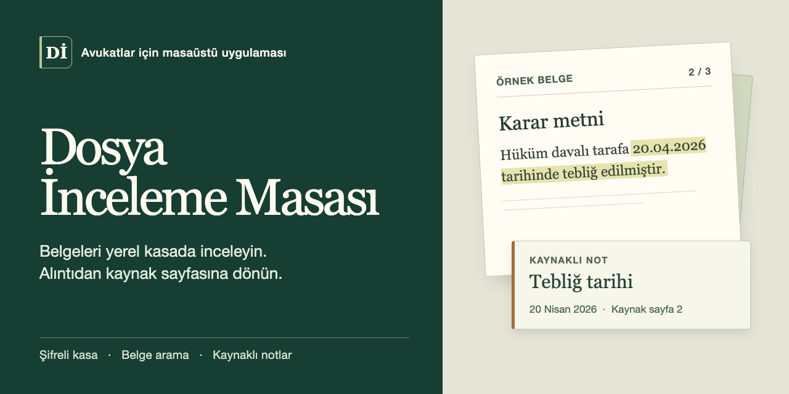
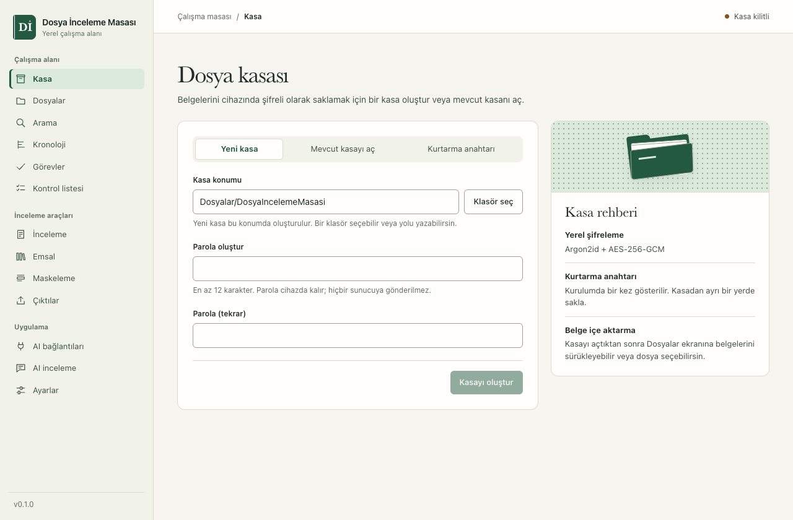
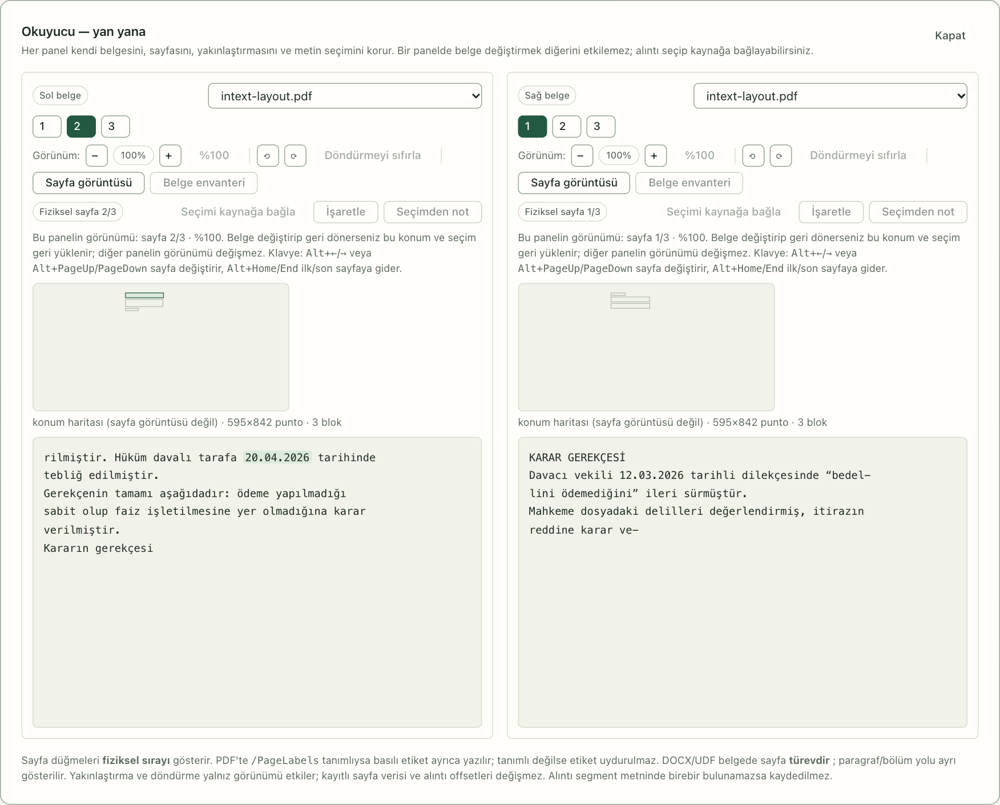

# Dosya İnceleme Masası

Dosya İnceleme Masası, avukatların dava belgelerini kendi bilgisayarlarında incelemesi için geliştirilen bir masaüstü uygulamasıdır. Örneğin bir kararın tebliğ tarihini bulabilir, ilgili cümleyi notunuza bağlayabilir ve daha sonra o nottan belgenin aynı sayfasına dönebilirsiniz.



## Uygulamayı nereden edinebilirim?

Proje **erken geliştirme aşamasında** ve henüz kararlı bir sürüm yayımlanmadı. macOS ve Windows için deneme paketlerini GitHub Actions üzerinden indirebilirsiniz. [Sürüm duyuruları](https://github.com/avazargozalli/dosya-inceleme-masasi/releases)

1. GitHub hesabınızla oturum açıp başarılı bir **desktop-build** çalıştırmasının özetini açın. [Paket üreten çalıştırma](https://github.com/avazargozalli/dosya-inceleme-masasi/actions/runs/42194554840) · [Tüm paketleme çalıştırmaları](https://github.com/avazargozalli/dosya-inceleme-masasi/actions/workflows/desktop-build.yml)
2. **Artifacts** bölümünde cihazınızın paketini seçin. Apple Silicon Mac için `dim-paket-dmg-aarch64-apple-darwin`, Intel Mac için `dim-paket-dmg-x86_64-apple-darwin`, Windows x64 için `dim-paket-msi-x64` kullanılır.
3. İndirdiğiniz ZIP dosyasını açın. Mac paketinde `.dmg`, Windows paketinde `.msi` bulunur. Deneme paketleri imzasızdır. İşletim sistemi yayıncı doğrulama uyarısı gösterebilir. Her paket, üretildiği tarihteki arayüzü içerir. [Dağıtım kararı](docs/adr/0012-dagitim-imzasi-kullaniciya-birakildi.md)

## İlk belgenizi inceleyin

**Kasa**, bilgisayarınızdaki şifreli çalışma alanıdır. **İnceleme dosyası**, bir davanın belgelerini ve notlarını bir arada tutar. **Belge** ise bu dosyaya eklediğiniz PDF, dilekçe veya taramadır.

<details>
<summary>Kasa giriş ekranını görüntüle</summary>

<picture>
  <source media="(prefers-color-scheme: dark)" srcset="docs/gorseller/kasa-koyu-tema.png">
  
</picture>

*Geliştirme sürümündeki kasa girişi. Yeni kasa, parola ile açma ve kurtarma seçenekleri aynı formda. GitHub temanıza göre açık veya koyu görünüm gösterilir.*

</details>

1. **Kasa** ekranında yeni bir kasa oluşturun. Kurtarma anahtarını kasadan ayrı bir yerde saklayıp ekrandaki onayı tamamlayın.
2. **Dosyalar → Yeni dosya** ile bir inceleme dosyası açın. İlk deneme için başlık olarak “Örnek karar incelemesi” yeterlidir.
3. [Üç sayfalık örnek karar PDF’sini](fixtures/synthetic/intext-layout.pdf) indirin. **Belge ekle** ile seçin veya belge listesine sürükleyin. **Ayrıştır** düğmesi belgeyi okunabilir metne dönüştürür.
4. **Oku** ile belgeyi açın. İkinci sayfada “20.04.2026” tarihinin geçtiği cümleyi seçip **Seçimi kaynağa bağla** düğmesine basın. Dosyanın **Kaynak alıntılar** bölümündeki **Okuyucuda aç** düğmesi sizi aynı alıntıya geri götürür.



*Solda tebliğ tarihinin geçtiği sayfa, sağda gerekçenin başlangıcı açık. İki paneli bağımsız çevirebilirsiniz. Görseldeki metni uygulamanın belge işleyicisi yukarıdaki örnek PDF’den çıkardı.*

## Hangi ekranı kullanmalıyım?

| Yapmak istediğim iş | Ekran | Ne yapabilirim? |
| --- | --- | --- |
| Belge bulmak ve okumak | Dosyalar · Arama | Dosyaya belge ekleyin, metinde arayın, iki belgeyi yan yana okuyun. Taranmış sayfalarda OCR ile metin çıkarabilirsiniz. |
| Olayları ve işleri takip etmek | Kronoloji · Görevler · Kontrol listesi | Olayları tarihe göre sıralayın, hatırlatıcı ekleyin ve tamamlanan işleri işaretleyin. |
| Bir iddianın dayanağını görmek | İnceleme · Emsal | İddiaya delil bağlayın, emsal kararın künyesini ve atıfta bulunduğunuz alıntıyı kontrol edin. |
| Paylaşılacak kopyayı hazırlamak | Maskeleme · Çıktılar | Hassas ifadeleri veya sayfadaki bölgeleri maskeleyin. Çalışma kayıtlarını dışa aktarın ya da şifreli devir paketi oluşturun. |
| Yapay zekâ önerilerini değerlendirmek | AI bağlantıları · AI inceleme | Sağlayıcıyı seçin, gönderilecek içeriği gözden geçirin ve önerileri inceleyin. |
| Kasayı yedeklemek | Ayarlar | Şifreli yedek alın, yedekleme konumunu belirleyin ve geri yükleme seçeneklerine erişin. |

Belge okuma ve arama cihazda çalışır. AI varsayılan olarak kapalıdır. Harici sağlayıcıya aktarım için kapsam ve kullanıcı onayı gerekir. Hangi işlevlerin doğrulandığını ve hangi fazların sürdüğünü yol haritasında görebilirsiniz. [Yol haritası](docs/roadmap.md) · [Veri güvenliği modeli](docs/security/threat-model.md) · [Pilot çalışma protokolü](docs/legal/pilot-protocol.md)

## Kaynaktan çalıştırma

Geliştirme ortamı Node.js 22.11–25.x, pnpm 10.15, Rust ve Python 3.11 veya üzerini kullanır. İşletim sisteminiz için Tauri 2 derleme araçlarını kurun. [Tauri önkoşulları](https://v2.tauri.app/start/prerequisites/)

Depo kökünde, macOS veya Linux için:

```bash
pnpm install --frozen-lockfile
python3 -m venv workers/document/.venv
workers/document/.venv/bin/python -m pip install -e 'workers/document[all,dev]'
pnpm --filter @dim/desktop exec tauri dev
```

Windows PowerShell’de aynı işlemler:

```powershell
pnpm install --frozen-lockfile
py -3 -m venv workers/document/.venv
workers/document/.venv/Scripts/python.exe -m pip install -e 'workers/document[all,dev]'
pnpm --filter @dim/desktop exec tauri dev
```

Taranmış belgelerde Türkçe ve İngilizce OCR için Tesseract ile `tur` ve `eng` dil verileri gerekir. Arayüz React ve Vite ile çalışır. Tauri komutlarını alan Rust çekirdeği, kasayı ve SQLCipher veritabanını (şema v66) yönetir. Her şema geçişinin sağlama toplamını denetler. PDF, DOCX ve OCR işlemlerini ayrı Python süreci yürütür. [Mimari kararlar](docs/adr/) · [Teknik şartname](docs/spec/DOSYA_INCELEME_MASASI_TAM_PROJE_PLANI.md) · [Test ve katkı rehberi](CONTRIBUTING.md)

## Katkı ve lisans

Hata bildirimi veya örnek belge paylaşırken yalnızca sentetik veri kullanın. Güvenlik bildirimleri için depodaki özel bildirim yolunu izleyin. [Güvenlik politikası](SECURITY.md) · [Davranış kuralları](CODE_OF_CONDUCT.md)

Proje AGPL-3.0-or-later lisanslıdır. [Lisans](LICENSE) · [Telif bildirimleri](NOTICE) · [Üçüncü taraf lisansları](THIRD_PARTY_NOTICES.md)
